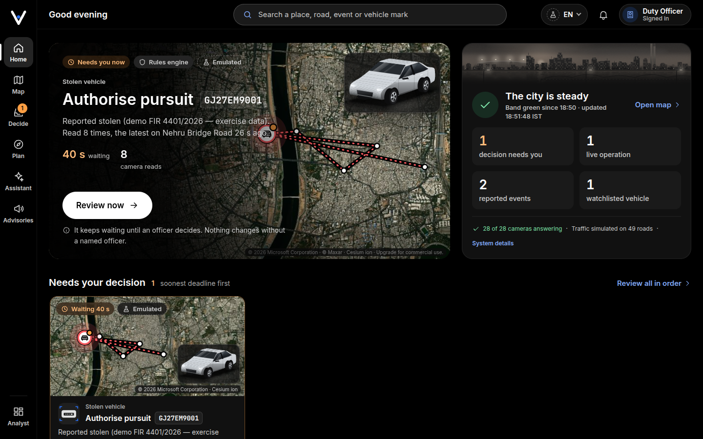

<h1 align="center">Veer — Ahmedabad's city-scale corridor & enforcement operating system</h1>

<p align="center">
  <strong>One live, human-supervised operating picture for the city's corridor events — VVIP movements,
  processions, mass gatherings, races, ceremonials, stadium egress, flood evacuations and work zones — and
  for stolen-vehicle pursuits, carried from a report to a ranked interception plan on the same rails.</strong>
</p>

<p align="center">
  
</p>

Veer runs on a single edge box (an NVIDIA GB10 with 121 GiB of unified memory) beside the city's command
centre. Six services and three local model hosts fuse the live traffic picture, the road network, the
cameras, public event reports and every agency's units into one picture; a two-tier AI brain plans and proposes;
**a named officer decides** every penalty, pursuit, dispatch and escort route switch. Everything the system emulates
or simulates says so on screen.

**The full product description — every screen, capability and service, for non-technical and technical readers
alike — is in [`PRODUCT.md`](PRODUCT.md).**

## What is in this repository

| Path | What it is |
|---|---|
| [`VVIP/`](VVIP/) | **The platform** — command-deck (SvelteKit + CesiumJS, the operator console and the public pages), convoy-brain (the two-tier decider/tactical brain, its MCP tools and decision support), traffic-oracle (fusion, routing, enforcement, the digital twin), corridor-store (PostGIS + pgRouting, migrations 001–025, the road network on real OpenStreetMap roads), event-emulator, signal-ingress (Rust), the OSINT event-intelligence services, embedding service; infra (compose, systemd boot units), the bring-up and acceptance scripts, tests, and the live evidence in [`VVIP/showcase/`](VVIP/showcase/) |
| [`submission/`](submission/) | **The presentation package** — the deck (`Gujarat_Veer_Deck.pptx` / `.pdf`, its source `make_deck.py` and `DECK.md`), the demo video script and the annexure template |
| [`PRODUCT.md`](PRODUCT.md) | **The product description** — what Veer is, every screen and capability in depth, the architecture and the honest status |
| [`PROBLEM_STATEMENT_GUJARAT.md`](PROBLEM_STATEMENT_GUJARAT.md) | The problem statement Veer answers |
| [`VEER_COMPLETE_CONTEXT.md`](VEER_COMPLETE_CONTEXT.md) | The full project context — every phase, decision and component |
| [`KAUSHIK_HANDOFF.md`](KAUSHIK_HANDOFF.md) | The operator handoff — daily commands, the acceptance gates, the pre-demonstration reset |
| [`docs/history/`](docs/history/) | Dated planning records (the base-repo review, the pivot plan, the mentor's God's-eye directive), kept as history |

**Start here:** [`PRODUCT.md`](PRODUCT.md) (the whole product), [`VVIP/README.md`](VVIP/README.md) (the quick start, the evidence) and
[`VVIP/TECHNICAL_DOCS.md`](VVIP/TECHNICAL_DOCS.md) (architecture, contracts, gates and the live acceptance record).

## Run it

```bash
cd VVIP
bash scripts/veer_up.sh --install-units                 # host env (~/.config/veer/veer.env, mode 600) + systemd units
bash scripts/veer_env.sh --set VEER_OPERATOR_PIN -      # the duty PIN, typed on stdin (never on a command line)
bash scripts/veer_env.sh --set VEER_SESSION_SECRET -    # signs operator sessions
bash scripts/veer_env.sh --set VEER_CESIUM_ION_TOKEN -  # optional: photorealistic 3D for signed-in operators
bash scripts/veer_up.sh                                 # models → compose → migrations → real-road seed → READY
```

Then open **`http://127.0.0.1:5273`** in a browser on the box and sign in with your name and the duty PIN.
`/` is **Home** (what needs you now), with **Map**, **Decide**, **Plan**, **Assistant** and **Advisories** on the
left rail and the full analyst workspace, situation wall and 3D city under **Analyst**; `/citizen` and `/driver` are
public. The stack starts itself at boot (`veer.target`).

**Supplied by the operator, never committed:** the model weights for the local model hosts (see
[`VVIP/models-config/`](VVIP/models-config/)), the duty PIN and session secret, and the Cesium ion token —
without a token the God's-eye runs keyless on OpenStreetMap imagery.

**Before a demonstration:** `bash VVIP/scripts/demo_reset.sh --apply --officer '<duty officer>' --cancel-debris`
stages the starting state and stops at PENDING — a signed-in human authorises the stolen-vehicle pursuit in
**Decide**; the script prints the checklist.

## Principles the code enforces

- **Vehicles only**, via ANPR plates — never faces or persons.
- **Every penalty is a human decision.** A reported-stolen vehicle's owner is never fined: its reads are
  evidence only, approving a fine on it is refused (409), its pursuit is authorised only by an approved
  sighting, and one approval authorises one pursuit.
- **The AI proposes, a named officer decides** — escort route switches, Plan B, closures and holds included.
- **Plates are masked** unless a named officer is signed in; **emulated and simulated sources are labelled**.
- Veer strengthens the state's ICCC / CCTV programmes — it plugs into them, it does not replace them.

## Licence and attributions

Code: MIT — see [`LICENSE`](LICENSE). Road network: © OpenStreetMap contributors, ODbL 1.0 — see
[`VVIP/services/corridor-store/seed/NOTICE.md`](VVIP/services/corridor-store/seed/NOTICE.md). The 3D city
uses Google Photorealistic 3D Tiles, Cesium World Terrain and Bing imagery through Cesium ion, credited on the
canvas — see [`VVIP/services/command-deck/src/lib/gods-eye/NOTICE.md`](VVIP/services/command-deck/src/lib/gods-eye/NOTICE.md).
