<p align="center">
  <picture>
    <source media="(prefers-color-scheme: dark)" srcset="VVIP/services/command-deck/static/brand/veer-lockup.svg">
    
  </picture>
</p>

<p align="center">
  <strong>Ahmedabad's city-scale operating picture for corridor events and vehicle enforcement —<br/>
  the AI proposes, a named officer decides.</strong>
</p>

<p align="center">
  
  
  
  
  
  
</p>

<p align="center">
  
  
  
  
  
</p>

<p align="center">
  
  
  
  
  
  
  
  <br/>
  
  
  
  
  
  
  
</p>

<p align="center">
  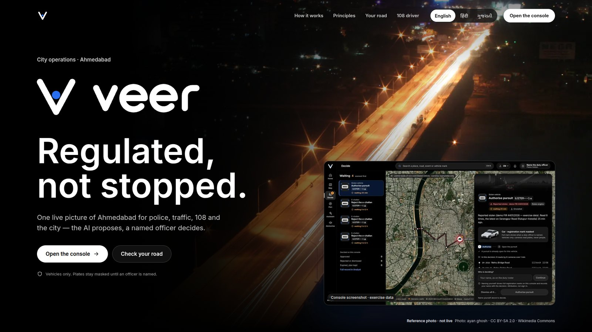
</p>

<p align="center">
  <a href="#a-tour-of-veer">Tour</a> ·
  <a href="#how-a-decision-flows">How a decision flows</a> ·
  <a href="#principles-the-code-enforces">Principles</a> ·
  <a href="#capabilities-at-a-glance">Capabilities</a> ·
  <a href="#architecture">Architecture</a> ·
  <a href="#honest-status">Honest status</a> ·
  <a href="#setup">Setup</a> ·
  <a href="#environment-variables">Environment</a> ·
  <a href="#documentation">Docs</a>
</p>

---

When a protected movement, a procession, a marathon or a stadium crowd takes over a corridor, an Indian city still
freezes whole roads for 15–45 minutes, coordinates five agencies by phone and radio, and leaves the commuter — and
the 108 ambulance — to find out at the barricade. **Veer** replaces that with one live, human-supervised picture of
the city: it plans the corridor on Ahmedabad's real roads, predicts when each stretch must close and for how long,
drafts the advisories in English, Hindi and Gujarati, gives the 108 driver a one-tap request, and carries a
stolen-vehicle report from the FIR to a ranked interception plan — **vehicles only, never persons**.

It runs on a single edge server (an NVIDIA GB10 with 121 GiB of unified memory) beside the control room: six
platform services, an OSINT pipeline and three local model hosts. Every penalty, pursuit, dispatch and escort route
switch waits for **a named duty officer**; if nobody answers a time-boxed proposal, the current plan holds.
Everything the system emulates or simulates says so on screen.

> **Documentation:** [`PRODUCT.md`](PRODUCT.md) (the product, every screen and capability) ·
> [`TECHNICAL_DESIGN.md`](TECHNICAL_DESIGN.md) (the technical design, 29 architecture, sequence, state and data-model
> diagrams) · [`docs/ENVIRONMENT.md`](docs/ENVIRONMENT.md) (every environment variable) ·
> [`docs/SAMPLE_DATA_AND_TESTS.md`](docs/SAMPLE_DATA_AND_TESTS.md) and [`samples/`](samples/) (sample data and test
> cases) · [`docs/DESIGN_NOTES.md`](docs/DESIGN_NOTES.md) (design notes and wireframes) · [`LICENSE`](LICENSE) (MIT).

---

## Contents

1. [A tour of Veer](#a-tour-of-veer) — every screen, with screenshots from the live stack
2. [How a decision flows](#how-a-decision-flows) — the stolen-vehicle chain and a protected movement, end to end
3. [Principles the code enforces](#principles-the-code-enforces)
4. [Capabilities at a glance](#capabilities-at-a-glance)
5. [Packages](#packages) and [Architecture](#architecture)
6. [Measured, verified, modelled](#measured-verified-modelled)
7. [Honest status](#honest-status)
8. [Setup](#setup) — prerequisites, install, bring-up, verify
9. [Environment variables](#environment-variables)
10. [Documentation](#documentation)
11. [What is in this repository](#what-is-in-this-repository)
12. [Licence and attributions](#licence-and-attributions)

---

## A tour of Veer

*All screenshots were taken on the running system on 2026-10-27, signed in as the duty officer, after the audited
demo reset that stages an EMULATED stolen-vehicle sighting waiting for a human decision. The Advisories screenshot
and the imagery gallery come from a private test stack of the same build. Folder:
[`VVIP/docs/screenshots/`](VVIP/docs/screenshots/).*

The interface is one web console at `http://127.0.0.1:5273`. Its design rule is **simple by default, deep on
demand**: each screen has one job and one primary action, and every power tool is kept one click deeper under
**Analyst**. Every operator page shares one shell — a left rail (**Home · Map · Decide · Plan · Assistant ·
Advisories**, with **Analyst** below), a slim top bar with a single search box (`Ctrl K` or `/`), the language menu
(EN · हिंदी · ગુજરાતી), the alerts bell with a soft chime, and the officer pill. The look is neutral black, white
and grey; colour is kept for meaning — **orange** a named officer must decide, **red** a stolen or watchlisted
vehicle, **green** approved or healthy, **teal** a protected route, **blue** a link or something the assistant
wrote — and a dashed outline means emulated or unverified.

### The landing page — the front door


`/welcome` is Veer's public front door (no sign-in): "Regulated, not stopped." over a credited reference photograph of
Ahmedabad at night, the console beside it, and — below — the problem with its modelled figures, See · Decide · Act,
the four audiences, the principles, what Veer is built on, and the agencies' and sources' marks, in English, Hindi
and Gujarati. **Open the console** leads to the operator sign-in; **Check your road** to the citizen page.

### Home — what needs you, what is happening, what is coming

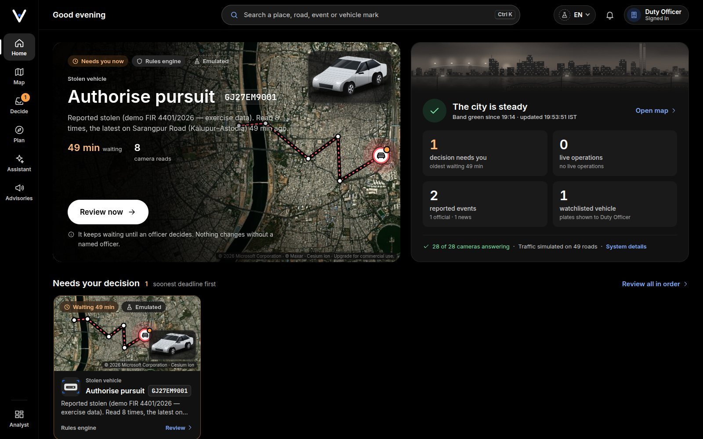

The first screen answers three questions. The **featured decision** — the one with the soonest deadline — sits over
the real satellite map of its place with the vehicle's studio shot, its tags (*Needs you now · Rules engine ·
Emulated*), how long it has waited and one large **Review now**. The rule is stated under it: *it keeps waiting
until an officer decides; nothing changes without a named officer.* The **city pulse** gives the band in one
sentence ("The city is steady") over a time-of-day scene of the Sabarmati riverfront, with four counts —
decisions that need you, live operations, reported events, watchlisted vehicles — and a systems line ("28 of 28
cameras answering · Traffic simulated on 49 roads"). Below run picture-card rails: *Needs your decision*, *Live
operations*, *Reported in the city* (official alerts and news, about places — never people) and *Coming up*.

### Decide — one decision at a time

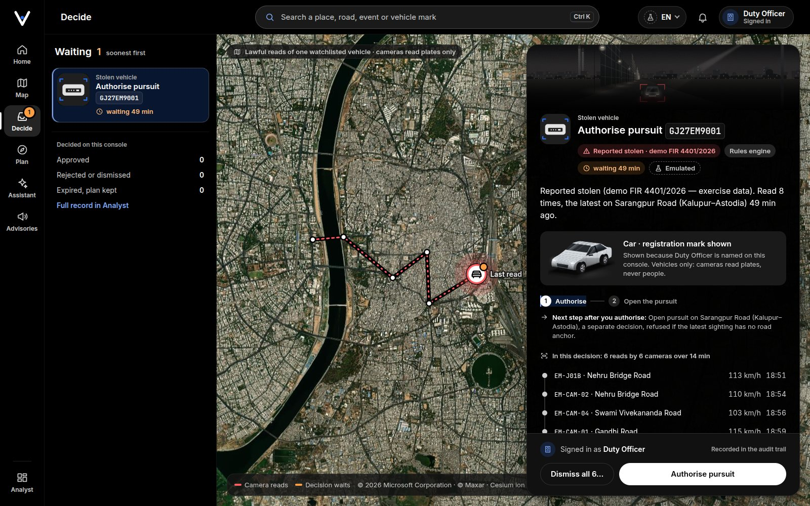

The queue on the left, the **real map of the place** in the middle, one decision sheet on the right. For a
stolen-vehicle sighting the sheet shows the FIR, the vehicle class (the plate is masked until a duty officer is
named — *"Vehicles only: cameras read plates, never people"*), a two-step **Authorise → Open the pursuit** stepper,
the camera reads as a timeline (camera, road, speed, time) and **"What changes if you authorise"** — the newest
sighting goes from *Pending* to *Approved, with your name*. The officer is named on the sheet; the button carries
the action. A server refusal is shown verbatim in the card, never as a passing toast. An e-challan on a
reported-stolen vehicle can only be rejected: its owner is the theft victim.

### Map — the city in photoreal 3D

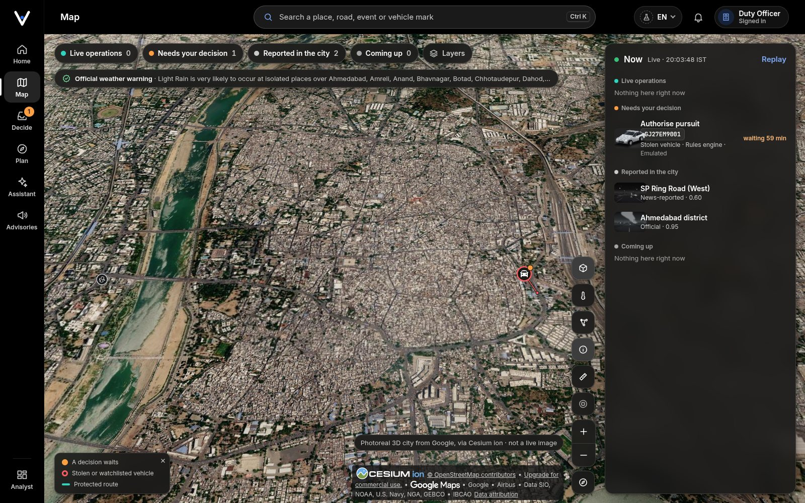

The God's-eye canvas, clean by default. Signed-in operators see **Google Photorealistic 3D Tiles** over Cesium
World Terrain (credited, and labelled *"Photoreal 3D city from Google, via Cesium ion · not a live image"*); without
a key the map falls back to a night street map and says why. Four group chips (Live operations · Needs your
decision · Reported in the city · Coming up), an official weather warning when one is in force, a **Now** panel
with small art for each object, a layers sheet on the left, a three-line legend, and tools for 3D, a thermal-style
view (*a visual filter, no thermal sensor*), measuring, following and replay.

### Plan a movement — where to, routes, launch, live

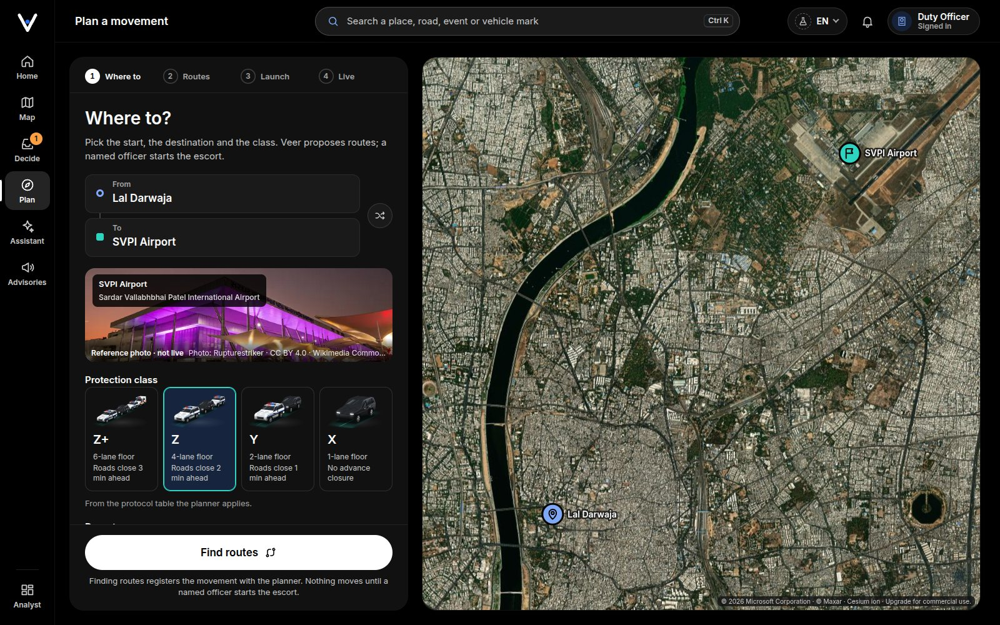

A four-step flow beside a satellite map. **Where to**: start and destination (the destination shows a credited
reference photograph — *"Reference photo · not live"*), the **protection class** as four cards with their convoy
compositions and the protocol each applies (Z+ six-lane floor, roads close three minutes ahead; Z four-lane, two
minutes; Y two-lane, one minute; X one lane, no advance closure), and the departure. **Routes** ranks candidates
with time, distance, roads held and lane-floor compliance, timed on the traffic twin and labelled *Simulated
traffic*. **Launch** needs a named officer ("One press sends one request"). **Live** follows the escort; the AI may
only *propose* a switch, and an unanswered proposal leaves the approved plan in force.

### Assistant — ask about the city

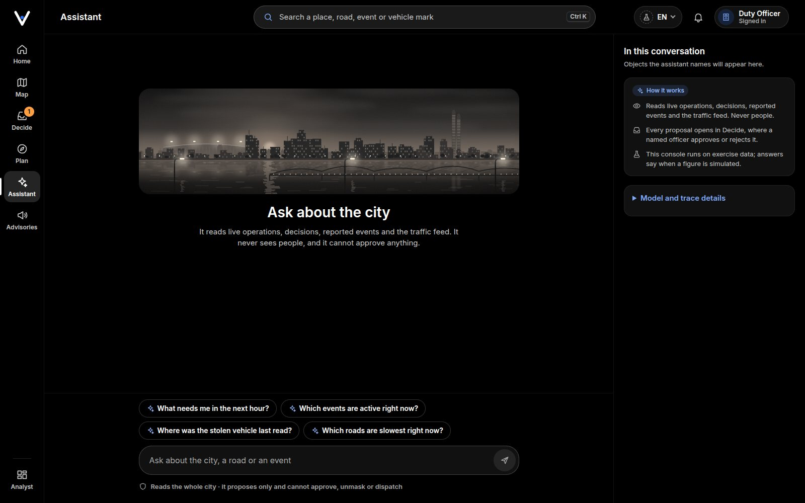

A conversation with the two-tier AI that reads live operations, decisions, reported events and the traffic feed —
never people — and **cannot approve, unmask or dispatch**. Answers are short prose with tappable object chips; a
proposal arrives as a card that opens in Decide. Every answer is checked by a grounding validator against what the
tools actually returned, and model diagnostics become one plain caution (for example, that a figure is simulated).

### Advisories — one fact, every audience, three languages

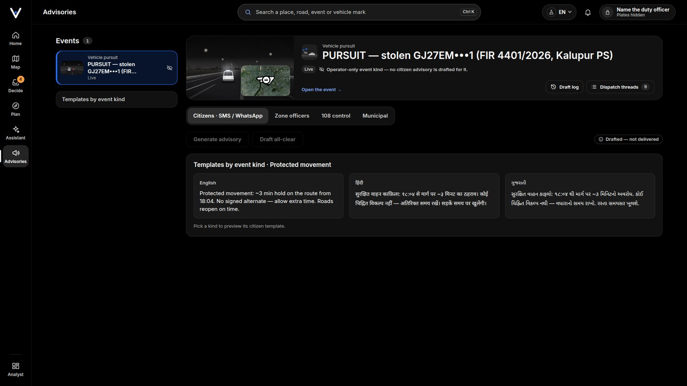

The communications desk drafts the same facts for **Citizens (SMS / WhatsApp)**, **Zone officers**, **108
control** and **Municipal** in **English, हिंदी and ગુજરાતી** side by side. The status is stated once — **"Drafted —
not delivered"**: no message gateway is deployed, so an officer copies and sends. Operator-only kinds (a pursuit,
as here) and unverified reports are never drafted for citizens, and that rule fails closed.

### Object pages — every record has a page

| Vehicle | Reported event | Place |
|---|---|---|
| 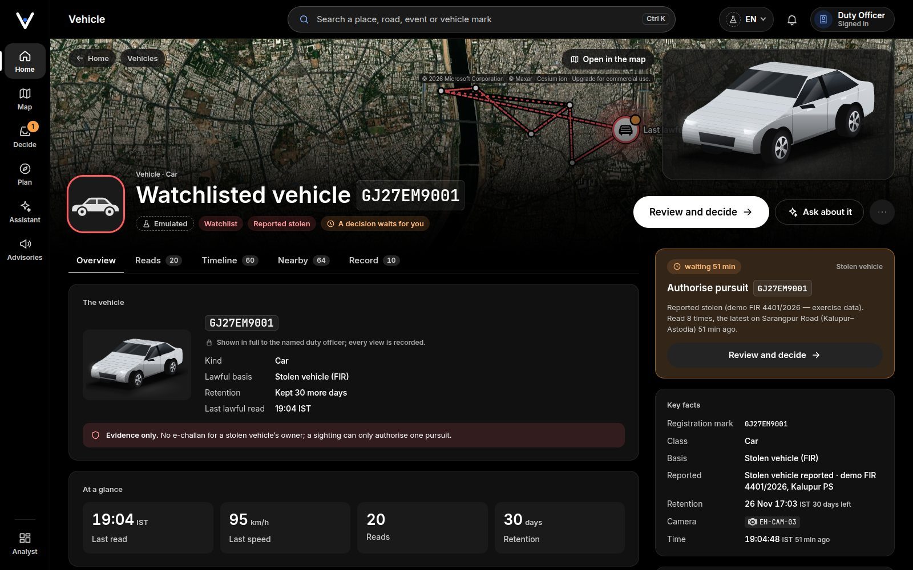 | 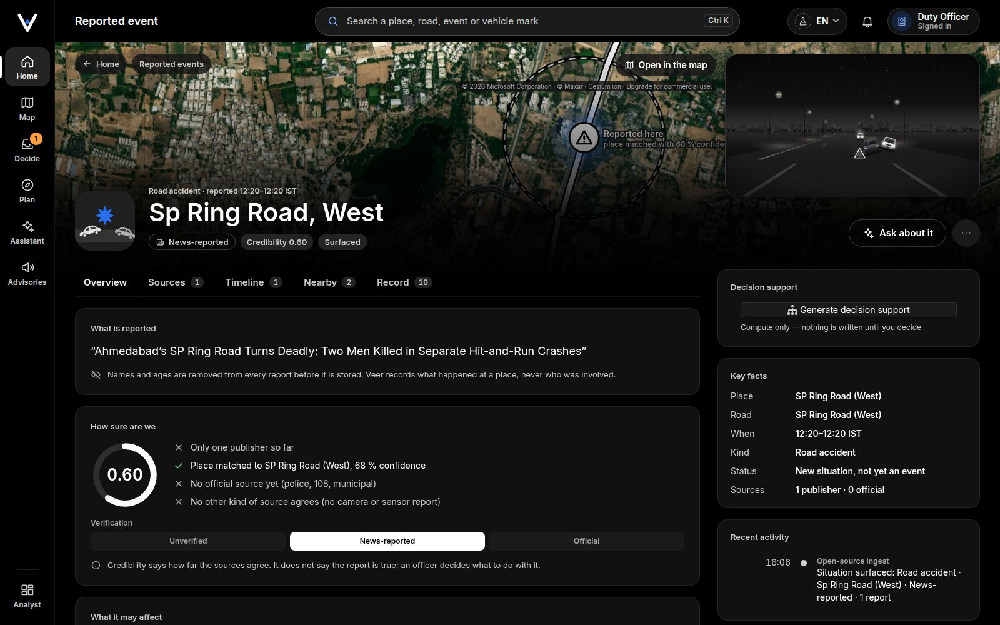 | 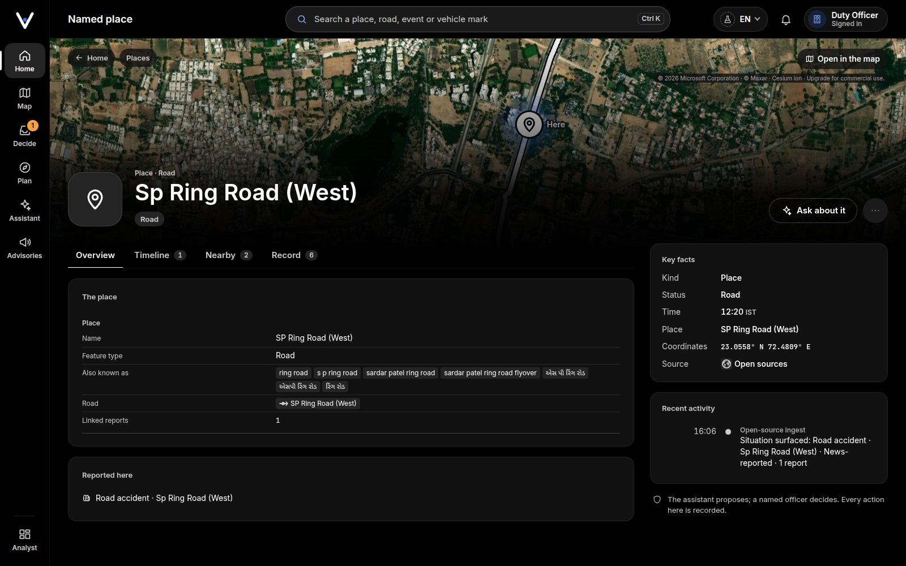 |

Corridor events, reported (OSINT) events, vehicles, places, operations, junctions, cameras, dispatches,
recommendations and sightings each get a page: a hero map with a picture card (vehicle shot, key art or credited
place photo), the title and honest tags, key facts, a timeline and the actions, with depth in tabs (**Overview ·
Reads · Timeline · Nearby · Record**). A vehicle page lists only lawful reads — *"Evidence only. No e-challan for a
stolen vehicle's owner; a sighting can only authorise one pursuit."* A reported event shows **"How sure are we"** —
a credibility gauge with plain checks and a verification ladder (*Unverified → News-reported → Official*), with the
reminder that credibility measures how far sources agree, not whether a report is true. Names and ages are removed
from every report before it is stored.

### Analyst — the full-density workspace

| Workspace | Situation wall |
|---|---|
| 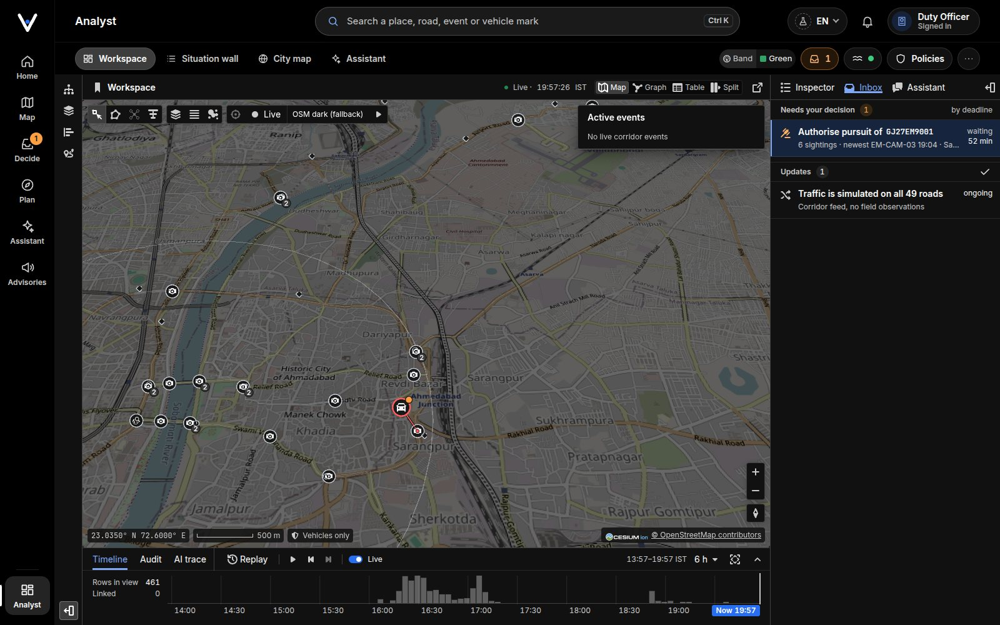 | 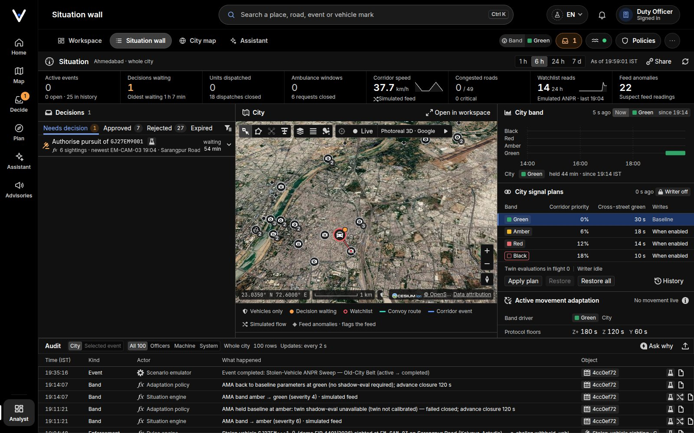 |

For supervisors and control-room analysts, one click deeper. The **Workspace** (`/analyst`) is a full-bleed canvas
with Map, Graph, Table and Split views, a bottom dock (Timeline, Audit, AI trace, Replay), a right dock (Inspector,
Inbox, Assistant), saved views and share links. The **Situation wall** (`/ops`) is the 24/7 board: active events,
decisions waiting, units dispatched, ambulance windows, corridor speed, congested roads, watchlist reads and feed
anomalies over 1 h / 6 h / 24 h / 7 d; the decision queue; the city band chart; **City signal plans** (band →
corridor priority and cross-street green, with the writer off by default); **Active movement adaptation**; and the
**Audit** stream with "Ask why".

### City map — the 3D city for analysts

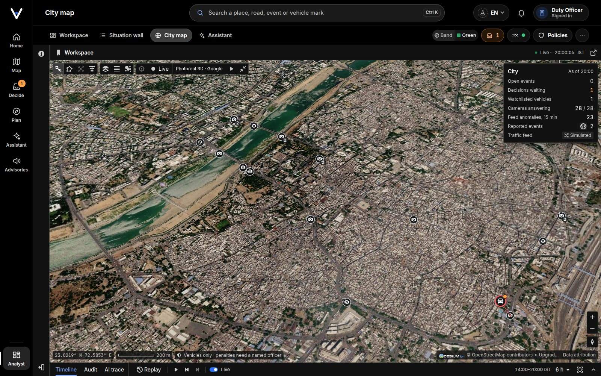

The fullscreen photoreal city under Analyst, with **City vitals** (open events, decisions waiting, watchlisted
vehicles, cameras answering, feed anomalies, reported events, *Traffic feed: Simulated*), eleven integrity-checked
layers draped on the tiles (none floating), sensor modes, share links and replay — and the imagery chip that says
what the picture is.

### Public pages — the citizen and the 108 driver

| Citizen — your road | Driver — the window (Gujarati first) |
|---|---|
| 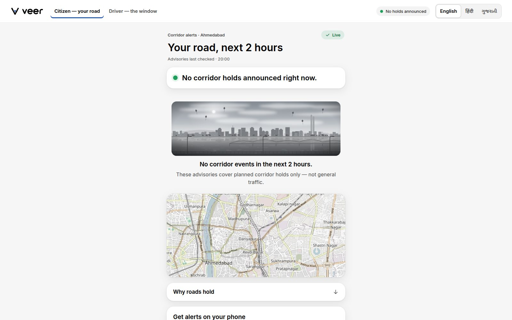 | 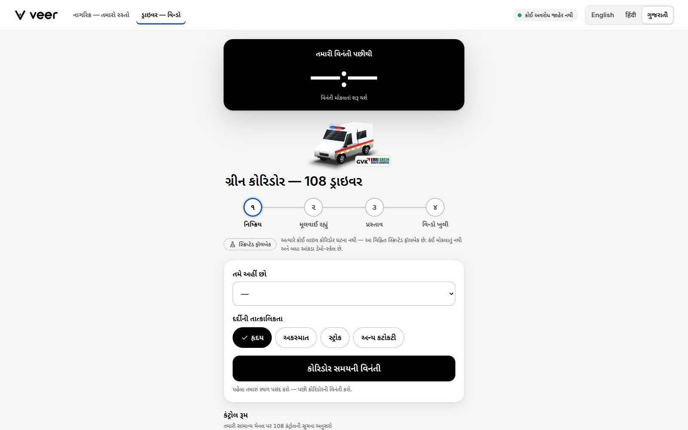 |

No sign-in, no operator code, a strict content-security policy and no map key: the public pages read only the
deck's own public projection of events. **Citizen** says in one plain sentence whether any corridor hold is
announced for the next two hours, lists each hold with its road and time, and badges every emulated row *Simulated
feed · emulated*. **Driver** gives the 108 driver four large steps, urgency buttons and one request button — **no
approve control, no location, no plate** — with a golden-hour clock and a live countdown once an officer opens the
window.

### Three languages, everywhere

| Home in Hindi | Decide in Gujarati | Citizen in Gujarati |
|---|---|---|
| 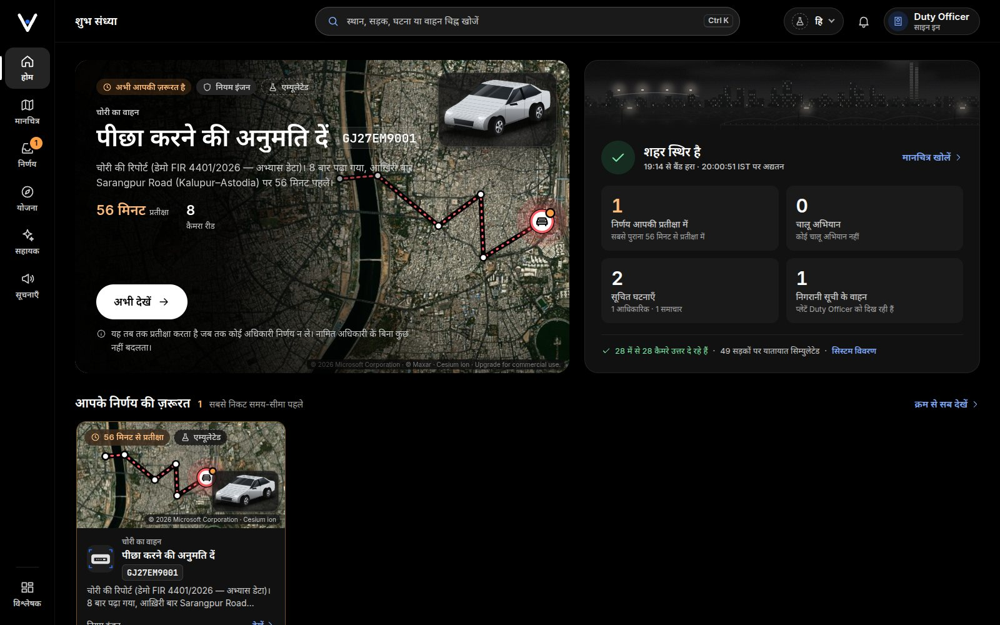 | 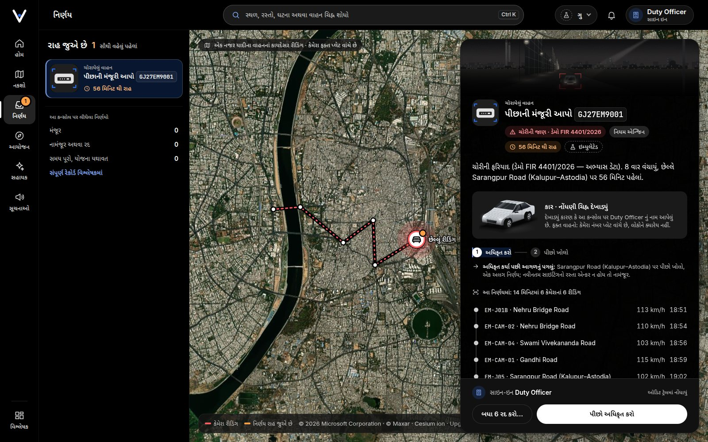 | 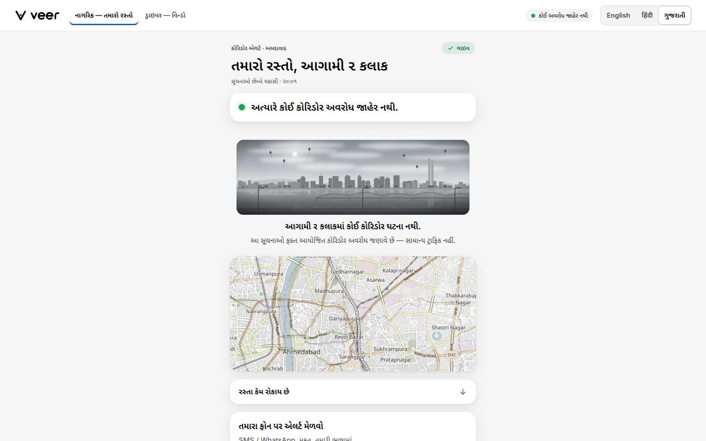 |

Every operator and public string exists in English, Hindi and Gujarati (a copy lint keeps 4,000+ strings honest);
times are IST; registration marks stay masked unless a duty officer is named.

### Imagery — pictures, not only maps

| Vehicle studio shots | Event key art | Reference photos and agency marks |
|---|---|---|
| 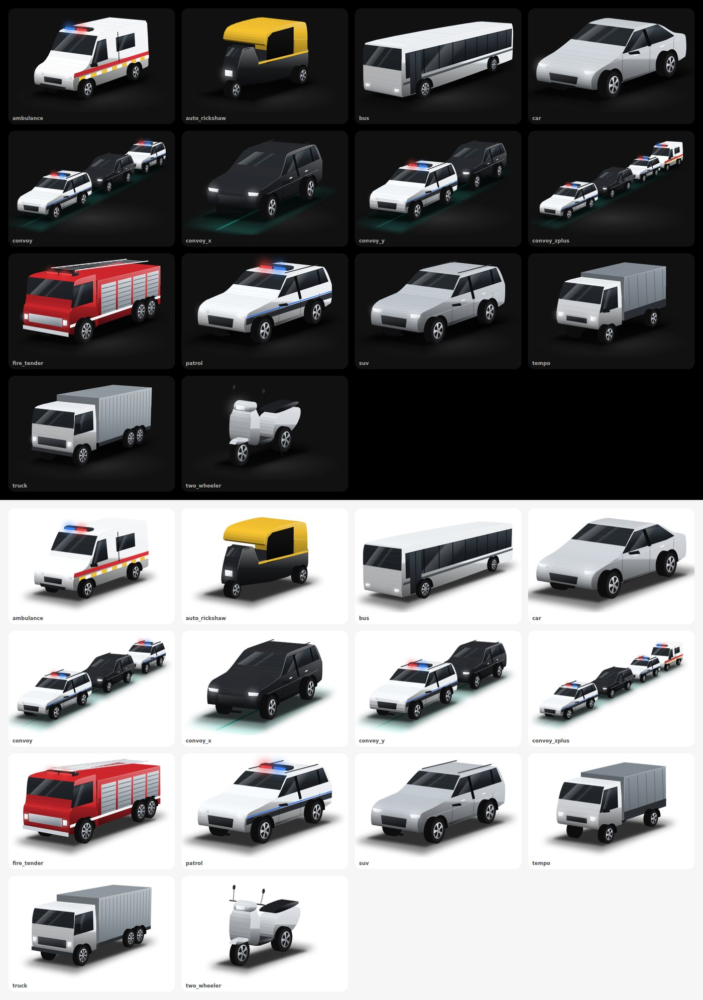 | 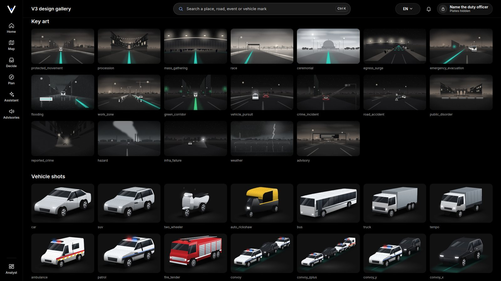 | 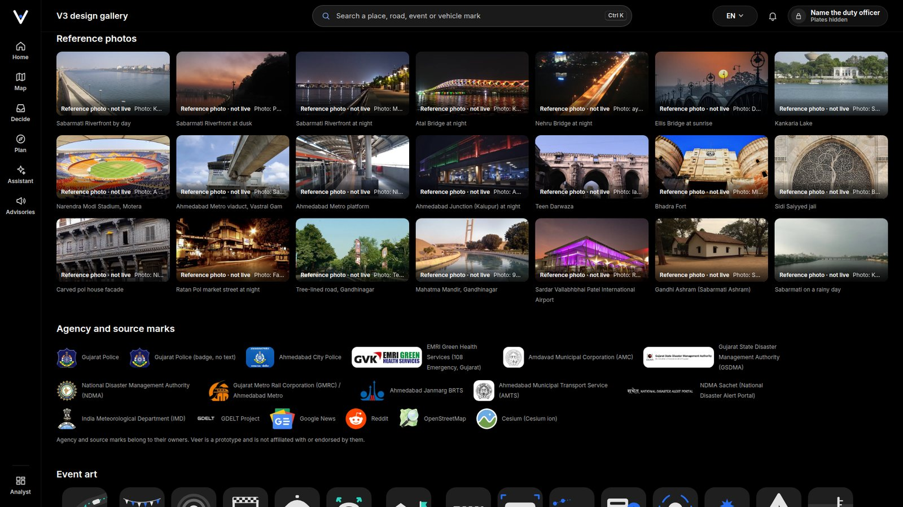 |

Studio shots of ten vehicle classes and of the four convoy compositions (Z+, Z, Y, X); 16:9 key art for every
corridor and reported-event kind; time-of-day riverfront scenes; **21 credited reference photographs** of
Ahmedabad's places from Wikimedia Commons (always captioned *"Reference photo · not live"*; photos with legible
plates, faces or riders as the subject were left out); and the marks of the agencies and data sources Veer works
with. The artwork is generated by a deterministic script in this repository; crowds appear only as distant masses,
never faces.

---

## How a decision flows

### The stolen-vehicle chain — from the FIR to an interception plan, never a fine on the victim

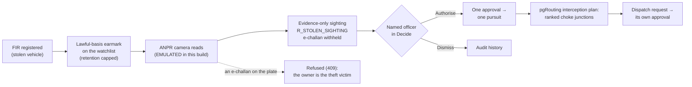

1. A stolen-vehicle FIR earmarks the plate on the watchlist under an enumerated lawful basis, with retention capped
   by the server.
2. ANPR cameras read the plate (emulated reads in this build, labelled so on every surface). Each read becomes an
   **evidence-only** sighting; an e-challan approval on that plate is refused (HTTP 409).
3. The sighting waits in **Decide**. A named officer authorises it — one approval opens one pursuit — or dismisses
   it; either way the decision is written to the append-only audit trail under that name.
4. The pursuit's interception plan ranks choke junctions on the real road graph; any dispatch is its own request
   with its own approval.

### A protected movement — regulated, not stopped

1. **Plan** registers the movement with its protection class; the planner proposes routes on the real network,
   checks the lane floor and times them on the traffic twin.
2. A named officer **launches** the escort. Closures activate 60–180 seconds ahead of the convoy and lift behind it:
   short rolling holds instead of a blanket freeze.
3. During the escort the decider may only **propose** a route switch, a Plan B, a hold or new closures; each needs a
   named officer's approval, and a proposal nobody answers within its window (90 s by default) leaves the approved
   plan in force.
4. The **Advisories** desk drafts citizen, zone-officer, 108 and municipal messages in three languages; the public
   **Citizen** page shows the holds; a **108 driver** can request a corridor window from the public **Driver** page.
5. **Clear the movement** lifts the closures, restores the signal programs and closes the event; the after-action
   record is the audit trail.

---

## Principles the code enforces

| Principle | What it means in practice |
|---|---|
| **Vehicles only** | Cameras read registration marks; there is no face, person, image or biometric field anywhere in the data model, and no person search. |
| **Plates masked until a duty officer is named** | Every surface shows `GJ27EM•••1` with a lock until an officer is named; exports, share links and saved views stay masked regardless. |
| **AI proposes, a named officer decides** | The AI, the rules engine and decision support only create PENDING proposals; approve controls exist only in Decide and the Analyst views. The server refuses an unnamed decision. |
| **No answer means the plan holds** | A time-boxed escort proposal that nobody answers expires; the convoy neither stops nor switches. |
| **No fine on a theft victim** | Reads of a reported-stolen vehicle are evidence only; an e-challan on it is refused (409); only an approved sighting can authorise a pursuit. |
| **Lawful basis and capped retention** | A watchlist entry needs an enumerated lawful basis (MV Act 1988 s.177/183/207, BNSS 2023 s.94, or a stolen-vehicle FIR) and a server-computed retention capped at 90 days. |
| **OSINT is about places, never persons** | Names and ages are redacted at parse; news and social URLs are never stored or shown (only the outlet's domain and a hash). |
| **Honest labels** | Every source says what it is — EMULATED, SIMULATED, UNVERIFIED-OSINT, NEWS-REPORTED, OFFICIAL-VERIFIED; a visual effect or a reference photo is never shown as a live feed. |
| **Strengthen the authorities** | Veer is the control room's tool; it plugs into the state's ICCC / CCTV / ITMS programmes and 108 dispatch rather than replacing them. |

---

## Capabilities at a glance

|  | Area | What Veer does | Real or emulated in this build |
|:-:|---|---|---|
|  | Road network | Ahmedabad's real roads traced on OpenStreetMap — 49 segments, 34 junctions — with pgRouting | **Real** (© OpenStreetMap contributors) |
| 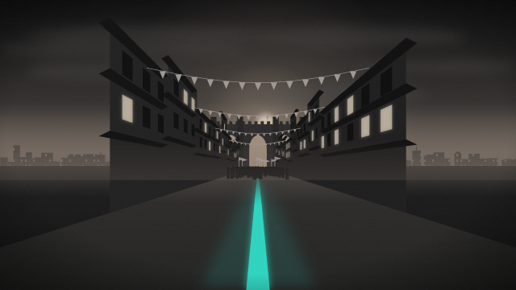 | Corridor events | Eight event classes on one engine: protected movements, processions (Rath Yatra), mass gatherings, races, ceremonial days, stadium egress, flood evacuation, metro work zones | Engine real; scenarios injected by the emulator, labelled |
| 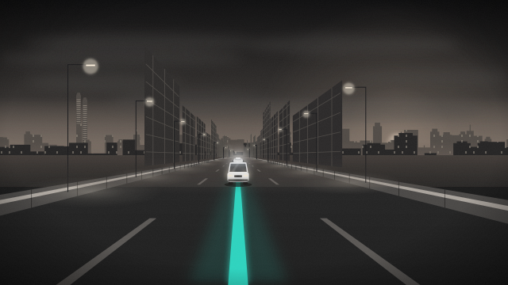 | Predictive rolling holds | Closures 60–180 s ahead per segment, ~2–3-minute holds instead of 15–45-minute freezes | Modelled on the traffic twin |
| 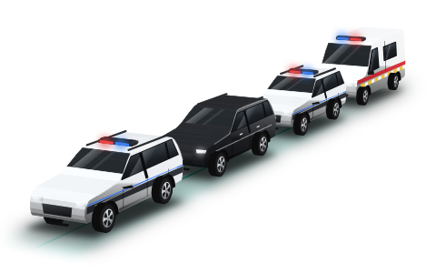 | Escort authority | The AI proposes switches / Plan B / holds; an officer approves each; timeout → hold | **Real** workflow |
| 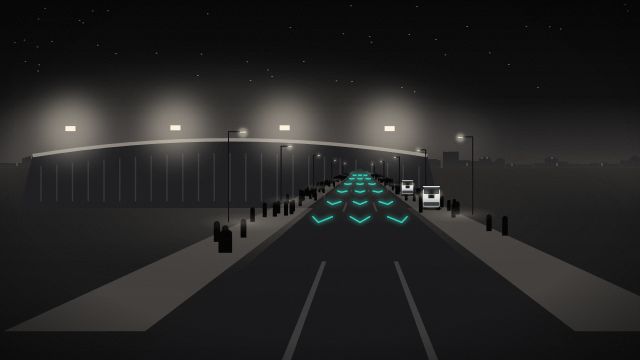 | Adaptive movement adaptation (AMA) | City band (GREEN / AMBER / RED / BLACK) with hysteresis and floors, shadow-evaluated on the twin | Engine real; traffic feed **simulated** |
| 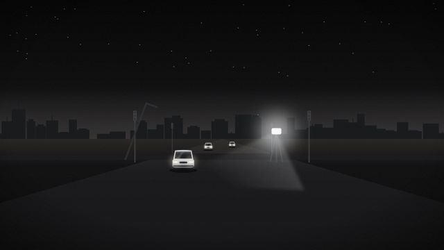 | City signal plans | Band → corridor priority and cross-street green; apply / restore / history behind guards | Writer **off** by default; guarded |
| 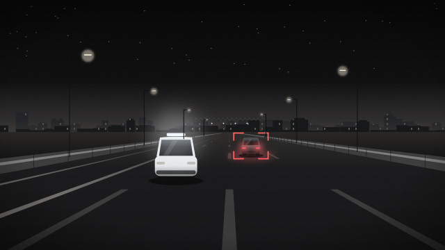 | Stolen-vehicle chain | FIR → earmark → ANPR → evidence-only sighting → officer → pursuit → interception plan | Chain real; ANPR reads **emulated** |
|  | 108 green corridor | Driver request → officer approval → timed window with a live countdown | **Real** workflow |
|  | Multi-agency dispatch | Jan Rakshak, police, 108, fire — each dispatch its own approved request | Units **emulated** |
| 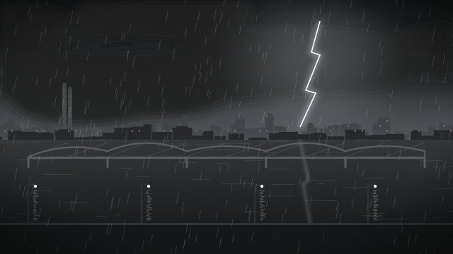 | OSINT event intelligence | Official alerts (NDMA Sachet, IMD), news and public posts → redacted, geolocated, fused situations about places | **Live** public sources (offline mode available) |
|  | Decision support | Ranked courses of action over nine criteria, simulated on the twin, every decision logged | **Real** engine |
| 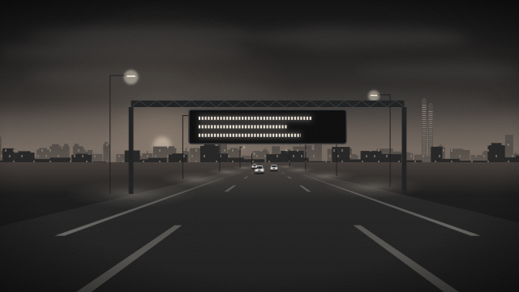 | Two-tier AI | A 27B decider and Gemma 4 12B on the edge box, embeddings for similar past situations, a grounding validator | **Real**, local |
|  | Advisories | EN / HI / GU drafts for four audiences, "Drafted — not delivered" | Drafts real; no gateway |
|  | Audit | Append-only trail of every decision, band change and approval, with "Ask why" | **Real** |
| 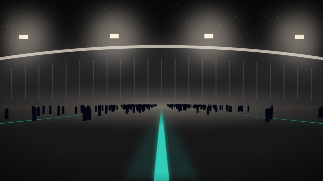 | 3D God's-eye | Google Photorealistic 3D Tiles with every overlay draped on the city | **Real** imagery, labelled not live |
|  | Operator gate | Name + duty PIN sign-in; every action recorded under the named officer | **Real** |

---

## Packages

| Package | Stack | What it does |
|---|---|---|
| [`command-deck`](VVIP/services/command-deck/) |    | The console for every audience, the operator gate, the public pages, the landing page |
| [`traffic-oracle`](VVIP/services/traffic-oracle/) |   | Traffic, routing, AMA, the twin, enforcement, dispatch, OSINT situations, decision support |
| [`convoy-brain`](VVIP/services/convoy-brain/) |   | Two-tier AI, escort workflows, chat, the grounding validator, 29 MCP tools |
| [`event-emulator`](VVIP/services/event-emulator/) |  | The use-case library and the living city, injected through the real APIs |
| [`signal-ingress`](VVIP/services/signal-ingress/) |   | Traffic feed adapters and plausibility checks, Arrow IPC to NATS |
| [`corridor-store`](VVIP/services/corridor-store/) |   | Migrations 001–025, the real-road seed |
| [`osint-ingress` · `osint-geo` · `osint-analysis` · `osint-common`](VVIP/services/) |  | Connectors and redaction, the gazetteer, fusion and credibility, shared ethics checks |
| [`embedding-service` · `model-host`](VVIP/services/) |   | Retrieval for similar past situations; the 27B decider as typed questions |

### Data from, and built for

<p align="center">
  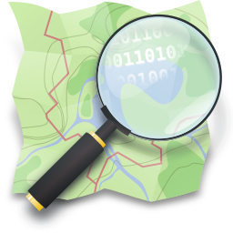&nbsp;&nbsp;
  &nbsp;&nbsp;
  &nbsp;&nbsp;
  &nbsp;&nbsp;
  &nbsp;&nbsp;
  &nbsp;&nbsp;
  &nbsp;&nbsp;
  &nbsp;&nbsp;
  &nbsp;&nbsp;
  &nbsp;&nbsp;
  &nbsp;&nbsp;
  
</p>
<p align="center"><sub>Agency and data-source marks belong to their owners; Veer is a prototype and is not affiliated with or endorsed by them.</sub></p>

---

## Architecture

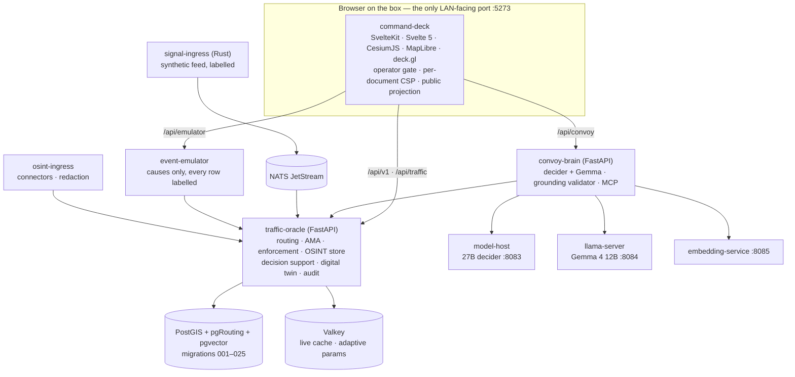

| Service | Stack | Responsibility |
|---|---|---|
| `command-deck` | SvelteKit 2 + Svelte 5, CesiumJS, MapLibre, deck.gl | The interface for every audience; operator PIN gate and sessions; same-origin loopback proxy; public projections |
| `traffic-oracle` | Python 3.12, FastAPI | Traffic ingest and forecasting, routing (OR-Tools, pgRouting), AMA, the digital twin, city fusion, corridor-event lifecycle, watchlist and enforcement, dispatch, signal plans, OSINT situations, decision support |
| `convoy-brain` | Python 3.12, FastAPI | Two-tier orchestration, pre-movement / live-escort / post-clearance workflows, escort proposals, chat, the grounding validator, an MCP server (29 tools) |
| `event-emulator` | Python 3.12, FastAPI | Cause-only injection of the use-case library through the real APIs; runs ledger and replay |
| `signal-ingress` | Rust, tokio, Arrow, async-nats | Traffic feed adapters with inline plausibility checks, Arrow IPC to NATS |
| `corridor-store` | PostgreSQL 16, PostGIS, pgRouting, pgvector | Migrations 001–025, the real-road seed |
| `osint-*` | Python | Connectors and redaction (ingress), gazetteer (geo), fusion and credibility (analysis), shared ethics checks (common) |
| `embedding-service`, `model-host` | Python | Retrieval for similar past situations; the decider as typed questions |

Every service except the deck binds loopback; container images run as non-root users with pinned bases. Bring-up is
one command (`scripts/veer_up.sh`) and the stack starts itself at boot through systemd user units. Full details:
[`PRODUCT.md`](PRODUCT.md) §5 and [`VVIP/TECHNICAL_DOCS.md`](VVIP/TECHNICAL_DOCS.md).

---

## Measured, verified, modelled

- **Tests:** 5,123 pytest tests collected across the services (2026-10-27 gate run of the ten service suites: 5,012
  pass, 92 skip themselves when an optional dependency or scratch store is absent) and 120 Rust tests; type checks,
  design-token contrast proofs (every text ink ≥ 4.5:1 on every surface), a copy lint over 4,000+ strings in three
  languages, contract replays and 40+ deck unit suites.
- **Live acceptance (2026-10-27, the V3 deploy):** READY 12/12 with the operator gate on; the live ladder's status,
  API probes, full smoke, feed-dark negative and recovery, fleet, tier-0, journeys J1–J6, God's-eye and 3D God's-eye,
  canvas UX, screens-verify, leak checks and the four OSINT checks are green. What is not green is recorded with its
  reason in [`VVIP/TECHNICAL_DOCS.md`](VVIP/TECHNICAL_DOCS.md) §18.8.
- **Bench (2026-10-13):** decider 455.78 tok/s (p99 1106.8 ms), Gemma 20.09 tok/s, embeddings 92.7 ms; 62.73 GiB
  resident; adversarial decision suite 19/19.
- **Modelled impact** ([`VVIP/IMPACT_REPORT.md`](VVIP/IMPACT_REPORT.md), from `VVIP/scripts/impact_results.json` —
  model outputs, not field measurements): junction-freeze commuter delay falls **25×–506× (central 100×)**; per
  movement, about 1.13 million → 11,319 commuter-minutes when all 34 junctions are frozen (an upper-bound framing);
  per year, about 4.67 million commuter-hours returned and ~33,000 golden-hour minutes for 108 patients. We claim
  minutes returned, never lives saved.

---

## Honest status

- **Real:** the road network, every decision the stack makes, the audit trail, the operator gate, the OSINT sources,
  the photoreal imagery (labelled not live), the reference photographs (credited, labelled not live).
- **Emulated or simulated — and labelled so on every surface:** the traffic feed, ANPR reads, camera sites, field
  units, and the scenario causes the emulator injects.
- **Modelled:** the impact figures and the traffic twin's timings.
- **Not connected today:** agency radio and computer-aided dispatch, and an SMS / WhatsApp gateway (advisories are
  drafts an officer sends).
- **Known leftovers:** a tablet bottom-sheet layout, hash deep links on Home, one long title clipping in the Analyst
  assistant dock at 1440 px, and the DSTGAT forecaster, which ships as architecture only — all listed in
  [`VVIP/TECHNICAL_DOCS.md`](VVIP/TECHNICAL_DOCS.md) §18.7–18.8 and [`PRODUCT.md`](PRODUCT.md) §6.

---

## Setup

### Prerequisites

| Requirement | For the full stack | For the console and services only |
|---|---|---|
| Hardware | An NVIDIA GB10-class edge server (121 GiB unified memory; the model stack is ~63 GiB resident) | Any x86-64 / arm64 machine with 16 GB RAM |
| OS | Ubuntu 22.04+ with systemd user units | Linux or macOS with Docker |
| Docker | Docker Engine with the Compose v2 plugin | same |
| Toolchain (only to develop outside Docker) | Python 3.12, Rust (stable), Bun 1.x, Node 18+ | same |
| Model weights | The 27B decider snapshot, Gemma 4 12B (GGUF) with `llama-server`, bge-m3 — supplied by the operator, never committed (see [`VVIP/models-config/`](VVIP/models-config/)) | not needed: the brain falls back to its heuristic tier and says so |
| Optional | A Cesium ion access token (photoreal 3D and satellite imagery for signed-in operators) and internet access for live OSINT | the map runs keyless on OpenStreetMap; OSINT can run offline |

### Install and bring up

```bash
# 1. get the code
git clone https://github.com/shubro18202758/veer.git
cd veer/VVIP

# 2. the host environment file (~/.config/veer/veer.env, mode 600) and the systemd user units
bash scripts/veer_up.sh --install-units

# 3. secrets — each typed on stdin (never on a command line, never committed)
bash scripts/veer_env.sh --set VEER_OPERATOR_PIN -      # the duty PIN officers sign in with
bash scripts/veer_env.sh --set VEER_SESSION_SECRET -    # 64 hex characters; signs operator sessions
bash scripts/veer_env.sh --set POSTGIS_PASSWORD -       # the database password, before the first bring-up
bash scripts/veer_env.sh --set VEER_CESIUM_ION_TOKEN -  # optional: photoreal 3D + satellite imagery

# 4. optional switches
bash scripts/veer_env.sh --set VEER_OSINT 1             # OSINT event intelligence (OSINT_MODE=offline without internet)

# 5. build and start: images → PostGIS → migrations 001–025 → real-road seed → services → converge
bash scripts/veer_up.sh --build

# 6. verify
bash scripts/veer_up.sh --status                        # one row per component: READY 12/12 with OSINT (11/11 without)
```

Open **`http://127.0.0.1:5273`** in a browser on the box and sign in with your name and the duty PIN. From then on
the stack **starts itself at boot** (`veer.target`). The public pages `/citizen` and `/driver` need no sign-in.

**Developing the console outside Docker:**
`cd VVIP/services/command-deck && bun install && ORACLE_PORT=8091 BRAIN_PORT=8092 EMULATOR_PORT=8090 bun run dev`
(the dev server refuses to start without the three backend ports).

**Running the tests:** see [`docs/SAMPLE_DATA_AND_TESTS.md`](docs/SAMPLE_DATA_AND_TESTS.md) — every suite with its
command, plus `bash VVIP/scripts/verify_all.sh` for the offline gate.

**Before a demonstration:** `bash VVIP/scripts/demo_reset.sh --apply --officer '<duty officer>' --cancel-debris`
cancels test debris through the audited lifecycle and stages a fresh EMULATED stolen-vehicle sighting that waits
PENDING — a signed-in human authorises the pursuit in **Decide**. Stage it shortly before: the sighting's reads go
stale after about 25 minutes.

---

## Environment variables

All host configuration lives in **`~/.config/veer/veer.env`** (mode 600, plain `KEY=VALUE`, never committed),
written by `scripts/veer_up.sh --install-units` and edited with `scripts/veer_env.sh --set KEY VALUE` (or
`--set KEY -` to type a secret on stdin). `veer_up.sh` passes it to Docker Compose and the systemd units. The
variables you are most likely to set:

| Variable | Secret | Default | What it does |
|---|:---:|---|---|
| `VEER_OPERATOR_PIN` | ✓ | unset (gate off) | The duty PIN for the operator sign-in. With it unset the console is open — never expose the deck beyond loopback that way |
| `VEER_SESSION_SECRET` | ✓ | random per start | Signs operator session cookies; set it so sign-ins survive restarts |
| `POSTGIS_PASSWORD` | ✓ | a development default | The `corridor_admin` database password (the database binds loopback only) |
| `VEER_CESIUM_ION_TOKEN` | ✓ | unset | Cesium ion token: Google Photorealistic 3D Tiles and Bing satellite imagery for signed-in operators; unset → keyless OpenStreetMap |
| `VEER_OSINT` | | `0` | `1` runs the OSINT pipeline (`osint-ingress`) and its surfaces |
| `OSINT_MODE` | | `live` | `offline` serves recorded samples — for venues without internet |
| `VVIP_REQUIRE_OFFICER` | | `1` | Officer actions without a named officer are refused (422) |
| `VVIP_ESCORT_APPROVAL_TIMEOUT_SEC` | | `90` | How long an escort proposal waits for an officer before it expires and the plan holds (15–600) |
| `VEER_DEMO` | | `0` | `1` switches the emulated living city and the signal-plan writer on (refused unless the public feed labels emulated rows) |
| `VEER_DESIGN_HARNESS` | | `0` | `1` serves the `/design` developer harness in a production build |
| `VEER_ROOT`, `VEER_RUN_DIR`, `VEER_LOG_DIR`, `VEER_VENV_DIR` | | detected | Where the checkout, runtime state, logs and Python environments live |
| `DECIDER_SNAPSHOT_PATH`, `LLAMA_SERVER_BIN`, `GEMMA_GGUF`, `BGE_M3_PATH`, `VEER_MODELS_CONFIG` | | detected | Model weights, the `llama-server` binary and the model-stack configuration |
| `POSTGIS_HOST_PORT` | | `56434` | The loopback port of the corridor store |

The complete reference — every variable each service reads, its default, whether it is required or secret, the
ports and binds, the safety switches and a minimal working `veer.env` with placeholders — is
[`docs/ENVIRONMENT.md`](docs/ENVIRONMENT.md).

---

## Documentation

| Document | What it covers |
|---|---|
| [`PRODUCT.md`](PRODUCT.md) | The product: what Veer is, who it serves, every screen and capability, the honest status |
| [`TECHNICAL_DESIGN.md`](TECHNICAL_DESIGN.md) | The technical design: system context, deployment, components, the data model (ER diagrams), key flows (sequence diagrams), state machines, security and privacy, reliability, the AI design, performance, testing and the design decisions (ADRs) |
| [`docs/ENVIRONMENT.md`](docs/ENVIRONMENT.md) | Every environment variable, grouped, with defaults and secrets marked |
| [`docs/SAMPLE_DATA_AND_TESTS.md`](docs/SAMPLE_DATA_AND_TESTS.md) · [`samples/`](samples/) | The datasets the system ships, curated sample files and API responses, every test suite and how to run it, and representative test cases |
| [`docs/DESIGN_NOTES.md`](docs/DESIGN_NOTES.md) · [`docs/wireframes/`](docs/wireframes/) | Design intent, the shell, colour and type systems, imagery, accessibility and honest-label rules, wireframes and design prototypes |
| [`VVIP/TECHNICAL_DOCS.md`](VVIP/TECHNICAL_DOCS.md) | The platform's full technical record: contracts, gates and the dated acceptance runs |
| [`VVIP/docs/USE_CASES.md`](VVIP/docs/USE_CASES.md) · [`VVIP/IMPACT_REPORT.md`](VVIP/IMPACT_REPORT.md) | The use-case library with sources; the impact model and its assumptions ledger |
| [`LICENSE`](LICENSE) | MIT for the code; third-party data, photographs and marks keep their own licences |

---

## What is in this repository

| Path | What it is |
|---|---|
| [`PRODUCT.md`](PRODUCT.md) | **The product description** — what Veer is, every screen and capability in depth, the architecture and the honest status |
| [`TECHNICAL_DESIGN.md`](TECHNICAL_DESIGN.md) | **The technical design document** with architecture, data-model, sequence and state diagrams |
| [`docs/`](docs/) | The environment reference, sample data and test cases, design notes and wireframes; dated planning records under `docs/history/` |
| [`samples/`](samples/) | Curated sample data and API responses |
| [`VVIP/`](VVIP/) | **The platform** — the services (`services/`), infrastructure (compose, systemd units), bring-up and acceptance scripts (`scripts/`), tests, docs and the live evidence in [`VVIP/showcase/`](VVIP/showcase/) |
| [`VVIP/docs/screenshots/`](VVIP/docs/screenshots/) | The screenshots in this README |
| [`VVIP/README.md`](VVIP/README.md) · [`VVIP/TECHNICAL_DOCS.md`](VVIP/TECHNICAL_DOCS.md) | The platform's quick start and evidence; architecture, contracts, gates and the acceptance records |
| [`VVIP/docs/USE_CASES.md`](VVIP/docs/USE_CASES.md) · [`VVIP/docs/GODS_EYE_INTEGRATION.md`](VVIP/docs/GODS_EYE_INTEGRATION.md) · [`VVIP/IMPACT_REPORT.md`](VVIP/IMPACT_REPORT.md) | The use-case library with sources; the God's-eye and enforcement design; the impact model and its assumptions ledger |
| [`submission/`](submission/) | The presentation package — the deck (`Gujarat_Veer_Deck.pptx` / `.pdf`, its source `make_deck.py` and `DECK.md`), the demo video script and the annexure template |
| [`PROBLEM_STATEMENT_GUJARAT.md`](PROBLEM_STATEMENT_GUJARAT.md) | The problem statement Veer answers |
| [`VEER_COMPLETE_CONTEXT.md`](VEER_COMPLETE_CONTEXT.md) · [`KAUSHIK_HANDOFF.md`](KAUSHIK_HANDOFF.md) | The project context and the operator handoff (daily commands, acceptance gates, the pre-demonstration reset) |
| [`docs/history/`](docs/history/) | Dated planning records, kept as history |

---

## Licence and attributions

Code: MIT, © 2026 Sayandeep Haldar and the Veer contributors — see [`LICENSE`](LICENSE). Road network: © OpenStreetMap contributors, ODbL 1.0 — see
[`VVIP/services/corridor-store/seed/NOTICE.md`](VVIP/services/corridor-store/seed/NOTICE.md). The 3D city uses Google
Photorealistic 3D Tiles, Cesium World Terrain and Bing imagery through Cesium ion, credited on the canvas — see
[`VVIP/services/command-deck/src/lib/gods-eye/NOTICE.md`](VVIP/services/command-deck/src/lib/gods-eye/NOTICE.md).
Reference photographs are Wikimedia Commons works under their own licences (CC0, public domain, CC BY, CC BY-SA —
not MIT), credited on screen and listed in
[`VVIP/services/command-deck/static/photos/NOTICE.md`](VVIP/services/command-deck/static/photos/NOTICE.md). Agency
and data-source marks belong to their owners; Veer is a prototype and is not affiliated with or endorsed by them —
see [`VVIP/services/command-deck/static/logos/NOTICE.md`](VVIP/services/command-deck/static/logos/NOTICE.md).
