<p align="center">
  <picture>
    <source media="(prefers-color-scheme: dark)" srcset="VVIP/services/command-deck/static/brand/veer-lockup.svg">
    
  </picture>
</p>

<p align="center">
  
  
  
</p>

# Veer — Technical Design Document

Veer is a city operations platform for Ahmedabad. It plans corridor events (protected movements, processions,
races, stadium egress, evacuations, work zones), supports stolen-vehicle enforcement, turns public sources into
situations about places, and proposes ranked courses of action for incidents. Across all of it one rule holds:
**the AI proposes and a named human officer decides.**

This document describes how the platform is built: its services, data, flows, state machines, security,
reliability and AI design. It is written for engineers and technical reviewers. Every statement is taken from
the code under [`VVIP/`](VVIP/) or from the committed documentation it names; numbers that come from a model or a
simulation say so, and every measured figure carries its date.

| | |
|---|---|
| Document date | 2026-10-27 (the V3 interface build) |
| Code described | `VVIP/services/`, `VVIP/infra/`, `VVIP/scripts/`, migrations 001–025 |
| Product description | [`PRODUCT.md`](PRODUCT.md) |
| Full reference (APIs, gates, records) | [`VVIP/TECHNICAL_DOCS.md`](VVIP/TECHNICAL_DOCS.md) |
| Environment variables | [`docs/ENVIRONMENT.md`](docs/ENVIRONMENT.md) |
| Sample data and test cases | [`docs/SAMPLE_DATA_AND_TESTS.md`](docs/SAMPLE_DATA_AND_TESTS.md) |
| Interface design notes and wireframes | [`docs/DESIGN_NOTES.md`](docs/DESIGN_NOTES.md) |

The repository directory is called `VVIP/` because the platform began as a protected-movement planner. Veer has
since become a general city platform; protected movements are one use case among several.

---

## Contents

1. [Purpose, scope, goals and non-goals](#1-purpose-scope-goals-and-non-goals)
2. [System context](#2-system-context)
3. [Containers and deployment](#3-containers-and-deployment)
4. [Component design](#4-component-design)
5. [Data model](#5-data-model)
6. [Key flows](#6-key-flows)
7. [State machines](#7-state-machines)
8. [Security and privacy design](#8-security-and-privacy-design)
9. [Reliability and degradation](#9-reliability-and-degradation)
10. [AI design](#10-ai-design)
11. [Performance](#11-performance)
12. [Testing strategy](#12-testing-strategy)
13. [Design decisions](#13-design-decisions)
14. [Known limitations](#14-known-limitations)

---

## 1. Purpose, scope, goals and non-goals

### 1.1 Purpose

Control rooms coordinate corridor operations by phone and radio across several agencies, with no shared picture
and no audit trail. Veer replaces that with one operating picture on a single edge server beside the control room:
it plans and runs corridor events on the city's real road network, carries enforcement and incident work on the
same backbone, and records every consequential decision under the name of the officer who made it.

This document exists so that an engineer can understand, operate, review or extend the platform without reading
every service first. It explains *why* the system is shaped the way it is, not only *what* it contains.

### 1.2 Scope

In scope: every service under `VVIP/services/`, the deployment under `VVIP/infra/`, the bring-up and gate scripts
under `VVIP/scripts/`, the database schema defined by migrations 001–025, and the model hosts the platform runs.

Out of scope: the legacy React dashboard under `VVIP/frontend/` (an offline, labelled, scripted fallback demo, not a
service), the model weights (supplied by the operator, never committed), and the step-by-step operator guide
(see [`VVIP/README.md`](VVIP/README.md) and [`PRODUCT.md`](PRODUCT.md)).

### 1.3 Goals

| # | Goal | How the design meets it |
|---|---|---|
| G1 | **Human authority.** No penalty, pursuit, dispatch, signal change or escort route switch without a named officer. | AI, rules and decision support only create PENDING proposals; services refuse unnamed decisions (409 or 422); the officer's identity comes from a verified deck session ([§8.3](#83-officer-attribution)). |
| G2 | **Vehicles only, places not persons.** | No face, person or biometric field in the schema; plates masked until an officer is named; OSINT redacted at parse ([§8.6](#86-vehicles-only-plate-masking-lawful-basis-and-retention), [§8.7](#87-osint-redaction-and-the-ingest-trust-boundary)). |
| G3 | **Honest labels.** Emulated, simulated and modelled data are never presented as real. | Row-level provenance (`data_quality`, `source`, `provenance_label`, `verification_state`), separate key spaces and tables for synthetic data, interface badges. |
| G4 | **Runs offline on one edge server.** | All models are local; the decision path needs no internet; only map imagery and optional OSINT reach outward. |
| G5 | **Auditable.** | Append-only status logs, audit tails, decision logs, the brain's `decisions_log`, and a degradation ledger mined from it. |
| G6 | **Fail safe.** | Authority paths fail closed (refuse, hold, fall back to baseline); performance aids fail open and say so ([§9](#9-reliability-and-degradation)). |
| G7 | **One engine for many event kinds.** | One `events.corridor_events` model with independent axes; the kind selects templates, never code paths. |
| G8 | **Survives reboots without an operator.** | systemd user units plus one idempotent bring-up script ([§3.4](#34-systemd-units-and-boot)). |

### 1.4 Non-goals

- **Not autonomous.** The platform never acts on its own on anything of consequence. If nobody answers a
  time-boxed escort proposal, the current plan holds.
- **Not a surveillance system for people.** No face recognition, person search, person tracking or biometric data.
- **Not a replacement for the state's systems.** Veer is designed to plug into the state's ICCC, CCTV and ITMS
  programmes; authority stays with the agencies.
- **Not connected today** to field traffic feeds, real ANPR cameras, convoy GPS, agency CAD or radio, a message
  gateway, or field signal controllers. Each has a seam in the code; each is emulated or absent in this build and
  labelled as such ([§14](#14-known-limitations)).
- **Not multi-city.** The network, gazetteer and scenario library are Ahmedabad's; the generators are data-driven.
- **No cloud model** in the decision path.

### 1.5 What is real, emulated, simulated and modelled

| Label | Meaning in this build | Examples |
|---|---|---|
| **Real** | Produced by the running stack or taken from a real source | The OpenStreetMap road network; every decision, refusal and band change; the audit trail; the local models' answers; public OSINT sources when enabled |
| **Emulated** | Produced by the event emulator to stand in for a feed that is not connected | ANPR reads (`emulated_anpr`), the 28 camera sites, agency units (`emulated_dispatch_projection`, `emulated_patrol`), convoy GPS (`emulated_gps`), emulator-opened corridor events, the living city |
| **Simulated** | Synthetic data | The traffic feed (`data_quality = synthetic`), the OSINT sandbox capture (`SIMULATED`) |
| **Modelled** | A model's output | Twin route times, decision-support wargames, forecasts, the impact figures in `VVIP/IMPACT_REPORT.md` |

The emulator supplies causes only. Every outcome reported anywhere is the real stack responding to those causes.

---

## 2. System context

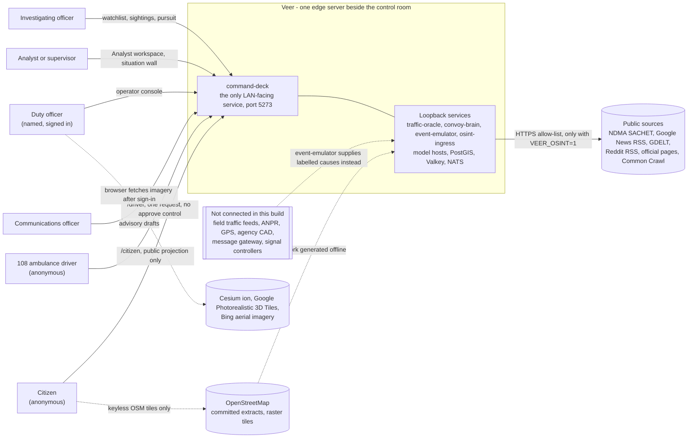

### 2.1 Actors

| Actor | Surface | Authentication | What they may do |
|---|---|---|---|
| Duty officer | Home, Decide, Map, Plan, Assistant, Advisories, Analyst | Name + duty PIN (operator gate) | Approve or reject every proposal; launch movements; authorise pursuits; approve dispatches and 108 windows |
| Investigating officer | Decide, object pages, Analyst | Same | Earmark a vehicle with a lawful basis; review sightings; authorise a pursuit from an approved sighting |
| Analyst or supervisor | Analyst workspace (`/analyst`), situation wall (`/ops`), City map (`/gods-eye`), `/chat` | Same | Read the full analysis, audit and degradation surfaces; decide where those surfaces offer it |
| Communications officer | Advisories (`/comms`) | Same | Read EN, HI and GU drafts; nothing is delivered (no gateway) |
| Citizen | `/citizen` | None | Read the public projection of corridor holds |
| 108 driver | `/driver` | None | File one ambulance corridor request and watch its status; cannot approve |

### 2.2 External systems

| System | Direction | Used for | Notes |
|---|---|---|---|
| OpenStreetMap | Offline (committed Overpass extracts); browser raster tiles | The 49-segment road network, the OSINT gazetteer, the keyless basemap | ODbL 1.0; the network is regenerated and re-verified offline by `scripts/gen_osm_network.py --verify` |
| Cesium ion (Cesium World Terrain, Bing aerial imagery), Google Photorealistic 3D Tiles | Browser only | Photoreal 3D city and satellite thumbnails for signed-in operators | The ion token is handed only to a valid operator session; public pages never receive it |
| Public OSINT sources | Server egress from `osint-ingress` | Situations at places | Off by default (`VEER_OSINT=0`); exact-host allow-list over HTTPS; an `offline` mode reads cached captures |
| Field feeds, ANPR, GPS, CAD, gateway, controllers | Not connected | — | Seams exist (`AnprSource` port, `live_anpr` source, `POST /movements/{id}/position`, the signal writer); the event emulator supplies labelled causes |

---

## 3. Containers and deployment

### 3.1 Deployment view

The deck is the only service reachable from the LAN. Everything else binds the loopback interface. The model
hosts run outside Docker as systemd user units (native access to the unified-memory pool); the platform services
run in one Docker Compose project, `vvip-argus`.

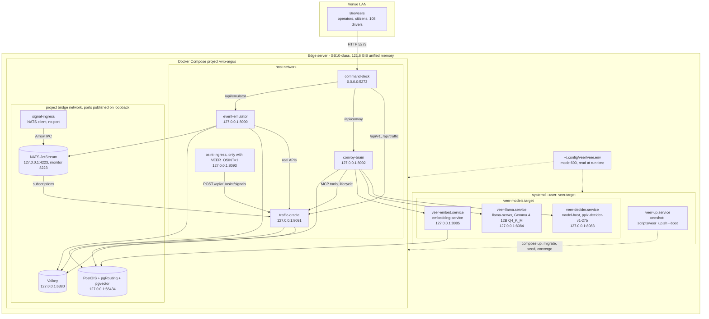

### 3.2 Ports and binds

These are the deployed values (`infra/compose.argus-override.yml`, `scripts/veer_env.sh`). The services' own
process defaults differ (for example the oracle defaults to 8081 and the brain to 8080); the deployment sets
`PORT` explicitly. `scripts/veer_up.sh` reads the ports from the rendered compose files and probes exactly those,
so a shell export cannot redirect it.

| Component | Bind | Runs as | Reached by |
|---|---|---|---|
| command-deck | `0.0.0.0:5273` | container, host network, uid 10006 | Browsers on the LAN |
| event-emulator | `127.0.0.1:8090` | container, host network, uid 10002 | The deck proxy (`/api/emulator`) |
| traffic-oracle | `127.0.0.1:8091` | container, host network, uid 10004 | Deck proxy, brain, emulator, osint-ingress |
| convoy-brain | `127.0.0.1:8092` | container, host network, uid 10005 | Deck proxy (`/api/convoy`) |
| osint-ingress (optional) | `127.0.0.1:8093` | container, host network, uid 10003, read-only root filesystem | Health probes only (it posts outward to the oracle) |
| model-host (decider) | `127.0.0.1:8083` | systemd user unit | Brain |
| llama-server (Gemma) | `127.0.0.1:8084` | systemd user unit | Brain |
| embedding-service | `127.0.0.1:8085` | systemd user unit | Brain |
| PostGIS | `127.0.0.1:56434` → 5432 | container, project bridge | Oracle, emulator, embedding-service, `migrate.py` |
| Valkey | `127.0.0.1:6380` → 6379 | container, project bridge | Oracle, brain, emulator |
| NATS (+ monitoring) | `127.0.0.1:4223` → 4222, `127.0.0.1:8223` → 8222 | container, project bridge | signal-ingress (in-network), oracle, emulator |
| signal-ingress | none | container, project bridge, uid 10001 | — (publishes to NATS) |

The host-networked services use host networking because the model hosts bind loopback and bridge-to-host-gateway
traffic is dropped on this host; with host networking `127.0.0.1:<port>` is the correct address for every peer.

### 3.3 Compose project and files

The one compose invocation is assembled by `scripts/veer_env.sh` (`veer_compose`):

| File | Role |
|---|---|
| `infra/compose.yml` | Base service definitions (storage, ingress, oracle, brain, the legacy deck image) |
| `infra/compose.gb10-override.yml` | arm64 PostGIS image (`Dockerfile.postgis.arm64`), host networking for oracle, brain and the SvelteKit deck, repo-tree-mirroring Dockerfiles, migrations taken out of `docker-entrypoint-initdb.d` (schema comes only from `migrate.py`) |
| `infra/compose.argus-override.yml` | The deployed stack: `vvip-argus-*` container names and `-argus` image tags, loopback binds, deployed ports, `restart: unless-stopped`, healthchecks, safety switches and pass-through flags |
| `infra/compose.osint-ingress.yml` | Added only when `VEER_OSINT=1`: `vvip-argus-osint-ingress`, read-only root filesystem, every capability dropped, `no-new-privileges`, 768 MB memory cap, an `osint_cache` volume, starts once the oracle is healthy |

Also in the tree but not part of the deployed invocation: `infra/compose.prod.yml` (an older production profile
with Prometheus, Grafana and an NVIDIA exporter) and `infra/compose.event-emulator.yml` (an emulator stanza for the
base fleet). The base `compose.yml` on its own publishes ports on all interfaces; only the four-file invocation
above is the deployed shape.

Volumes: `postgis_data`, `valkey_data`, `nats_data`, and `osint_cache` when OSINT is on. No volume or host path is
owned by the service uids.

### 3.4 Systemd units and boot

| Unit (`infra/systemd/`) | Type | What it does |
|---|---|---|
| `veer.target` | target, `WantedBy=default.target` | Wants `veer-models.target` and `veer-up.service`; needs `loginctl enable-linger` to start without a login session |
| `veer-models.target` | target, `PartOf=veer.target` | Wants the three model units |
| `veer-decider.service` | simple, `Restart=always` | `infra/scripts/serve_models.sh --foreground decider`; cold load about 285 s; `RestartPreventExitStatus=78` (missing files are reported once, not retried every 5 s); `OOMScoreAdjust=500` |
| `veer-llama.service` | simple, `Restart=always` | `serve_models.sh --foreground llama`: llama-server with 2 slots × 8,192 tokens, `--jinja`, `--metrics`, loopback only |
| `veer-embed.service` | simple, `Restart=always` | `serve_models.sh --foreground embed`; waits for the PostGIS port before starting |
| `veer-up.service` | oneshot, `Restart=on-failure` | `scripts/veer_up.sh --boot`: wait for Docker, bring up, converge; not retried on "not converged" (exit 1) or a preflight refusal (exit 2) |

Every unit reads `EnvironmentFile=%h/.config/veer/veer.env`, so a reboot, a unit restart and a manual run see the
same settings. Boot was verified by real reboots on **2026-10-23**: `READY 11/11` in 4 min 25 s with no manual
command.

### 3.5 Bring-up order

`scripts/veer_up.sh` is the one idempotent bring-up, run as the stack's owner (never root). Its order guarantees
that no service is recreated against an older schema. One bring-up runs at a time (a lock in `$VEER_RUN_DIR`).

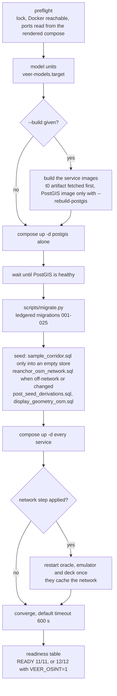

The readiness table has one row per component: postgis (which names the network basis, for example
`network osm 49/49 · 34 junctions`), valkey, nats, signal-ingress, oracle, brain, deck, emulator, decider, gemma,
embeddings, and osint when enabled. `--status` prints the same table read-only and adds a `security` row: a deck
reachable beyond loopback with the operator gate off reads **DEGRADED**. Exit codes: 0 ready, 1 not converged, 2
preflight refusal or usage, 3 a bring-up step failed.

### 3.6 Images

| Image (`infra/docker/`) | Base | User |
|---|---|---|
| `Dockerfile.postgis.arm64` | `pgvector/pgvector:pg16` (digest-pinned) + PostGIS + pgRouting | the PostgreSQL image's own server user |
| `Dockerfile.signal-ingress` | `rust:alpine` builder → `alpine:3.21` | uid 10001 |
| `Dockerfile.event-emulator` | `python:3.12-slim` (digest-pinned) | uid 10002 |
| `Dockerfile.osint-ingress` | `python:3.12-slim` (digest-pinned) | uid 10003 |
| `Dockerfile.traffic-oracle.gb10` | `python:3.12-slim` (digest-pinned); bakes the t0-alpha artifact and sets `VVIP_FOUNDATION_MODEL_PATH` | uid 10004 |
| `Dockerfile.convoy-brain.gb10` | `python:3.12-slim` (digest-pinned) | uid 10005 |
| `Dockerfile.command-deck` | `oven/bun:1.4.3` build → `oven/bun:1.4.3-slim` (digest-pinned), `bun install --frozen-lockfile` | uid 10006 |

The two `.gb10` Dockerfiles mirror the repository tree inside the image because the services resolve repo-rooted
paths (the seed, `veer_models.yaml`, the OSINT data files). Still open: the Rust base images are not digest-pinned,
and the plain x86 `Dockerfile.traffic-oracle` and `Dockerfile.convoy-brain` still run as root (the deployed arm64
images do not).

---

## 4. Component design

### 4.1 command-deck

**Stack:** TypeScript, SvelteKit 2 with Svelte 5 runes, `@sveltejs/adapter-node` run by Bun, CesiumJS 1.146
(vendored under `static/cesium`), MapLibre GL 5, deck.gl 9. **Source:** `VVIP/services/command-deck/`.

The deck is the interface for every audience and the stack's only LAN-facing process. It has four server-side
responsibilities besides rendering pages: the same-origin proxy to the loopback services, the operator gate, the
per-document content-security policy, and the public projection that feeds the public pages.

#### 4.1.1 Route groups

Routes live under `src/routes/` in three groups. The root is a SvelteKit **reroute** (`src/hooks.ts` →
`src/lib/shell/root-flip.ts`): `/` resolves to Home's route node `/(v3)/home`, and `/analyst` to the workspace's
node `/(deck)`. Because it is a reroute, everything that decides per page reads the **resolved route id**
(`event.route.id`), never the URL.

| Group | Routes | Theme | Purpose |
|---|---|---|---|
| `(v3)` | `/` (also `/home`), `/decide`, `/decide/[unit]`, `/o/[urn]`, `/map`, `/plan`, `/assistant`, `/v3-gallery` | V3 night | The V3 screens: Home (featured decision, city pulse, four rails), Decide (queue, real map, one decision sheet), object pages for ten record kinds, the city map (the shared canvas with V3 chrome), the planner, the assistant; `/v3-gallery` is an identity gallery of static assets |
| `(deck)` | `/analyst`, `/ops`, `/gods-eye`, `/chat`, `/comms`, `/design` | V3 night | The Analyst family (workspace, situation wall, fullscreen 3D city, chat console) and Advisories, all drawn inside the V3 shell; `/design/*` is a developer harness that answers 404 in production unless `VEER_DESIGN_HARNESS=1` |
| `(public)` | `/citizen`, `/driver`, `/api/public/events`, `/api/public/dispatches/[id]` | V3 day | No sign-in, strict CSP, no operator module in their static graph, no map key |

Deck-owned server routes: `GET/POST/DELETE /api/session` (sign-in), `GET /gods-eye/mode` (keyless or ion-keyed
basemap, per session), `GET /gods-eye/feeds`, and the two public projection endpoints.

#### 4.1.2 Request pipeline (`src/hooks.server.ts`)

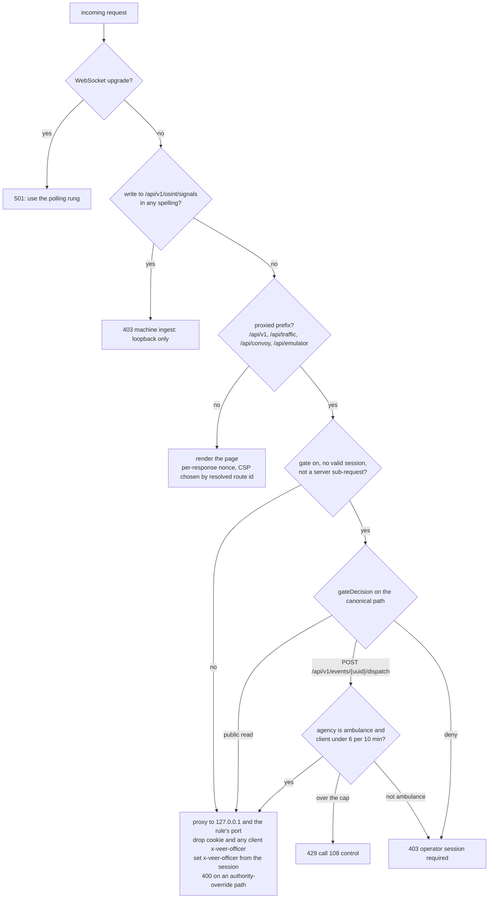

| Proxy rule | Target | Prefix stripped | Upstream budget |
|---|---|---|---|
| `/api/v1` | `http://127.0.0.1:${ORACLE_PORT:-8091}` | no | 60 s; 130 s for the twin run, twin comparison and decision-support generation |
| `/api/traffic` | same oracle | no | 60 s |
| `/api/convoy` | `http://127.0.0.1:${BRAIN_PORT:-8092}` | yes | 300 s (planning workflows are heavy by design) |
| `/api/emulator` | `http://127.0.0.1:${EMULATOR_PORT:-8090}` | yes | 60 s |

Properties of the proxy:

- **Host pinned.** The host is hard-coded to `127.0.0.1`; only the ports come from the environment.
- **Authority pinning.** After building the upstream URL the proxy checks that its origin is still the rule's
  target; a protocol-relative or backslash path that would override the authority is refused with 400.
- **Identity.** The `cookie` header never travels upstream, any client-supplied `x-veer-officer` is deleted, and a
  verified session's officer name is set (percent-encoded, so Devanagari and Gujarati names survive).
- **Cancellation.** An upstream request is aborted when the client goes away (closed tab, superseded poll).
- **Bodies.** Hop-by-hop headers and the now-wrong `content-encoding`/`content-length` are not relayed.
- **Errors.** An unreachable upstream answers 502 with the upstream named; refusals from services (409, 422) are
  relayed verbatim so the interface can show them in the service's own words.

#### 4.1.3 Operator gate (`src/lib/shell/operator-session.server.ts`)

The gate is opt-in: it is on whenever `VEER_OPERATOR_PIN` is non-empty (it is on in the deployment). Details in
[§8.2](#82-operator-gate-and-sessions). The gate protects **data**, not page shells: an anonymous browser can load an
operator page's code, but every proxied data call returns 403 and the imagery key is withheld.

#### 4.1.4 Per-document content-security policy

A CSP applies to a whole document, and a client-side navigation keeps the document it started in. So the policy is
chosen per document from the resolved route id: `(deck)` and `(v3)` routes get the operator policy (what CesiumJS
needs), `(public)` routes get the strict policy. Details in [§8.4](#84-content-security-policy-and-response-headers).

#### 4.1.5 Public projection (`src/lib/citizen/public-api.server.ts`)

The public pages never read an operator feed. The deck server builds a projection itself, through its own proxy
(server sub-requests pass the gate), and returns only what an advisory needs:

- **Public kinds only.** Pursuits and crime incidents (which carry plates, FIR numbers and officer names) are
  dropped. **OSINT firewall:** an OSINT-sourced event is dropped whatever its kind, so a promoted report never
  reaches a citizen or a 108 driver as a real corridor.
- **Horizon.** An event is projected in full only while active, inside its window, or starting within 2 hours;
  later events appear as "Later" rows with kind, times and road names only. A protected movement's Later row
  carries its date and no roads (`roads_withheld`).
- **Facts.** The primary spine as signage road names, each stretch with its nearest signalised junction (the 108
  waypoint); the hold length from the phase's closure policy or the oracle's published advance closure, labelled
  by provenance; an alternate from k-shortest paths; a plain-language tier from the newest band; and a list of the
  facts whose read failed (`unavailable`), so the card says "unavailable right now" instead of inventing a value.
- **Emulated flag.** True for events opened by the emulator, test or rehearsal movements, and escorts driving on
  emulated GPS. Every answer carries `emulated_labelling: true`; `veer_up.sh --demo` refuses to start the living
  city unless it sees that marker.
- **Caching.** The whole feed is cached 5 s with single-flight; static facts 10 min; the driver's dispatch status
  2 s. N citizens cost one oracle read per 5 s.
- **Dispatch status for the driver.** `GET /api/public/dispatches/{id}?event=` reads the dispatch and its event by
  id and fails closed: an absent event answers not-found, an unreadable one 503, an OSINT-sourced one not-found.

#### 4.1.6 Client data layer

There is no WebSocket path in production (adapter-node cannot upgrade), so every live surface polls through the
proxy, one request in flight per surface, paused while the tab is hidden. Cadences are in
[§11.4](#114-polling-and-caching-design). Plates are masked in the browser (`lib/gods-eye/plates.ts`) unless a named
officer is signed in. Every user-visible string of the operator screens ships in English, Hindi and Gujarati,
loaded per route.

Key source areas: `lib/v3/**` (the V3 screens and shell), `lib/gods-eye/**` (the CesiumJS canvas, eleven layers,
basemap and imagery chip), `lib/ops/**` (the situation wall's stores and endpoints), `lib/citizen/**` (public
pages and projection), `lib/shell/**` (gate, proxy limits, reroute), `lib/i18n/**` (string packs).

### 4.2 traffic-oracle

**Stack:** Python 3.12, FastAPI, asyncpg, valkey, nats-py, ONNX Runtime, OR-Tools, NetworkX/igraph, DuckDB,
scikit-learn, PyTorch (architecture only). **Source:** `VVIP/services/traffic-oracle/src/traffic_oracle/`.

The oracle is the stack's system of record and its numeric engine. Every write of city state (events, routes,
earmarks, sightings, recommendations, dispatches, signal plans, OSINT situations, decision-support records) goes
through it, and it owns the deterministic tools the AI chooses among.

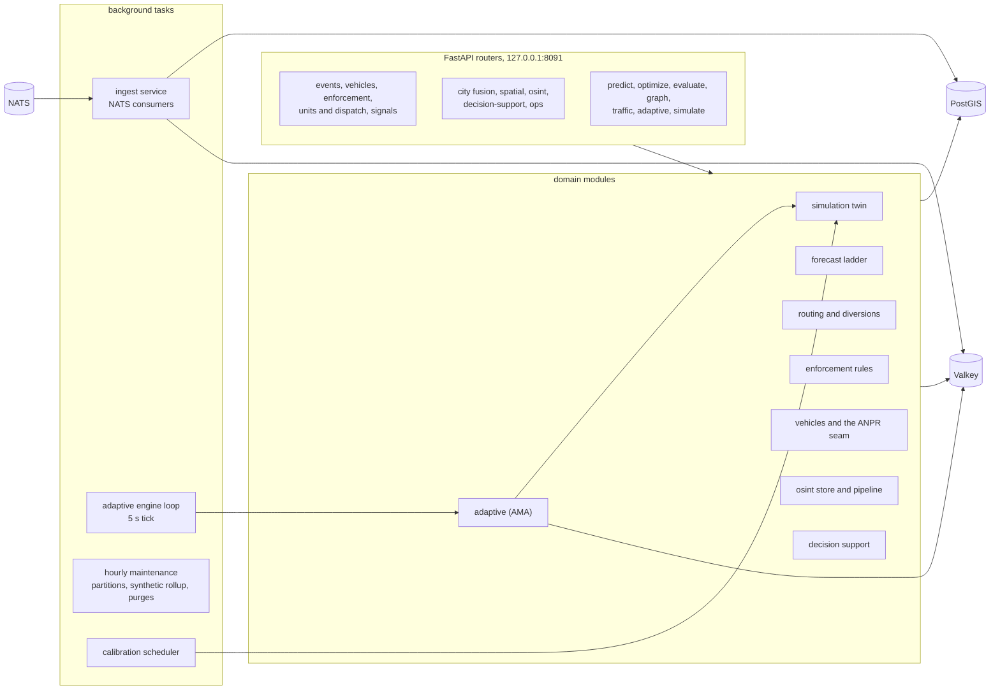

| Module | Responsibility |
|---|---|
| `data/` | Settings (`VVIP_*` environment), database pool, Valkey cache, pgRouting queries, pgvector store |
| `ingest/` | One supervised NATS connection: `corridor.traffic.live`, `corridor.traffic.emulated`, `corridor.traffic.anomaly`, `corridor.units.emulated`; Arrow decode; buffered writes to `traffic.observations`; newest row per segment to Valkey; daily partitions dropped after 14 days |
| `anomaly/` | The Tier-1 anomaly consumer (ingress flags → `traffic.anomaly_log`); an Isolation Forest exists as code only |
| `predict/` | The forecast ladder: support gate → t0-alpha foundation rung → DSTGAT rung (no weights shipped) → labelled heuristic; quantile contract; ETA (labelled fallback until trained) |
| `optimize/` | OR-Tools CP-SAT routing, pgRouting k-shortest alternatives, P90-robust edge costs, diversion planner (Dijkstra on the turn graph) |
| `adaptive/` | Active Movement Adaptation: deterministic classifier, hysteresis, escalation, degradation, twin shadow evaluation, protocol-floored parameter publishing, the engine loop, Valkey mirror |
| `simulation/` | The seeded Monte-Carlo twin, scenario library, calibration (≥ 24 field hours and replay error ≤ 5 km/h before it counts as field-calibrated) |
| `events/` | Corridor events: create, the live board, lifecycle `POST /{id}/status`, route updates `POST /{id}/routes`, the pursuit validator |
| `vehicles/` | Watchlist earmarks (lawful basis, capped retention), the ANPR ingest seam `POST /sightings`, lawful-read surfaces, retention reaper, interception plan, the officer full-mark lookup and its audit |
| `enforcement/` | Deterministic e-challan rules → PENDING recommendations; the stolen-vehicle rule; the human decision endpoint with append-only audit tail |
| `units/` | The five-agency dispatch channel and lifecycle; emulated unit projection and patrol frames; the loopback check on `x-veer-officer` |
| `signals/` | City signal plans: band → plan table, default-off writer, twin shadow evaluation before any write, snapshot and restore |
| `city/` | City fusion: entities, dossiers, the city feed, cameras, the one lawful-read predicate (`SQL_LAWFUL_READ`), plate masking of labels and feed text |
| `spatial/` | Segment geometry with `geometry_basis` (`osm`, `osm_display`, `schematic`) |
| `osint/` | Machine ingest of redacted signals, the trust boundary, re-fusion through the OSINT libraries, situation reads, officer promotion |
| `decision_support/` | Courses of action, AHP + lexical veto + TOPSIS, wargames (twin, cascade or seeded surrogate), the human-gated decision |
| `ops/` | The degradation ledger (`GET /api/v1/ops/degradation-taxonomy`) |
| `runtime/` | Unified-memory budget, ONNX sessions, memory guard (3,500 MB), thread pools |
| `coordination.py` | Guarded router registration: a module that cannot import is replaced by a stub answering 503 "not deployed", so the oracle always boots |

### 4.3 convoy-brain

**Stack:** Python 3.12, FastAPI, httpx, valkey, structlog, Prometheus client. **Source:**
`VVIP/services/convoy-brain/src/convoy_brain/`.

The brain orchestrates the AI. It never writes city state of consequence on its own: it asks the models, runs the
deterministic tools through the oracle, checks every claim, and turns anything that would change a plan into a
proposal for a named officer.

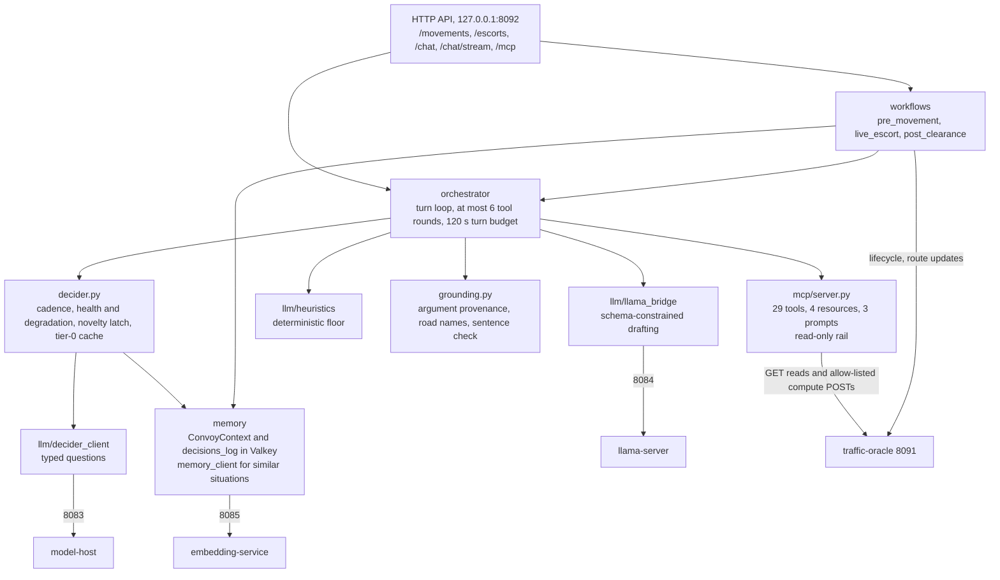

**Two tiers.** The strategic tier is `pplx-decider-v1-27b`, served by model-host as **typed questions** (choice,
probability, score), never as a chat model. It owns strategy and tool selection. The tactical tier is Gemma 4 12B
(shown to operators as `gemma4-12b-veer`; its served alias stays internal), which drafts tool arguments against each
tool's JSON schema and composes answers. Below both sits a deterministic heuristic floor. The fallback chain is
decider → Gemma → heuristics, and every drop is audited. See [§10](#10-ai-design).

**Workflows.**

| Workflow | Shape | Key constraints |
|---|---|---|
| Pre-movement (`POST /movements`, `/movements/{id}/plan`) | Decider checkpoint (route strategy, urgency, disruption tolerance) over a state document of at most 1,500 tokens; tactical agents validate and draft; security re-validation loop | `MAX_SECURITY_RETRIES = 2`; route options labelled by a digest of their own segment sequence so the tier-0 cache keys on content |
| Live escort (`POST /movements/{id}/escort`, 202) | Background task per movement; GPS loop is pure numeric code; event-driven decider checkpoints; one open proposal per escort | Approval timeout 90 s (clamped 15–600); hold at most 180 s; lookahead 3 km; at most 14,400 iterations |
| Post-clearance (`POST /movements/{id}/clear`) | Segment-by-segment deactivation, recovery polling, after-action report | Recovery below congestion 0.3, polled every 5 s, at most 120 polls |

**Grounding validator** (`grounding.py`): checks argument provenance before a tool runs, resolves typed road names
against the network, and checks every sentence of the answer against the turn's tool results. See
[§10.5](#105-grounding-validator).

**MCP** (`POST /mcp`, JSON-RPC 2.0): 29 tools (12 compute and read tools, 10 read-only city tools, 6 canvas verbs
and `city_decision_support`), 4 resources and 3 prompt templates. The executor may POST only to seven compute
endpoints and one compute pattern (decision-support `/generate`); a regular expression forbids any tool name
containing approve, decide, earmark, dispatch_request, withdraw or transition.

**Memory.** `ConvoyContext` (Valkey `convoy:context:{movement_id}`) holds each movement's state and its
`decisions_log`, the audit trail of every AI answer and fallback. The memory client queries the embedding service
for similar past situations (novelty latch, tier-0 cache) and, unless `VVIP_MEMORY_RECORD=0`, files served
checkpoints as decision documents.

**Other modules.** `http_guard.py` (outbound URL policy, [§8.5](#85-network-exposure-the-loopback-proxy-and-outbound-calls)),
`adaptive_params.py` (fail-closed client of the oracle's adaptive parameters), `gps_sim.py` (the labelled emulated
GPS walker), `dss/coa_generator.py` (the brain's strategy prior for decision support: a recorded, labelled opinion
that never changes the ranking and never acts), `agents/` (four tactical agents on Gemma).

Retired routes (`/movements/{id}/dossier`, `/threat-assessment`, `/protocol/assess`, `/analytics/reasoning`,
`/recommendations/reasoning`) answer **410** and write nothing: the model no longer produces security dossiers,
threat levels or compliance verdicts.

### 4.4 event-emulator

**Stack:** Python 3.12, FastAPI, psycopg, valkey, nats-py, pyarrow. **Source:** `VVIP/services/event-emulator/`.
Loopback `:8090`, reached by the deck as `/api/emulator`.

The emulator is the emulated half of the stack. It injects **causes only** — procession schedules, marathon
waves, weather onset, incidents, green-corridor requests, convoy departures, emulated ANPR reads and patrolling
units — through the real services' real APIs. It never produces outcomes (decisions, parameters, bands, hits or
recommendations).

| Seam | Mechanism | Consumed by |
|---|---|---|
| Corridor events | Event rows, then `POST /api/v1/events/{id}/status` as `event-emulator (system)` | Situation engine, boards, dispatch auto-close |
| Situation inputs | Valkey `adaptive:inputs:{id}` in the exact reader shape, with the provenance sidecar `emulator:source:{id}` | Adaptive engine loop |
| ANPR reads | `POST /api/v1/vehicles/sightings`, every row `source = emulated_anpr`; a stolen-plate tape first ensures its labelled `stolen_vehicle_fir` earmark as a scenario precondition | Watchlist, enforcement, interception |
| Agency units | NATS `corridor.units.emulated` → Valkey `units:emulated:{unit_id}` (30 s) | `GET /api/v1/units`, the canvas |
| Twin | One `POST /api/v1/simulate/twin` per run (recorded, never acted on) | — |
| Showcase traffic | Arrow batches on `corridor.traffic.emulated` (never `.live`), every row labelled synthetic | Oracle's own key space `traffic:emulated:latest:{segment_id}` |

Runs are deterministic (a tape is a pure function of spec, seed and start time; two runs are byte-identical),
run-scoped (fresh identities per run), stoppable and replayable. A replay of a tape whose route is not a legal path
on the current network is refused (422 `route_not_on_current_network`). The library holds ten use cases (eight
corridor classes, the flagship composite and the stolen-vehicle camera sweep). The **living city**
(`EMULATOR_LIVING_CITY`, off by default) runs a deterministic day program of overlapping emulated causes.

### 4.5 signal-ingress

**Stack:** Rust 2024, tokio, arrow, async-nats. **Source:** `VVIP/services/signal-ingress/`.

Four feed adapters (government traffic, mapping API, fleet GPS, crowdsource) observe one shared synthetic
congestion field over the 49-segment network compiled into the binary (`src/feeds/segments_ahmedabad.rs`,
generated from the store by `scripts/gen_ingress_segments.py`; `--check` fails on drift). **No live connector is
wired: every row is published with `data_quality = synthetic`.**

Pipeline: feeds → bounded channel (10,000) → Tier-1 plausibility checks → batcher (flush at 100 rows or 100 ms) →
Arrow IPC → NATS `corridor.traffic.live`; anomaly documents go to `corridor.traffic.anomaly` with an additive
`feed_quality` field so a flag raised on simulated data is never mistaken for a field anomaly. The eight checks:
future timestamp, stale data, speed jump, phantom reading, speed z-score, congestion outlier, road-class mismatch,
spatial mismatch. Every row lies on its own road (the crowdsource feed's GPS error is truncated at 30 m).

### 4.6 corridor-store

**Engine:** PostgreSQL 16 with PostGIS, pgRouting, pgvector and pg_trgm (the deployed arm64 image).
**Source:** `VVIP/services/corridor-store/` (`migrations/`, `seed/`, an OSM importer CLI).

- `scripts/migrate.py` applies `migrations/001–025` in order and ledgers each in `corridor.schema_migrations`
  (name, checksum, applied time, duration). 001–006 are byte-immutable (checksum ledger); 007–025 are idempotent,
  schema-only and additive, except 025, which deliberately drops a reversible hash column.
- The seed runs in a fixed order: `sample_corridor.sql` (empty store only) → `reanchor_osm_network.sql`
  (converts or completes the network in place, ids preserved, a second apply is a no-op) →
  `post_seed_derivations.sql` (camera sites, stations, junction names, signal programs) →
  `display_geometry_osm.sql`.
- The network itself is generated deterministically by `scripts/gen_osm_network.py` from committed Overpass
  extracts and verified offline (`--verify`): every segment within 15 m of its OpenStreetMap centreline (worst
  7.76 m), length within 2 % (worst 0.96 %), one strongly connected network.

The schema is described in [§5](#5-data-model).

### 4.7 The OSINT services

Off by default (`VEER_OSINT=0`). Four Python packages, one runtime container:

| Package | Runs in | Responsibility |
|---|---|---|
| `osint-common` | ingress and oracle | The C-T types (`RawOsintSignal`, situations), the closed vocabulary of event classes and source priors, the ethics checks (`assert_no_person_keys`, `find_pii`) |
| `osint-ingress` | its own container, `:8093` | Scheduler and connectors, the allow-listed HTTP client, robots.txt for official pages, redaction at parse, the capture cache, publishing to the oracle with an outbox |
| `osint-geo` | oracle | Offline gazetteer resolver (ODbL, with transliteration and Gujarati/Hindi spellings), snapping onto the real network |
| `osint-analysis` | oracle | Classify, fuse, correlate, score credibility, attach to compatible live events, flag second-order effects |

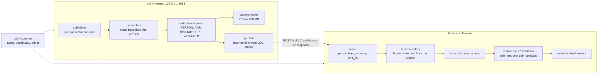

Connectors and default cadence (`OSINT_CADENCE_<CONNECTOR>_SEC` overrides; below 60 s is raised to 60 s):
`sachet_cap` 5 min, `google_news_rss` 10 min, `gdelt_events` and `gdelt_doc` 15 min, `reddit_rss` 15 min,
`amc_scrape` and `gsdma` hourly (best effort; a robots.txt disallow disables the connector), `common_crawl` on
demand only. A further official-page connector exists in code but is disabled (its host is unverified). In
`offline` mode, and after any failed live fetch, the newest cached capture is parsed and labelled `cached-sample`.

### 4.8 embedding-service

**Source:** `VVIP/services/embedding-service/`; run by `veer-embed.service` on `127.0.0.1:8085`.

Late-interaction memory for "similar past situations": `pplx-embed-v2-late-0.6b` multi-vector embeddings (128-d per
token, MaxSim rerank) with `bge-m3` dense recall (1,024-d). Hybrid search: dense recall of 100, MaxSim rerank to 20.
Routes: `POST /embed/documents` (encode and upsert), `POST /search`, `POST /incidents`, `GET /incidents/recent`,
`GET /health`. Storage: `traffic.memory_docs`, `traffic.incidents`, `traffic.memory_segment_embeddings`. A 9B
auxiliary embedder exists as a disabled configuration slot. There is no read-only dense `/embed` route yet, so OSINT
fusion uses lexical similarity.

### 4.9 model-host and llama-server

**model-host** (`VVIP/services/model-host/`, `127.0.0.1:8083`) serves the decider. It loads the snapshot directory
once (about 5 minutes cold) and keeps it resident. API: `GET /decider/health`, `POST /warmup`, `POST /decide`
(`{state, questions}`, at most 6 questions, **batched into one forward pass**), `GET /metrics`. Question types:
`choice` (at most 249 options), `noul` (a probability), `score` (an expected level). Every answer carries
`{value, probability, confidence, distribution}`. Errors are explicit: 429 with `Retry-After: 5` when 8 requests
are queued, 503 while loading, 413 when the state exceeds 8,192 tokens (never truncated), 422 for malformed
questions. It makes no outbound HTTP calls and runs with `HF_HUB_OFFLINE=1`.

**llama-server** (llama.cpp, pinned build) serves Gemma 4 12B Q4_K_M with 2 parallel slots of 8,192 tokens, the
GGUF-embedded chat template (`--jinja`) and Prometheus metrics, bound to loopback.

---

## 5. Data model

### 5.1 Schemas

| Schema | Holds | Introduced by |
|---|---|---|
| `corridor` | Road segments, junctions, adjacency, the `road_graph` view, signal programs and their history and apply log, cameras, agency stations, protocol parameters, vehicles, earmarks, sightings, dispatches and their events, the lookup audit, the migration ledger | 001, 002, 006, 007, 010–015, 020, 024–025 |
| `traffic` | Range-partitioned observations, real hourly aggregates, the separate synthetic rollup, the anomaly log, segment embeddings, memory documents, incidents, memory embeddings | 001–004, 019 |
| `convoy` | Legacy movement records, planned routes, diversions | 001 |
| `events` | Corridor events, routes (with supersession), phases, profiles, the status log, enforcement recommendations | 007, 008, 010, 013, 017, 018, 021 |
| `adaptive` | The situation log and published parameter overrides (the AMA audit) | 005, 007 |
| `simulation` | Twin runs and calibrations | 006 |
| `emulator` | The emulator's runs ledger | 009, 016 |
| `osint` | Redacted raw signals, the gazetteer, resolved situations, geocodes, situation-signal links | 021, 023 |
| `decision` | Decision-support proposals, courses of action, wargame runs, the append-only decision log | 022 |

Columns below are taken from the migrations. Types are simplified for the diagrams (`geometry` stands for the
PostGIS geometry with its SRID 4326; `_array` marks a PostgreSQL array). Relationships drawn with a dashed line are
logical links that the schema does not enforce with a foreign key.

### 5.2 Road network and city assets (`corridor`)

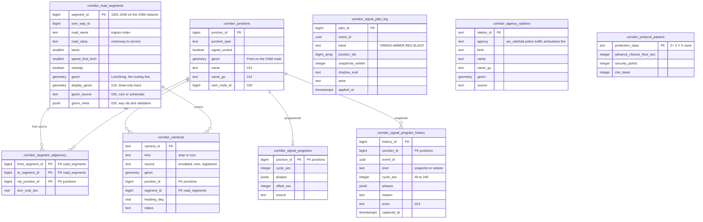

`corridor.road_graph` is a view over segments and adjacency for pgRouting: `cost = turn_cost_sec +
length / speed limit`, and `reverse_cost = -1` for one-ways. Camera sites store location and identity only — no
frame, image or stream column exists. On a fresh install the network holds 49 segments, 34 junctions (11
signal-controlled, with 11 programs), 198 turning movements, 28 emulated camera sites and 18 agency stations.

### 5.3 Traffic and memory (`traffic`)

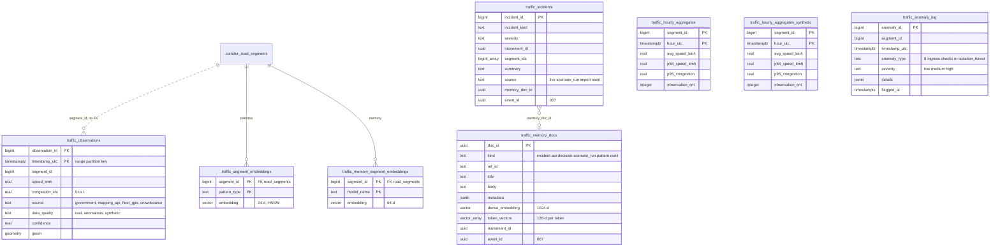

`traffic.hourly_aggregates` is **real-only**: it is the twin's calibration input and the pattern matcher's history.
The simulated feed's rollup lives in `traffic.hourly_aggregates_synthetic` (migration 019) and is served beside the
real rows, labelled, never merged; the oracle's test suite fails if any calibration, twin, pattern or vector query
names the synthetic table. A fresh install therefore holds zero real aggregate rows. `traffic.synthetic_observations`
(003) is a legacy gap-filling table that nothing in the live path writes.

### 5.4 Events, vehicles, enforcement and dispatch

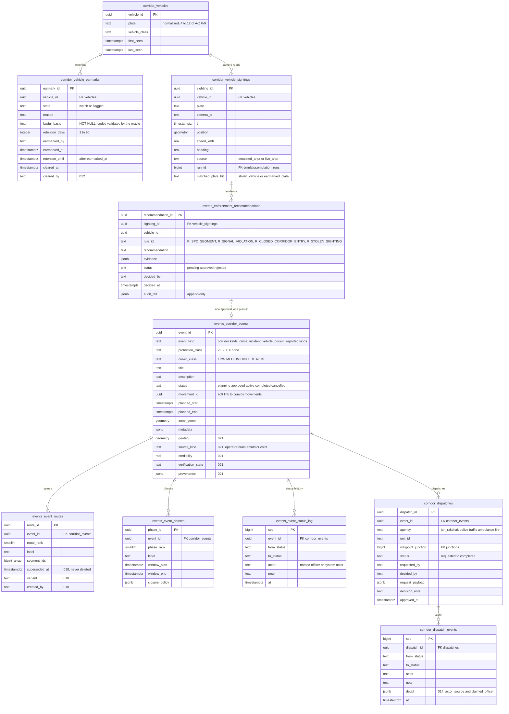

Also in these schemas: `events.event_profiles` (008: the eight use-case templates, never live rows) and
`corridor.vehicle_lookup_audit` (024/025: one row per officer full-mark lookup — `id`, `looked_up_at`, `officer`,
`mark_masked`, `found`, `disclosure` — the reversible `mark_sha256` column was dropped by 025). Sighting `source`
`live_anpr` is reserved for a real vendor adapter; nothing writes it in this build.

### 5.5 OSINT and decision support

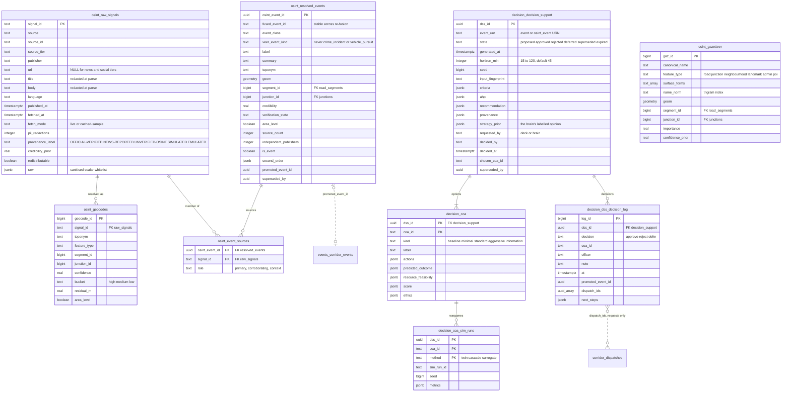

No OSINT table has a person, author, handle, byline, suspect, victim, owner, face or biometric column; a migration
grammar test scans every column. The database refuses `veer_event_kind` values `crime_incident` and
`vehicle_pursuit` on resolved situations. A partial unique index allows at most one `proposed` decision-support
record per subject.

### 5.6 Movements, adaptation, simulation and emulation

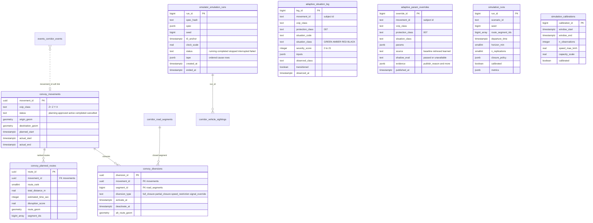

The adaptive tables key on a subject id (a corridor event or a legacy movement), stored as text. `simulation.runs`
is never written by the emulator.

### 5.7 Valkey keys

| Key | TTL | Writer | Purpose |
|---|---|---|---|
| `traffic:latest:{segment_id}` | 300 s | oracle ingest | Newest live-plane row per segment (synthetic today, labelled) |
| `traffic:emulated:latest:{segment_id}` | 300 s | oracle ingest | The emulator's plane; never overwrites the live plane; only emulated events' bands read it |
| `units:emulated:{unit_id}` | 30 s | oracle (from NATS) | Emulated patrol frames |
| `convoy:position:{movement_id}` | 30 s | brain | Latest convoy fix, `source: gps` or `emulated_gps` |
| `convoy:context:{movement_id}` | none while active, 24 h after completion | brain | Movement state and its `decisions_log` |
| `adaptive:inputs:{id}` + `emulator:source:{id}` | set by writer (emulator: 30 s) | emulator | Situation inputs in the reader's shape, with provenance |
| `adaptive:anomaly:active` | — | oracle | Corridor anomaly flag for the classifier |
| `adaptive:params:{id}` | 30 s, re-set every 10 s | oracle engine loop | Published, protocol-floored parameters |
| `situation:changed` | 60 s | oracle engine loop | Band-change signal (a decider checkpoint trigger) |
| `corridor:summary:{corridor_id}`, `traffic:forecast:{segment_id}:{horizon}` | 60 s | oracle | Summary and forecast caches |

Valkey runs with `maxmemory 512mb` and `allkeys-lfu`.

### 5.8 NATS subjects

| Subject | Format | Publisher | Consumer |
|---|---|---|---|
| `corridor.traffic.live` | Arrow IPC | signal-ingress | oracle |
| `corridor.traffic.anomaly` | JSON | signal-ingress | oracle |
| `corridor.traffic.emulated` | Arrow IPC (live-plane schema) | event-emulator | oracle (own key space) |
| `corridor.units.emulated` | JSON | event-emulator | oracle |

Replays carry an `X-Emulation-Replay: <run_id>` header on HTTP requests and NATS messages.

---

## 6. Key flows

Each flow below is drawn from the code paths named in it. Status codes are the services' own.

### 6.1 Traffic ingest

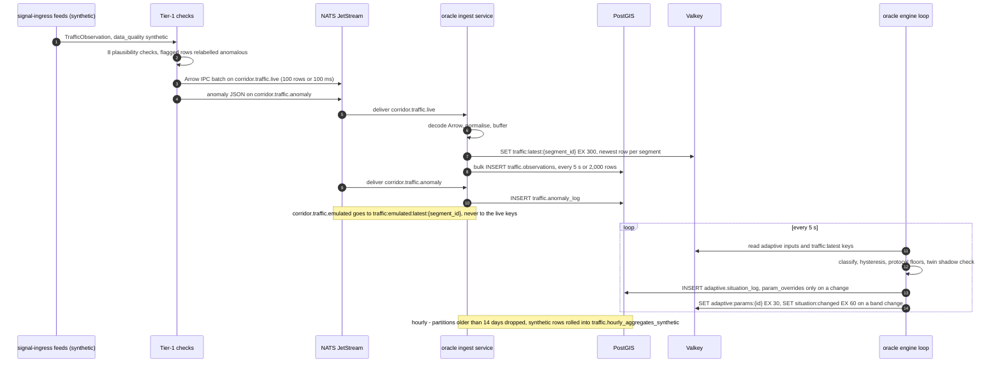

Missing inputs are skipped, never fabricated. A subject whose inputs stay missing for 300 s is evicted, and a tick
that hangs is abandoned after 30 s and counted as a failed poll ([§9](#9-reliability-and-degradation)).

### 6.2 An officer decision through the deck proxy

The same pattern serves every human decision: an e-challan or sighting, a dispatch, a lifecycle transition, a
route update, an escort proposal, a decision-support proposal, an OSINT promotion.

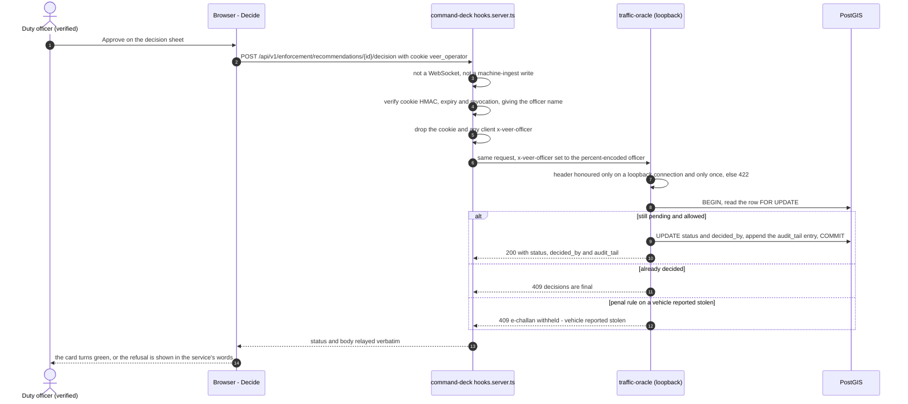

### 6.3 The stolen-vehicle chain

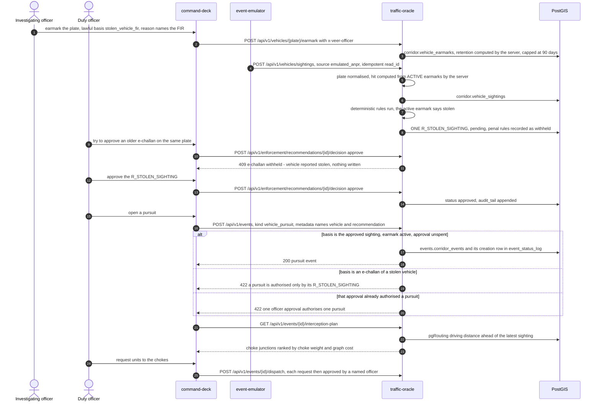

No code path creates an approved recommendation. Rejecting a withheld e-challan stays allowed. On the map a
sighting reads `STOLEN · NO FINE`, a pending penal row of a stolen vehicle `WITHHELD · STOLEN`, and an e-challan
approved before the rule existed `SUPERSEDED · STOLEN` (kept as audit history, never a pursuit basis).

### 6.4 A live-escort proposal: approval, rejection or timeout

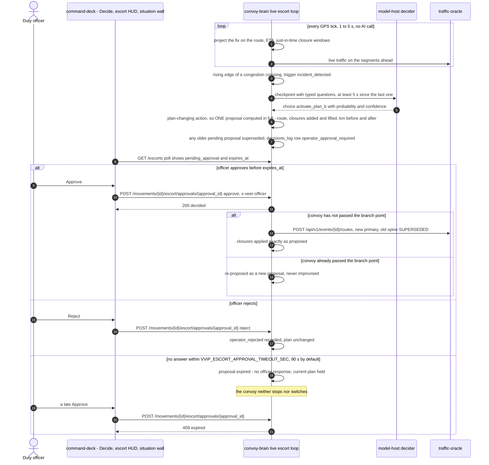

Only "continue monitoring" or "proceed" is carried out without an officer. A proposal raised by the fixed rule
because no model answered is labelled "RULE PROPOSES", never AI. Low-confidence, withheld (novel) and fallback
answers raise the same kind of proposal with their reason.

### 6.5 The OSINT pipeline

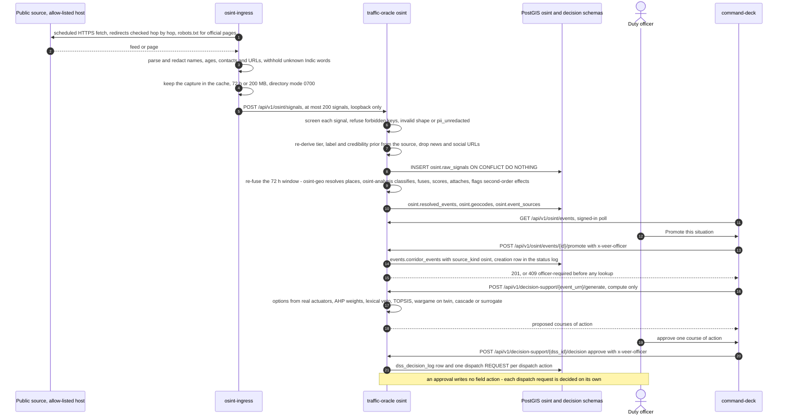

A situation never surfaces from one social post or one community. A single social source is capped at a
credibility of 0.30, syndicated copies count as one source, and a district alert attached to a street-level report
is context, never corroboration. Decision support for an area-level situation (no road anchor) can offer only
monitor, advisory or verify.

### 6.6 The 108 corridor request

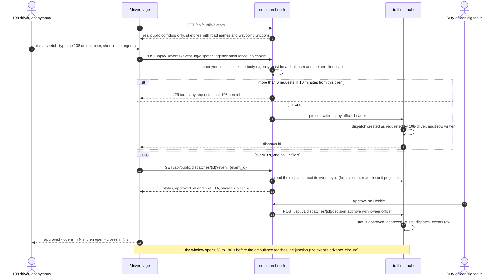

The page has no approve control, collects no location and shows no registration mark. An event opened by the
emulator is never offered as a requestable corridor. With no live public event, a labelled scripted fallback walks
the steps and sends nothing. The clock counts from the moment the request was sent; the platform reports minutes
returned to the golden hour and makes no claim about patient outcomes.

### 6.7 The public projection

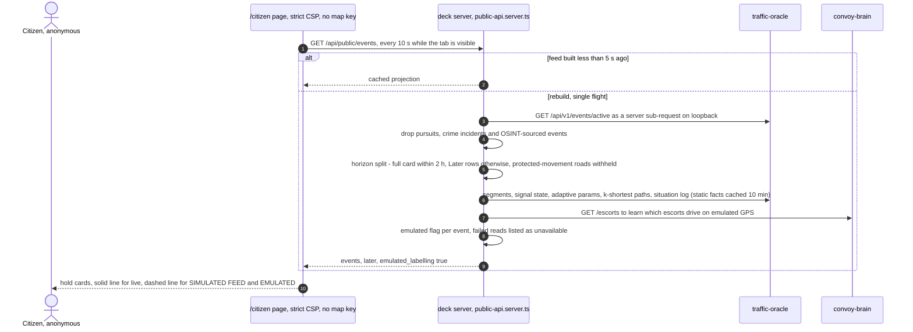

---

## 7. State machines

### 7.1 Corridor event lifecycle

Source: `events/__init__.py` `EVENT_TRANSITIONS`, migration 013. Every status, the creation included, is one
`events.event_status_log` row with its named actor; an illegal transition answers 409.

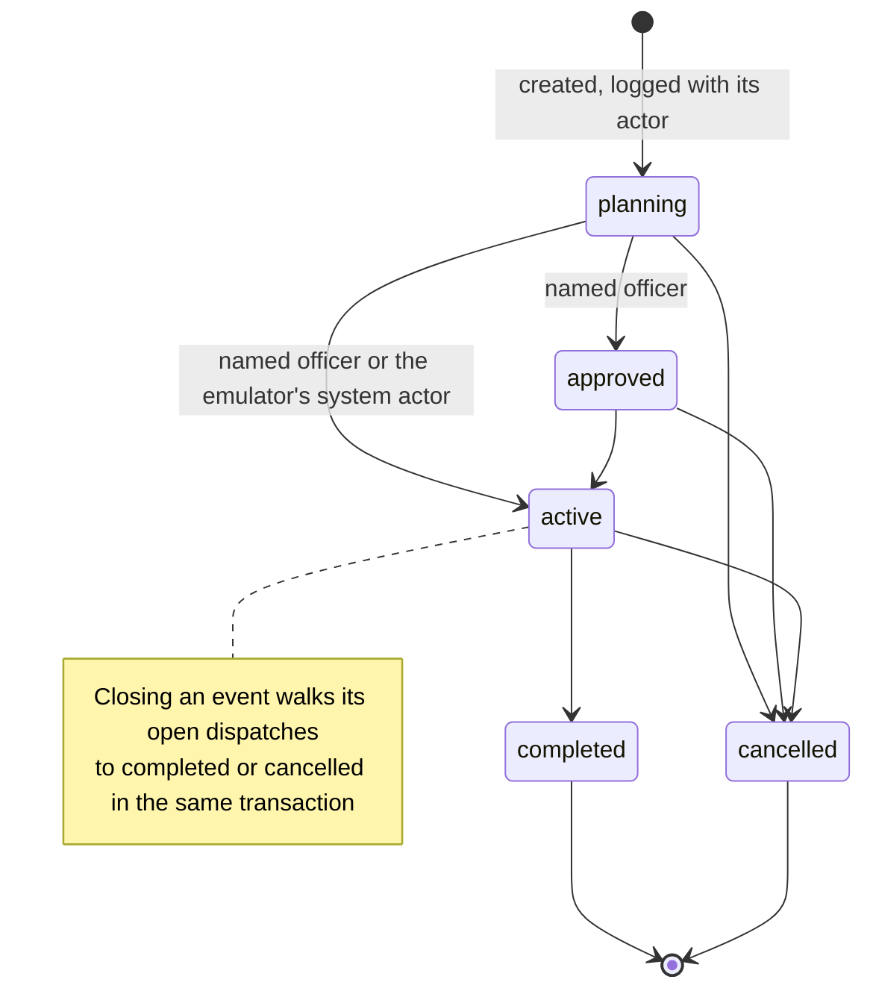

Route updates (`POST /api/v1/events/{id}/routes`) are allowed only while the event is planning, approved or active:
the new spine becomes primary and the old one is superseded, never deleted.

### 7.2 Recommendation lifecycles

The platform has two kinds of recommendation with different lifecycles.

**Enforcement recommendations** (`events.enforcement_recommendations`, `enforcement/__init__.py`): born pending by a
deterministic rule; decided once by a named officer; never expire.

```mermaid
stateDiagram-v2
    [*] --> pending : a deterministic rule fires on a sighting
    pending --> approved : named officer approves
    pending --> rejected : named officer rejects
    pending --> pending : approve refused 409 for a penal rule on a stolen vehicle
    approved --> [*]
    rejected --> [*]
    note right of approved
        An approved R_STOLEN_SIGHTING may authorise
        exactly one pursuit. Decisions are final.
    end note
```

**Decision-support proposals** (`decision.decision_support`, `decision_support/store.py`): the PENDING → APPROVED /
REJECTED / EXPIRED shape, with deferral and supersession.

```mermaid
stateDiagram-v2
    [*] --> proposed : generate, compute only
    proposed --> approved : named officer approves a course of action
    proposed --> rejected : named officer rejects
    proposed --> deferred : named officer defers
    proposed --> superseded : a new proposal for the same subject
    proposed --> expired : horizon_min elapsed, applied on read or decision
    approved --> [*] : dispatch requests created, each decided on its own
    rejected --> [*]
    deferred --> [*]
    superseded --> [*]
    expired --> [*]
```

A decision without a named officer answers 409 `officer-required` before any lookup. Every decision appends one
row to `decision.dss_decision_log` in the decision's own transaction.

### 7.3 Dispatch lifecycle

Source: `units/router.py` `DISPATCH_TRANSITIONS`; every transition is one `corridor.dispatch_events` row.

```mermaid
stateDiagram-v2
    [*] --> requested : officer, decision support or the 108 driver
    requested --> approved : named duty officer approves
    requested --> deferred : named duty officer defers
    requested --> cancelled
    approved --> en_route
    approved --> cancelled
    en_route --> on_scene
    en_route --> cancelled
    on_scene --> completed
    on_scene --> cancelled
    deferred --> [*] : terminal, re-request with a new dispatch
    completed --> [*]
    cancelled --> [*]
```

When the event closes, an on-scene dispatch completes (if the event completed) and every other open dispatch is
cancelled, with the actor `system:event_closed`. There is no agency CAD or radio link: the unit that moves on the
map is an emulated projection of the record.

### 7.4 Escort proposal

Source: `workflows/live_escort.py` (`PLAN_CHANGING_ACTIONS`, the approval book, `APPROVAL_CLOSED`).

```mermaid
stateDiagram-v2
    [*] --> pending : plan-changing answer - hold, Plan B or emergency re-route
    pending --> approved : named officer approves before expires_at
    pending --> rejected : named officer rejects
    pending --> expired : no answer in the timeout, or the escort ended
    pending --> superseded : a newer proposal is raised
    state after_approval <<choice>>
    approved --> after_approval
    after_approval --> [*] : before the branch point, switch and closures applied
    after_approval --> pending : past the branch point, re-proposed
    rejected --> [*] : plan unchanged
    expired --> [*] : current plan held
    superseded --> [*]
```

There is at most one open proposal per escort. A decided, expired or superseded proposal is never decided again
(409). The escort run itself has its own status: `idle`, `waiting_for_gps`, `running`, then `completed`, `stopped`
or `failed`; a missing or stale fix is `waiting_for_gps` and fails the escort after `VVIP_ESCORT_GPS_TIMEOUT_SEC`
(300 s by default), and a missing fix never completes it.

### 7.5 Situation band with hysteresis (per subject)

Source: `adaptive/situation.py` and `adaptive/hysteresis.py`. The classifier scores security tier, traffic regime,
weather, crowd density and the anomaly and event flags into 0–21: **GREEN 0–4, AMBER 5–9, RED 10–14, BLACK 15–21**.
It is monotone (worsening any input never softens the band) and a Z+ movement is never below AMBER. The hysteresis
controller then turns the noisy observed band into a stable effective band.

```mermaid
stateDiagram-v2
    direction LR
    state first_reading <<choice>>
    [*] --> first_reading
    first_reading --> GREEN : first observation
    first_reading --> AMBER : first observation
    first_reading --> RED : first observation
    first_reading --> BLACK : first observation
    GREEN --> AMBER : 2 consecutive readings above GREEN
    AMBER --> RED : 2 consecutive readings above AMBER
    GREEN --> RED : 2 consecutive readings at RED or worse
    GREEN --> BLACK : one BLACK reading, immediate
    AMBER --> BLACK : one BLACK reading, immediate
    RED --> BLACK : one BLACK reading, immediate
    BLACK --> RED : 4 readings below and 120 s dwell
    RED --> AMBER : 4 readings below and 120 s dwell
    AMBER --> GREEN : 4 readings below and 120 s dwell
```

Rules (`HysteresisConfig`: `up_confirm = 2`, `down_confirm = 4`, `min_dwell_sec = 120`, `black_immediate`): an
up-streak moves to the **lowest** band seen in the streak; a down-streak, once 120 s have passed since the last
transition, moves to the **highest** band seen in it (so a recovery that alternates AMBER and GREEN after RED
settles on AMBER rather than latching RED). A reading at the current band ends both streaks. The engine publishes
`situation:changed` on every effective transition.

### 7.6 City band

The city band is the most severe effective band across active subjects (no subjects: GREEN, the city at rest). It
drives the city signal-plan table.

```mermaid
stateDiagram-v2
    state "Known: most severe band of the active subjects" as Known
    state "Stale: unknown, not at rest" as Stale
    [*] --> Known
    Known --> Stale : engine polls failing, or a tick abandoned after 30 s
    Stale --> Known : the next successful poll
    note right of Stale
        A signal-plan apply without an explicit band is refused 409,
        city band unknown - pass band explicitly
    end note
```

Band → signal plan (`signals/plans.py`): GREEN writes nothing; AMBER moves 6 % of the cycle to the priority phase
(cross-street green floor 18 s), RED 12 % (14 s), BLACK 18 % (10 s). Cycle lengths and offsets never change, and no
cross phase drops below its floor.

---

## 8. Security and privacy design

### 8.1 Trust boundaries

```mermaid
flowchart LR
    subgraph Z0["Zone 0 - Internet, untrusted"]
        src["OSINT sources"]
        tiles["Imagery providers<br/>OSM, Cesium ion, Google, Bing"]
    end
    subgraph Z1["Zone 1 - venue LAN, untrusted clients"]
        anon["Anonymous browser<br/>/citizen, /driver"]
        opb["Operator browser<br/>signed session cookie"]
    end
    subgraph Z2["Zone 2 - deck edge, 0.0.0.0:5273"]
        edge["operator gate, CSP and headers,<br/>public projection, loopback proxy"]
    end
    subgraph Z3["Zone 3 - loopback services, trusted callers only"]
        svc["oracle, brain, emulator, osint-ingress"]
        models["model hosts 8083-8085"]
        stores["PostGIS, Valkey, NATS"]
    end
    subgraph Z4["Zone 4 - host secrets"]
        envf["veer.env, mode 600<br/>PIN, session secret, ion token, DB password"]
    end
    anon -->|"TB1 - public pages, ambulance POST only"| edge
    opb -->|"TB1 - PIN sign-in, HttpOnly SameSite=Strict cookie"| edge
    edge -->|"TB2 - loopback proxy, officer from the session"| svc
    svc --> models
    svc --> stores
    svc -->|"TB3 - egress allow-list, HTTPS only"| src
    opb -.->|"TB4 - browser imagery, token only after sign-in"| tiles
    anon -.->|"TB4 - keyless OSM tiles only"| tiles
    envf -.->|"TB5 - read at run time"| edge
    envf -.-> svc
```

| Boundary | Threat | Control |
|---|---|---|
| TB1 browser → deck | Anonymous access to operator data; PIN guessing; forged identity; script injection | Default-deny gate on every proxied path; throttled constant-time PIN check; HttpOnly, SameSite=Strict signed cookie; nonce CSP; officer identity never taken from the client |
| TB2 deck → services | Open relay; identity spoofing; forged machine ingest | Host pinned to 127.0.0.1; authority-override paths refused; `x-veer-officer` stripped from clients and set from the session; services honour it only on a loopback connection, exactly once; writes to the OSINT ingest path refused at the deck |
| TB3 OSINT → internet | Data exfiltration, SSRF, hostile bodies, scraping against a site's wishes | Exact-host allow-list checked twice per request, redirects checked hop by hop, `trust_env=False`, bounded decompression, robots.txt for official pages |
| TB3' OSINT ingest → oracle | A caller labelling a signal "official", PII leaking into storage | Labels, tier and credibility prior re-derived from the source; PII patterns re-checked; person keys refused |
| TB4 browser → imagery | Imagery quota handed to anyone on the LAN | `GET /gods-eye/mode` gives the ion token only to a valid operator session (`no-store`, `vary: cookie`); public pages never receive it and their CSP does not admit the operator tile hosts |
| TB5 secrets | Secrets in git, argv, shell history or logs | Mode-600 host file, `--set KEY -` reads stdin, a release secret scan, never printed |

### 8.2 Operator gate and sessions

Source: `src/lib/shell/operator-session.server.ts`, `src/routes/api/session/+server.ts`.

- **Opt-in, on in deployment.** The gate is on whenever `VEER_OPERATOR_PIN` is non-empty. `veer_up.sh --status`
  reports a LAN-exposed deck with the gate off as DEGRADED.
- **Sign-in.** `POST /api/session {officer, pin}`; the officer name is normalised (2–64 characters; control
  characters, bidirectional overrides and isolates, LRM and RLM refused; ZWJ and ZWNJ allowed for Indic names); the
  PIN is compared in constant time (SHA-256 digests compared with `timingSafeEqual`). Failures are throttled at
  8 per 5 minutes per client (429). Answers: 200, 401 wrong name or PIN, 429 throttled, 409 gate off.
- **Session.** Cookie `veer_operator` = base64url payload `{o, exp, jti}` + `.` + base64url HMAC-SHA256, signed with
  `VEER_SESSION_SECRET` (or 32 random bytes per process when unset, so sessions end at a restart), 12-hour
  lifetime, HttpOnly, SameSite=Strict, `Secure` only when `VEER_SESSION_SECURE=1` (behind TLS).
- **Sign-out.** `DELETE /api/session` revokes the token id on the server (a copied cookie stops working too). The
  revocation set lives in the deck process; rotating `VEER_SESSION_SECRET` ends every session at once.
- **Default deny.** Without a valid session every request under `/api/v1`, `/api/traffic`, `/api/convoy` and
  `/api/emulator` is refused (403) on its canonical, once-decoded path. The allow-list for anonymous callers is
  exactly: the road geometry `GET /api/v1/spatial/segments`, two liveness probes (`/api/convoy/health`,
  `/api/emulator/health`), and the 108 request `POST /api/v1/events/{uuid}/dispatch` with agency `ambulance`, capped
  at 6 per client per 10 minutes. An allow-list, not a deny-list, so a new operator route is gated the day it ships.
- **Canonical paths.** The gate decodes the path once (as uvicorn does) and refuses malformed escapes, double
  encoding, backslashes, control characters and dot segments.

### 8.3 Officer attribution

The deck forwards the signed-in officer as `x-veer-officer` on every proxied call and strips any client copy. The
oracle (`units/router.py` `authenticated_officer`) and the brain honour it **only on a loopback connection**; a
repeated or malformed header is a 422, never silently replaced by the body's officer. A differing `officer` in the
body is kept as `claimed_officer` for the audit. It is the actor of every lifecycle transition, recommendation
decision, dispatch, earmark, route update, escort approval, decision-support decision and OSINT promotion.

`VVIP_REQUIRE_OFFICER` (1 in deployment) additionally makes earmark create and clear and signal-plan apply and
restore (oracle), and escort start, stop and clear (brain), refuse an unnamed call with 422. Decisions on
recommendations, dispatches, decision support, promotions and full-mark lookups need an officer regardless. An
unattended script's decisions carry the script's own label (for example "Scripted demo officer (showcase
script)"), never a person's name.

### 8.4 Content-security policy and response headers

Every response gets `x-content-type-options: nosniff`, `referrer-policy: strict-origin-when-cross-origin`,
`x-frame-options: DENY` and `permissions-policy: geolocation=(), camera=(), microphone=(), payment=()`. Every HTML
page gets a CSP with a per-response nonce (every SvelteKit inline script is stamped with it; no
`'unsafe-inline'` for scripts) and `frame-ancestors 'none'`.

| Directive | Public pages (`(public)`) | Operator pages (`(deck)`, `(v3)`) |
|---|---|---|
| `script-src` | `'self'`, nonce, `'wasm-unsafe-eval'` | adds `'unsafe-eval'` (the Cesium build's knockout) and `blob:` (Cesium task workers) |
| `img-src`, `connect-src` | `'self'`, OSM tiles, `https://*.cesium.com`, `https://*.virtualearth.net` (`img-src` also `data:` and `blob:`) | adds `https://tile.googleapis.com` (photoreal 3D tiles) and `http://*.virtualearth.net` (Bing tiles requested in the page's scheme) |
| `worker-src`, `child-src` | `'self' blob:` | same |
| `object-src`, `base-uri`, `form-action` | `'none'`, `'self'`, `'self'` | same |

The policy is chosen from the resolved route id, so `/` (route node `/(v3)/home`) and `/analyst` (node `/(deck)`)
carry the operator policy whatever URL was typed, and the public shell links no operator route, so a citizen never
client-navigates into the canvas under the strict policy.

### 8.5 Network exposure, the loopback proxy and outbound calls

- Every service except the deck binds loopback. The deck reaches them only through its proxy, whose host is
  hard-coded and whose authority is re-checked per request.
- The brain's outbound policy (`http_guard.py`): platform endpoints (model hosts, oracle) must be plain http(s) on
  loopback or `host.docker.internal`; any URL from external input would have to pass `validate_external_url`
  (rejecting loopback, private, reserved, link-local and multicast addresses), and the stack fetches no such URL
  today. The emulator and the embedding service apply the same fixed-endpoint rule.
- model-host makes no outbound call. osint-ingress reaches only its allow-list and its loopback oracle (a
  non-loopback oracle URL is refused; unset, it posts to the discard port).
- The OSINT machine-ingest path `POST /api/v1/osint/signals` is refused at the deck for every caller in every
  spelling: only osint-ingress, on loopback, may post to it.

### 8.6 Vehicles only, plate masking, lawful basis and retention

- **Vehicles only.** No face, person, image or biometric field on any path. Camera sites store location and
  identity only; sightings are a plate plus kinematics; agencies dispatch units, not people.
- **Plate masking.** Every surface shows a mark like `GJ27EM•••1` until a named officer is signed in. The oracle
  masks every entity label and feed text it sends; raw plates ride only in data fields that the deck serves to a
  signed-in officer; the deck masks every plate it renders unless an officer is named. CSV exports, share links,
  saved views and watches are always masked.
- **One lawful-read rule.** A single camera read is shown only when its vehicle holds an active earmark or the read
  is evidence for a recommendation (`city/common.py` `SQL_LAWFUL_READ`, used by every sighting surface); anything
  else is a count-free 404.
- **Lawful basis.** An earmark's `lawful_basis` is NOT NULL in the schema and must be one of the oracle's codes:
  `mva_1988_s177`, `mva_1988_s183`, `mva_1988_s207`, `bnss_2023_s94`, `stolen_vehicle_fir`.
- **Retention.** `retention_days` is capped at 90 by a schema CHECK and `retention_until` must follow
  `earmarked_at`. Reads of a vehicle with no active earmark are kept 30 days and purged in the read path (health at
  `GET /api/v1/vehicles/retention`); reads of an earmarked vehicle are kept for the longer of 30 days and the
  earmark's retention.
- **Full-mark lookup.** `GET /api/v1/vehicles/lookup?plate=` answers only a named officer (409 before the plate is
  parsed otherwise) and writes one audit row with the **masked** mark; the raw mark is never stored or logged, and
  the access log masks the query value.
- **Protected movements.** Identities and destinations are never logged; the route stays off the public feed until
  inside the 2-hour horizon.

### 8.7 OSINT redaction and the ingest trust boundary

- Names and ages are replaced at parse (`[PERSON]`, `[AGE]`, `[CONTACT]`, `[URL]`); a Gujarati or Devanagari word
  that is neither a known place nor an ordinary word is withheld as `[WITHHELD]`. There is no named-entity model, so
  the honest measure is held-out recall on a corpus written blind: Latin-script names 0.882, Indic-script names 1.0,
  age markers 0.895, ordinary words kept 0.987. A cue-less name or an all-caps headline can survive; the oracle's
  ingest guard refuses any signal on which the shared patterns still fire.
- News and social URLs are never stored, logged or shown (the outlet's domain and a hash only). Poster blocks,
  GDELT actor columns and court-record portals are never read. A leftover poster handle is stripped before storage.
- The oracle never trusts a payload's tier, label, credibility prior, licence or redistributability: they are
  re-derived from the source, and the only exception lowers trust (a signal that says EMULATED or SIMULATED keeps
  that label).
- A situation becomes a corridor event only when a named officer promotes it.

### 8.8 Secrets handling

- Secrets (`VEER_OPERATOR_PIN`, `VEER_SESSION_SECRET`, `VEER_CESIUM_ION_TOKEN`, a non-default `POSTGIS_PASSWORD`)
  live only in `~/.config/veer/veer.env`, mode 600, outside the repository. `scripts/veer_env.sh --set KEY -` reads
  the value from standard input (silently from a terminal), so it never appears in argv or shell history; the
  helper prints only "KEY set" for secret-looking keys.
- The compose files interpolate secrets from the environment; no file in the repository contains one.
  `veer_models.yaml` carries no credential; database credentials are environment-only.
- Gated tools sign in through one helper (`scripts/deck_session.sh`, `scripts/lib/deck_session.mjs`) that reads the
  PIN at run time and sends it once on standard input.
- `scripts/secret_scan.sh` scans the tree, the staged diff and the commits a push would send for the literal values
  of those secrets and for credential patterns, before any release.
- The full variable reference is [`docs/ENVIRONMENT.md`](docs/ENVIRONMENT.md).

### 8.9 Container hardening

Every image the deployment builds runs as a non-root user (uids 10001–10006, one per service), with digest-pinned
Python and Bun bases and a frozen lockfile for the deck. osint-ingress additionally runs with a read-only root
filesystem, a `/tmp` tmpfs, every capability dropped, `no-new-privileges` and rotated logs.

---

## 9. Reliability and degradation

### 9.1 Principles

1. **Authority fails closed.** Anything that would change the city — a penalty, a pursuit, a dispatch, a signal
   write, a route switch, a non-baseline parameter — refuses, holds or falls back to baseline when a precondition is
   missing.
2. **Aids fail open, and say so.** Caches, latches and optional model rungs step aside when their inputs are
   missing; the next rung answers, and the drop is labelled and audited.
3. **Unknown is not calm.** A stale band is "unknown", not GREEN; a feed that stops is named with the time it
   stopped; a module that cannot load answers 503 "not deployed".

### 9.2 Fail-closed behaviours

| Condition | Behaviour | Where |
|---|---|---|
| No named officer on a decision | 409 `officer-required` or 422 | oracle, brain |
| Approve a penal rule on a stolen vehicle | 409, nothing written | `enforcement/` |
| Pursuit from an e-challan of a stolen vehicle, or from a spent approval | 422 | `events/` pursuit validator |
| Escort proposal unanswered | Expires; current plan held | brain `live_escort` |
| Convoy past the branch point at approval time | Re-proposed, never improvised | brain |
| Signal plan while the twin is not field-calibrated | Refused: "twin not calibrated: no field observations — simulated feed only" | `signals/`, `simulation/calibration.py` |
| Signal apply while the city band is unknown | 409 `city band unknown — pass band explicitly` | `signals/router.py` |
| Signal writer flag off | Writer refuses every write | `signals/writer.py` |
| Adaptive deviation does not beat baseline on the twin | Baseline parameters published | `adaptive/shadow.py` |
| Brain cannot read adaptive parameters | Protocol baseline used | brain `adaptive_params.py` |
| `live_anpr` read without `VVIP_ACCEPT_LIVE_ANPR=1` | Refused | `vehicles/sighting_processor.py` |
| ANPR read more than 30 s in the future | 409 | `vehicles/` |
| OSINT signal with surviving PII | Refused `pii_unredacted`, never stored | `osint/ingest.py` |
| OSINT libraries missing in the image | 503 "osint pipeline not deployed", nothing stored | `osint/` |
| Public dispatch status for an unreadable event | 503; absent or OSINT-sourced event reads not-found | deck public projection |
| Emulator replay off the current network | 422 `route_not_on_current_network` | emulator |
| Living city without public emulated labelling | `veer_up.sh --demo` refuses | bring-up |
| Deck upstream unreachable | 502 naming the upstream | deck proxy |

### 9.3 The degradation ledger

`GET /api/v1/ops/degradation-taxonomy` (oracle `ops/`) scans the brain's `convoy:context:*` keys and groups every
degraded or failed decision in each `decisions_log` into a recurring-cause taxonomy: `checkpoint_fallback:<tier>`,
`checkpoint_rate_limited`, `novelty_latch:novel`, `tier0:<miss status>`, `alert:<type>` and
`orchestrator:<action>`. It fabricates nothing: an empty log yields an honest empty taxonomy, every entry carries a
`sample_ref` naming one real audit row, and corrupt contexts are counted. The situation wall shows it (10 s poll),
with a click-through to the full audit entry.

### 9.4 AMA floors and twin shadow evaluation

- **Protocol floors** (generated from `shared/schemas/protocol_params.json` into both Python services, drift-checked
  by `scripts/export_protocol_params.py --check`): advance closure Z+ 180 s, Z 120 s, Y 60 s, X none (exactly 0);
  lane floors Z+ 6, Z 4, Y 2, X 1. The adaptive layer may raise a closure window per situation but never below the
  floor, and a Z+ movement is never below AMBER.
- **Baseline scoring weights** (time 0.3, disruption 0.4, security 0.2, complexity 0.1) are the fail-closed default;
  any per-movement reweighting stays inside protocol floors.
- **Shadow evaluation.** Any deviation from baseline must beat baseline in a paired twin run, or the engine
  publishes baseline. Each published change writes one `adaptive.param_overrides` row with its reason
  (`first_publish`, `class_change`, `param_change`, `verdict_change`, `escalation_change`, `degradation_change`).
- **Same-provenance inputs.** A live event's band reads only the live plane; emulated traffic can never drive a real
  event's band. The audit row records `inputs_origin` and `simulated_feed`.

### 9.5 When the models are down

| Failure | What happens | Shown as |
|---|---|---|
| Decider p95 above 3,000 ms or unreachable (polled every 15 s; a probe decide must beat the line before any degrade decision) | Brain drops to tactical-only; operator alert; audited | "Tactical only" |
| Decider loading (cold start about 5 min) | 503 from model-host; brain answers through the tactical tier | "Tactical only" |
| Gemma unavailable or over budget | Deterministic heuristics: keyword tool selection, default arguments, degraded final answer | "Rules only" |
| Embedding service down | Novelty latch disabled (without benching the decider); tier-0 cache fails open to a real decider call | audited row |
| Confidence below 0.45 | Gemma draft plus operator alert, not an action | proposal or draft |
| Confident but novel | Answer withheld (`novelty_latched`), audited, operator alert | alert |
| A grounding check fails | The call is refused or the sentence removed; the answer says how many and why | `ungrounded_claims_removed` alert |
| Forecast input out of support | Heuristic rung with the drift reason; the foundation rung needs at least 12 warm-up samples | `provenance.rung` |
| Any tier slow inside a live escort | No tier failure stops a convoy; the GPS loop has no AI call | escort status |

### 9.6 When the feeds are down

- **Traffic feed.** `traffic:latest:*` keys expire after 300 s; the engine skips missing inputs and evicts a subject
  after 300 s of missing inputs. The full-system smoke has a negative control: with signal-ingress stopped past the
  TTL, the data-plane legs fail while everything else stays green.
- **Database stops answering.** A tick that hangs is abandoned after 30 s; the city band turns stale (unknown).
- **NATS down.** The ingest service reports it in `/health`; containers are not restarted for upstream conditions
  (healthchecks are connectivity-only); `veer_up.sh --status` shows the row DEGRADED.
- **Internet down.** The decision path is unaffected. OSINT readiness never depends on the internet (READY with
  "offline cache only" in the detail); `OSINT_MODE=offline` parses cached captures labelled `cached-sample`. Map
  imagery falls back to Veer's own roads and entities with the `OSM · DARK · FALLBACK` chip and the reason; 3D tiles
  retry on transient failures (5, 20, 65, 130 s) and stop at once on a refusal.
- **Satellite thumbnails.** At most 6 tiles per card, 4 in flight, a 192-tile shared cache and 800 requests per
  browser-tab session; the first 401, 403 or 429 stands satellite down for the session and the thumbnails fall back
  to the night map silently.

### 9.7 Boot and recovery

Model units restart on exit (`Restart=always`); a missing file exits 78 and is reported once. `veer-up.service`
retries a failed step but not "not converged" or a preflight refusal. A bring-up interrupted between the network
step and the restart of the network readers leaves a marker so the next bring-up restarts them. Recorded
end-to-end: **READY 11/11 in 4 min 25 s after a real reboot (2026-10-23)**, repeated in 4 min 27 s.

---

## 10. AI design

### 10.1 Tiers

All models run locally on the Veer server. No cloud model and no internet connection sit in the decision path.

| Tier | Component | Role |
|---|---|---|
| T5 strategic | `pplx-decider-v1-27b`, BF16, model-host `:8083` | Strategy and tool selection, asked typed questions; every answer is a distribution with a confidence |
| T4 tactical | Gemma 4 12B Q4_K_M (shown as `gemma4-12b-veer`), llama-server `:8084` | Drafts tool arguments against each tool's schema (one repair round), composes answers; four agents (traffic analyst, route planner, security liaison, diversion coordinator) |
| T3 numeric | Forecast ladder (support gate, t0-alpha, DSTGAT, heuristic), ETA, OR-Tools, pgRouting | The deterministic tools the decider chooses among |
| T2 adaptive | The situation engine ([§7.5](#75-situation-band-with-hysteresis-per-subject)) | Bands and protocol-floored parameters |
| T1 memory | `pplx-embed-v2-late-0.6b` + `bge-m3`, embedding-service `:8085` | Similar past situations for the novelty latch and the tier-0 cache |

### 10.2 A decider checkpoint or chat turn

```mermaid
flowchart TD
    T["trigger<br/>pre_movement, incident_detected, congestion crossing,<br/>situation_changed, phase_transition, operator_chat"] --> CAD{"at least 5 s since this movement's last checkpoint?"}
    CAD -->|"no, unless the trigger may force"| WAIT["wait or rate-limit, audited"]
    CAD -->|yes| T0{"tier-0 cache hit?<br/>eligible trigger, similarity at least 0.75, entry under 300 s"}
    T0 -->|yes| CACHED["cached answer, zero 27B calls"]
    T0 -->|no| DEC["decider: typed choice over the tool menu, plus a confidence score"]
    DEC --> NOV{"confident but novel?<br/>no comparable in memory"}
    NOV -->|yes| LATCH["withheld as novelty_latched, audited, operator alert,<br/>falls through to the tactical tier"]
    NOV -->|no| CF{"confidence at least 0.45?"}
    CF -->|no| DRAFT["Gemma draft plus operator alert"]
    CF -->|yes| ARGS["Gemma drafts the tool arguments<br/>json_schema envelope, one repair round"]
    LATCH --> ARGS
    DRAFT --> ARGS
    ARGS --> PROV{"argument provenance check"}
    PROV -->|fails| REF["call refused, refusal shown"]
    PROV -->|passes| EXE["MCP executor<br/>GET reads, allow-listed compute POSTs only"]
    EXE --> ORC["oracle computes"]
    ORC --> MORE{"another tool?<br/>at most 6 rounds inside a 120 s budget"}
    MORE -->|yes| DEC
    MORE -->|no| FIN["Gemma composes the answer"]
    FIN --> SENT["sentence check against the tool results"]
    SENT --> OUT{"would it change a plan?"}
    OUT -->|yes| PROP["PENDING proposal for a named officer"]
    OUT -->|no| SAY["answer with citations, removed sentences counted"]
```

The diagram merges the checkpoint path (`decider.py`) and the chat turn (`orchestrator.py`) for readability; both
fall through decider → Gemma → heuristics when a tier is slow or unavailable, and every drop is written to the
movement's `decisions_log` with the decider's `{value, probability, confidence}` when it ran.

### 10.3 Typed questions

The decider is never asked to chat. It answers `choice` (pick one of at most 249 single-token codes), `noul` (a
probability that a statement is true) and `score` (an expected level on a described scale), at most six per request,
all in one forward pass. Its temperature and readout alphabet are fixed in the snapshot's configuration and never
overridden. State documents are budgeted: at most 1,500 tokens for pre-movement, 400 per event, 8,192 hard (413
beyond, never truncated). The decider is **never called per GPS tick**; checkpoints fire only on the six triggers
above, at least 5 s apart per movement (phase transitions and pre-movement planning may force past the limit).

### 10.4 Tool calling and the read-only rail

The brain exposes 29 tools over MCP: twelve compute and read tools (forecast, routes, diversions, scenarios, ETA,
shortest and k-shortest paths, segments, live traffic, historical patterns, the twin), ten read-only city tools
(events, entities, dossiers, the feed, signal state, units, dispatches, the interception plan, the situation log,
recommendations), six canvas verbs (fly to, track, highlight, annotate, sensor, layer) that call no HTTP and return
a directive the operator applies or dismisses, and `city_decision_support`, which computes or reuses ranked courses
of action and never decides.

Gemma drafts arguments inside a `json_schema` response envelope that embeds the tool's `inputSchema`; llama-server
compiles it to a grammar, so generation stops at the closing brace (a runaway generation is structurally
impossible). Per-call output budgets are 48, 192 and 512 tokens (selection, arguments, final answer); results are
truncated at 4,096 bytes.

The executor may POST only to `/api/v1/predict/flow`, `/predict/eta`, `/optimize/routes`, `/optimize/diversions`,
`/evaluate/scenarios`, `/traffic/live`, `/simulate/twin`, and the decision-support `/generate` for a well-formed
event URN — never to a decision or promotion route. No tool name may contain approve, decide, earmark,
dispatch_request, withdraw or transition; a test pins the rule.

### 10.5 Grounding validator

`convoy_brain/grounding.py` makes "state only what the tools returned" a rule the code applies:

1. **Argument provenance.** A drafted road-segment id must come from the operator's message, the session context or
   an earlier tool result. `predict_eta` needs a tool-reported route length and speed; softer inputs are labelled
   ASSUMED INPUTS. A failing call is refused and the refusal is shown.
2. **Road names** are resolved against the network; a name the network does not carry is answered "no road segment
   named X", never with another road's data.
3. **Every sentence** of the answer is checked against the turn's tool results, the session context and the
   operator's words. A sentence naming an unreported road or place, an unreported figure with a unit, a clock time
   or a segment id, a vehicle position the lookups did not find, or a unit ETA while no unit is fielded is removed;
   the answer says so (`done.grounding.removed`) and the operator is alerted. When every lookup about a subject came
   back empty, the answer is the deterministic "not in the city picture". A position quoted for a "right now"
   question carries the sighting's age.

### 10.6 Confidence, novelty and the tier-0 cache

- **Confidence floor 0.45** (`VVIP_CONFIDENCE_FLOOR`), calibrated on 2026-10-19 against the live decider, whose
  pre-movement checkpoint confidences measured 0.50 and 0.47. Below it, the answer becomes a Gemma draft plus an
  operator alert.
- **Novelty latch.** A confident answer with no comparable situation in memory above the similarity floor is
  withheld and audited. An unreachable memory disables the latch without benching the decider.
- **Tier-0 cache.** A routine checkpoint (eligible triggers only; operator chat never qualifies) whose best
  comparable clears a similarity of 0.75 is answered from a cache of at most 128 entries, each fresh for 300 s,
  isolated per movement. Pre-movement route options are labelled by a digest of their own ordered segments, so a
  cached answer always selects the same physical route. `DECIDER_TIER0_DISABLE=1` turns it off.
- **Logging.** Every answer and fallback, with its distribution and confidence, is appended to the movement's
  `decisions_log`; the degradation ledger mines it ([§9.3](#93-the-degradation-ledger)).

### 10.7 Why the AI never acts alone

- The AI's tool rail is read-only plus compute; nothing reachable through it approves, decides, dispatches,
  earmarks, promotes or transitions.
- Everything that would change a plan becomes a PENDING proposal that only a named officer can decide, on Decide or
  in the Analyst workspace and situation wall — never on the map, in the assistant, on object pages or on public
  pages.
- An unanswered escort proposal expires and the current plan holds; it never auto-applies.
- Canvas moves are suggestions the operator applies or dismisses, and the answer is audited.
- The model-written security dossiers, threat levels and compliance verdicts were retired (410). The recorded threat
  level defaults to `not_assessed` and recording protocol state needs a named officer.
- Decision support's numbers say what they are: the public-safety criterion is a fixed prior by the option's
  actions, not a simulated outcome; speed of effect is a nominal time per option kind, not a unit ETA.

### 10.8 Model memory budget

Target hardware: an NVIDIA GB10-class edge server with a 121.6 GiB unified-memory pool (`/proc/meminfo`, the source
of truth on this hardware).

| Resident process | Weights | Planned budget | Measured |
|---|---|---|---|
| model-host: decider 27B BF16 | 48.58 GiB | 55 GiB | `cuda_reserved` 48.99 GiB; warm decide 460–477 ms at a 138-token state (2026-10-12) |
| llama-server: Gemma 4 12B Q4_K_M, 2 × 8,192 context | 6.87 GiB | 9.5 GiB | peak 7.25 GiB after the first completion |
| embedding-service, both encoders | 2.17 GiB | 5.0 GiB | co-resident; cold start about 36 s |
| oracle forecaster | — | 0.4 GiB | the t0-alpha rung is over this (probe high-water 1,536 MiB, 2026-10-18); a whole oracle with it loaded used about 1.6 GiB of its 3.5 GiB |
| Platform services (PostGIS, Valkey, NATS, oracle, brain, development) | — | about 12 GiB | — |
| **Total planned** | | **about 82 GiB, about 40 GiB headroom** | resident model stack **62.73 GiB** (bench of 2026-10-13) |

Nothing is ever evicted: each model host is resident for the life of its process and supervised by its unit.
Serialisation is compute-only (one decider forward pass at a time with a queue of 8; two llama slots; an embedder
batch lock).

---

## 11. Performance

### 11.1 Route budgets (deck first-load JavaScript)

Ceilings in gzip bytes from `services/command-deck/tests/route-budget.json`, set on 2026-10-26 and 2026-10-27 from
the measured size plus about 10 KB of headroom, and enforced by `tests/route-budget.unit.mjs` (static graph) and
`tests/route-coldload.mjs` (cold load in English and in Hindi or Gujarati).

| Route | Static | Cold load EN | Cold load HI / GU |
|---|---|---|---|
| `/` and `/home` (Home) | 312,320 | 321,536 | 385,024 |
| `/decide` | 310,784 | 335,360 | 397,312 |
| `/o/[urn]` | 324,096 | 344,064 | 407,040 |
| `/map` | 397,312 | 397,312 | 460,800 |
| `/plan` | 297,472 | 310,272 | 372,736 |
| `/assistant` | 307,712 | 315,904 | 379,392 |
| `/comms` | 305,664 | 349,696 | 415,232 |
| `/analyst` | 368,640 | 404,480 | 475,136 |
| `/ops` | 440,320 | 473,088 | 540,160 |
| `/gods-eye` | 376,832 | 402,432 | 473,088 |
| `/citizen` | 175,104 | 458,240 | 490,496 |
| `/driver` | 129,536 | 129,536 | 150,016 |

These ceilings stop regressions. The redesign's original first-load budget is **not** met: the OSINT and
decision-support features and the workspace redesign add weight on the first screen; the remaining reductions are
listed in the file's note.

### 11.2 Model bench (dated)

From `scripts/bench_results.json` and `scripts/bench_adversarial_report.json`, the run of **2026-10-13**
(13:24 UTC). The bench ran against the fleet of that day (since replaced by the current stack, with the same model
hosts) and has not been re-run since; later changes (the OpenStreetMap network, the V3 interface) are not
reflected in it.

| Metric | Result |
|---|---|
| Decider throughput | 455.78 tok/s |
| Decider latency p99 | 1,106.8 ms |
| Gemma throughput | 20.09 tok/s |
| Embedding round-trip | 92.7 ms |
| Stack resident memory | 62.73 GiB of the 121.6 GiB pool |
| Adversarial scenarios | 19 / 19 passed, average 29.19 s, maximum 57.38 s per scenario |
| Tracked quality gaps (pass the gate) | tool_validity 0.684, keyword_coverage 0.561 (docs-pass run of the same day) |

### 11.3 Other dated figures

| Figure | Value | Date |
|---|---|---|
| Decider warm decide | 460–477 ms at a 138-token state, one question | 2026-10-12 |
| t0-alpha forecast, 200 segments × 32 horizons | about 494 ms per forecast | 2026-10-18 |
| Tier-0 cache hit on an identical plan | `latency_saved_ms` +1,825 | 2026-10-24 |
| Boot to READY 11/11 | 4 min 25 s | 2026-10-23 |
| Photoreal 3D canvas under software WebGL | no frame over 3 s, median 567 ms | 2026-10-24 |

### 11.4 Polling and caching design

The deck polls through its proxy because adapter-node cannot upgrade WebSockets (the proxy answers 501 at once, so
clients drop straight to their poll rung). Each surface keeps one request in flight and pauses while the tab is
hidden.

| Surface | Interval |
|---|---|
| Situation wall audit stream | 2 s |
| Escort HUD, escort store | 1.5 s, 2 s |
| City feed, canvas feed | 3 s |
| City entities (canvas) | 4 s |
| Corridor board, band | 5 s |
| Enforcement queue, dispatch, interception plan | 6 s |
| Canvas layers, watchlist | 8 s |
| Signals, degradation ledger, brain posture, corridor summary, emulator | 10 s |
| Citizen feed | 10 s |
| 108 driver dispatch status | 3 s |
| Sighting-retention health | 60 s |
| Junction registry and segment lines | 300 s |

Server-side caches: the public feed 5 s (single flight), static public facts 10 min, driver status reads 2 s;
Valkey TTLs as in [§5.7](#57-valkey-keys); the decider's tier-0 cache 300 s × 128 entries; the deck's shared
192-tile thumbnail cache.

### 11.5 Call budgets

| Call | Budget |
|---|---|
| Deck proxy → oracle | 60 s; 130 s for the twin, twin comparison and decision-support generation |
| Deck proxy → brain | 300 s |
| Brain turn | 120 s total, enforced on every model call; tool calls 30 s; at most 6 tool rounds |
| Brain → decider | 20 s per decide; health probe 3 s |
| Brain → Gemma | max(30 s, 5 s + tokens ÷ 16 tok/s) per call |
| Deck public projection → upstream | 6 s per read |

---

## 12. Testing strategy

The full description is in [`VVIP/TECHNICAL_DOCS.md`](VVIP/TECHNICAL_DOCS.md) §13 and §18.6; sample data and test
cases are in [`docs/SAMPLE_DATA_AND_TESTS.md`](docs/SAMPLE_DATA_AND_TESTS.md). In summary:

- **Per-service suites**, each run whole (a test needing an absent database or library skips itself and is counted):
  pytest for every Python service and OSINT package, `cargo test --locked` for signal-ingress.
- **Deck tests:** unit scripts (`tests/*.unit.mjs`) for the shell, every V3 screen, map style, planner, advisories,
  public pages and the root reroute; recorded-payload contract tests; design-token parity and contrast; a copy lint;
  route JavaScript ceilings; `svelte-check`.
- **Hermetic browser smokes:** every GET stubbed, every non-GET and every third-party request aborted; software-WebGL
  canvas and screen cameras that prove key elements and non-blank pixels.
- **Generators with verify modes:** the OSM network, the ingress segment table, display geometry, the OSINT
  gazetteer, protocol parameters.
- **Wave tiers:** the forecaster support hatch, the novelty latch, the foundation forecaster on its real artifact,
  P90-robust routing, the tier-0 cache, the repetition-gate self-test and the degradation ledger.
- **A docs-consistency check** that compares documented figures with the tree and the recorded artifacts.
- **Live tiers** (on demand, one operator sign-in, GET-only reads): gate behaviour, model smokes, a model-drift
  panel, the adversarial bench, operator journeys, the flagship scenario, a consistency-under-repetition gate and a
  leak check of every log for secrets.

`scripts/verify_all.sh` runs the offline ladder (no sign-in, no model call, nothing written to any stack; the deck
tiers serve the built deck on a private keyless preview). `--live` adds the live tiers.

| Recorded result | Value | Date |
|---|---|---|
| pytest tests collected across all suites | 5,119 | 2026-10-26 |
| Last whole-suite runs | traffic-oracle 2,064 passed / 104 skipped; convoy-brain 742 / 1; event-emulator 318 / 13; osint-common 444; osint-ingress 381 / 1; osint-geo 390; osint-analysis 360 | 2026-10-26 |
| signal-ingress `cargo test --locked` | 120 passed | 2026-10-24, re-run 2026-10-26 |
| Operator journeys J1–J6 on the live deck | 92 / 92 checks | 2026-10-24 |
| Live acceptance on the deployed stack | 19 of 22 steps green first time; the three failures fixed and re-run green | 2026-10-23/24 |

The V3 screens are covered by their own unit tests and hermetic smokes; the committed documentation quotes no pass
count for the merged V3 tree, so none is quoted here.

---

## 13. Design decisions

Short records in the form *decision · alternatives · why*.

**ADR-01 · One edge server, local models only.**
Alternatives: cloud inference; a hybrid with a cloud fallback.
Why: the decision path must work without internet at a control room or venue, and protected-movement data must not
leave the premises. The unified-memory pool fits a 27B decider, a 12B tactical model and the embedders resident with
about 40 GiB of headroom.

**ADR-02 · The deck is the only LAN-facing service; everything else binds loopback.**
Alternatives: an API gateway; mutual TLS between services; services on the LAN with their own auth.
Why: one choke point to harden (gate, CSP, headers, projection) and one place where identity is established. The
services keep a simple trust rule: a call on loopback came from the deck or a peer on the same box.

**ADR-03 · Officer identity travels as a header set from a verified session and trusted only on loopback.**
Alternatives: per-service sessions; signed tokens verified by every service; trusting the request body.
Why: the services need a name for the audit, not a login system. Stripping the client copy at the deck and checking
the transport at the service closes spoofing from the LAN without a key-distribution problem.

**ADR-04 · Proposals are born PENDING; no code path creates an approved row.**
Alternatives: auto-approve above a confidence; approve-by-default with an undo.
Why: authority must stay human and auditable. A missing approval leaves the city as it was, which is always safe.

**ADR-05 · An unanswered escort proposal holds the current plan.**
Alternatives: apply the proposal on timeout; stop the convoy.
Why: the approved plan is the one an officer saw and signed; switching without a human or halting a moving convoy are
both worse than continuing on the approved route.

**ADR-06 · A stolen vehicle's reads are evidence only; e-challan approval answers 409; one approval authorises one
pursuit.**
Alternatives: issue e-challans and cancel later; let any approval authorise pursuits.
Why: the registered owner of a stolen car is the victim. A spent approval must not silently authorise a second
operation.

**ADR-07 · One corridor-event model with independent axes; the kind selects templates, never code paths.**
Alternatives: a service or schema per event type.
Why: eight event classes plus enforcement share forecasting, routing, adaptation, audit and the public projection.
New kinds are data, not branches.

**ADR-08 · The emulator injects causes only, through the real APIs.**
Alternatives: a mock stack; synthetic outcomes for demos.
Why: every reported outcome is the real stack's behaviour; emulation is labelled at the row level and confined to
its own subjects and key spaces.

**ADR-09 · The decider answers typed questions; Gemma drafts arguments; grounding is enforced in code.**
Alternatives: one chat model with function calling; prompt-only grounding.
Why: typed answers carry a distribution and a confidence that can be gated and audited; schema-constrained drafting
cannot ramble; a validator that deletes unsupported sentences does not depend on the model's obedience.

**ADR-10 · A deterministic adaptation layer with hysteresis, protocol floors and twin shadow evaluation.**
Alternatives: a learned controller acting directly; no adaptation.
Why: bands must not flicker, floors are doctrine, and any deviation must be shown better than baseline before it is
published. Deterministic code is auditable.

**ADR-11 · Synthetic data in separate tables and key spaces.**
Alternatives: one table with a quality flag.
Why: calibration, training and the twin must never read simulated history by accident; separation makes that
structural rather than a filter that can be forgotten.

**ADR-12 · Migrations 001–006 immutable, 007 onward idempotent and additive; schema only from `migrate.py`; fixed
bring-up order.**
Alternatives: a migration framework with down-migrations; schema applied by the database image.
Why: re-runnable, ledgered schema changes that never touch data, applied before any service starts, so no service
runs against an older schema.

**ADR-13 · A content-security policy per document, chosen by the resolved route id.**
Alternatives: one policy for the whole site; per-URL rules.
Why: the canvas needs eval and blob workers that public pages must not have; a client-side navigation keeps its
document, so the policy must fit the whole operator console; route ids survive the root reroute where URLs do not.

**ADR-14 · Public pages read a server-side projection, never an operator feed.**
Alternatives: anonymous access to filtered operator endpoints.
Why: filters on raw feeds fail open; a projection built by the deck exposes only the advisory fields and can enforce
the OSINT firewall, the 2-hour horizon and the emulated labelling in one place.

**ADR-15 · OSINT is about places; redaction at parse; trust re-derived at the oracle.**
Alternatives: store raw items and redact on display; trust the connector's labels.
Why: personal data never reaches storage, and a compromised or buggy connector cannot mint an "official, verified"
situation.

**ADR-16 · Polling instead of WebSockets.**
Alternatives: a WebSocket or SSE gateway.
Why: adapter-node cannot upgrade; bounded polls through the same gated proxy keep one security path; the 2 s audit
rung meets the console's needs.

**ADR-17 · Model hosts as systemd user units outside Docker.**
Alternatives: model containers.
Why: native access to the unified-memory pool, resident processes supervised with restart-on-exit, and one
environment file shared with the compose bring-up.

---

## 14. Known limitations

Interface:

- The tablet layout and its bottom-sheet "Now" list are not built; the rail stays on the left at every width.
- The alerts bell is not fed on the Analyst pages; waiting decisions still show on the rail's Decide badge, the
  Inbox chip and the live strip.
- The `#evt=`, `#rec=` and `#dsp=` deep-link hand-overs on `/` are not done (they still work on `/ops`).
- The Analyst `/chat` tab still shows the brain's raw alert codes.
- Route JavaScript is held under ceilings, but the redesign's original first-load budget is not met.
- `/v3-gallery` (static identity assets only) is served in production; unlike `/design/*` it is not behind
  `VEER_DESIGN_HARNESS`.

Data and integrations:

- No live traffic, ANPR, GPS or agency feed is connected; all are emulated or synthetic and labelled.
- No agency CAD or radio integration and no message gateway: dispatches are approved records, advisories are drafts.
- No field signal controller; the writer refuses every write until the twin is field-calibrated (at least 24 field
  hours and replay error at most 5 km/h), which a fresh install cannot be.
- Every Z+ plan on the current network is conditional: no route meets the six-lane floor end to end.
- Ahmedabad only.
- No usability testing with working control-room operators yet.

Models:

- The DSTGAT forecaster ships as architecture only (no trained weights); the ETA regressor is untrained (labelled
  fallback); the Isolation Forest is code only.
- Tracked quality gaps on the adversarial bench: tool_validity 0.684 and keyword_coverage 0.561 (the decider often
  answers after one tool where a scenario expects two).
- OSINT redaction has no named-entity model; the embedding service has no read-only `/embed` route, so OSINT fusion
  uses lexical similarity.
- The model bench (2026-10-13) predates the OpenStreetMap network and the V3 interface and has not been re-run.

Environment, build and code:

- One Cesium ion CDN edge refuses TLS from the current host; a session that resolves to it loses aerial imagery (an
  honest fallback note) while the 3D tiles retry.
- signal-ingress's Rust base images are not digest-pinned; the plain x86 oracle and brain Dockerfiles run as root.
- The deck's session revocation list lives in process memory; a deck restart forgets it (rotate the session secret to
  end every session).
- Compose passes `EMBEDDING_SERVICE_URL` to the oracle, but no oracle code on this tree reads it (the oracle's
  dense-embedding path is not wired).
- Earmark lawful-basis codes are validated in the oracle's code, not by a schema CHECK (the retention cap is a
  schema CHECK).

The roadmap (each item with a seam already in the code) is in [`PRODUCT.md`](PRODUCT.md) §6.4.
