

  <picture>
    <source media="(prefers-color-scheme: dark)" srcset="../VVIP/services/command-deck/static/brand/veer-lockup.svg">
    
  </picture>

   

# Veer — design notes

These notes describe the design of Veer's interface as it ships (the **V3** interface, deployed on 2026-10-27):
the intent, the shell, navigation, colour, type, imagery, the map, the decision card, language, accessibility and
the honest-label rules — and the decisions and design-review feedback that shaped them. Low-fidelity wireframes of
the shipped layout are in [`wireframes/`](wireframes/), next to images of the design-phase prototype.

The values quoted here are read from the code: the V3 tokens in
[`VVIP/services/command-deck/src/lib/v3/tokens.css`](../VVIP/services/command-deck/src/lib/v3/tokens.css) (mirrored in
`tokens.ts`), the shell in `src/lib/v3/shell/`, and the screens under `src/lib/v3/` and `src/routes/`. Where the
design phase specified something different, the code wins and the difference is stated. A surface-by-surface
description of the product is in [`PRODUCT.md`](../PRODUCT.md) §3; the engineering summary is
`VVIP/TECHNICAL_DOCS.md` §18.

---

## Contents

1. [Design intent — simple by default, depth on demand](#1-design-intent--simple-by-default-depth-on-demand)
2. [The shell](#2-the-shell)
3. [Navigation model](#3-navigation-model)
4. [Colour system](#4-colour-system)
5. [Typography and spacing tokens](#5-typography-and-spacing-tokens)
6. [Imagery system](#6-imagery-system)
7. [The map](#7-the-map)
8. [Decide — the one-card anatomy](#8-decide--the-one-card-anatomy)
9. [The other screens](#9-the-other-screens)
10. [Trilingual copy rules](#10-trilingual-copy-rules)
11. [Accessibility](#11-accessibility)
12. [Honest-label rules](#12-honest-label-rules)
13. [Design decisions and the review feedback that shaped them](#13-design-decisions-and-the-review-feedback-that-shaped-them)
14. [The design-phase prototype](#14-the-design-phase-prototype)
15. [Known gaps](#15-known-gaps)

---

## 1. Design intent — simple by default, depth on demand

The earlier interface (v2) was a dense analyst workspace: map, graph, table, timeline, inspector, inbox and search
on one screen, small type, every object a row. It was correct and complete, and it was the wrong *first* screen for
a duty officer at 2 a.m. A design study of it found no answer to "what do I do now?", text as the only signal,
engineering details leaking into operator copy (model diagnostics, raw scores), several places to decide and to
look, and empty or developer surfaces in the main path.

V3 keeps the whole v2 machine and puts a simpler first screen on top of it. Its principles:

- **One primary job per screen**, and at most one primary button. Home = know; Decide = decide; Map = watch; Plan =
  start a movement; Object page = understand; Assistant = ask; Advisories = tell.
- **Glanceable status**: a screen's top line is a sentence ("The city is steady"), with a few large numbers, not a
  dashboard.
- **The big obvious next action**: Home features the decision with the soonest deadline and one large
  "Review now"; every card ends in one verb.
- **Progressive disclosure in four levels.** L0 glance (Home, chips) → L1 card (rail card, selection card, decision
  card) → L2 page (an object page and its tabs) → L3 Analyst (the full workspace, the situation wall, graph, table,
  timeline, audit, lab). An L0/L1 surface shows at most three figures, one provenance tag and one primary verb, and
  never a raw enum, a model id or a table.
- **Cards and rails over tables**; a table appears only at L3.
- **Defaults that do the right thing**: the map opens clean; Decide opens on the soonest deadline; an escort
  proposal that expires keeps the current plan; decision support preselects the recommended option.
- **Motion with meaning only**: a countdown drains, a live dot pulses, a decided card collapses to its outcome,
  a selected marker grows a halo.
- **The rules are part of the design**: masked plates with a lock, provenance tags, "Who is deciding?" on every
  decision, "If no one answers…" on every time-boxed proposal, "Evidence only" on every stolen-vehicle card.

**Nothing was removed; some things moved one level deeper.** Every power tool of v2 stays one click away under
**Analyst**, which every officer can see. The rules that were never negotiable carry over unchanged: the AI
proposes and a named officer decides (approve controls live only in Decide and in the Analyst workspace and wall —
never on the map, in the assistant, on object pages or on public pages); vehicles only; registration marks masked
unless a duty officer is named; OSINT about places and situations, never persons; honest labels.

---

## 2. The shell

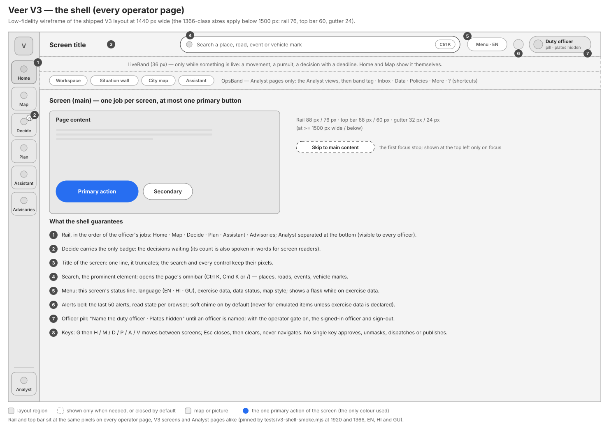

`src/lib/v3/shell/V3Shell.svelte` is the one frame on every operator page — the V3 screens and, since the Analyst
pages were moved under it, `/analyst`, `/ops`, `/gods-eye`, `/chat` and `/comms` too. It owns no data and imports no
store: pages talk to it through the same small contract the v2 shell used.

| Region | Size | What it holds |
|---|---|---|
| **AppRail** (`AppRail.svelte`) | 88 px wide at ≥ 1500 px, 76 px below | The mark, then Home · Map · Decide · Plan · Assistant · Advisories in the order of the officer's jobs, then **Analyst** at the bottom, separated. Icon and label, never icon-only. Decide carries the only badge — decisions waiting — orange, with its count also in words for screen readers. |
| **TopBar** (`TopBar.svelte`) | 68 px tall at ≥ 1500 px, 60 px below | Three columns: the screen title (one line, it truncates); the **search**, centred and the bar's one prominent element ("Search a place, road, event or vehicle mark", opening the page's omnibar); and a cluster of the menu, the alerts bell and the officer pill. The search and every control sit at the same pixels on every page. |
| **HeaderMenu** (`HeaderMenu.svelte`) | in the top bar | The secondary items in one compact control: this screen's status line, the language (EN · हिंदी · ગુજરાતી), the exercise-data statement, the data status of every feed and the map style. While the console runs on exercise data the closed trigger shows a flask. |
| **Alerts bell** (`AlertsButton.svelte`, `alerts.svelte.ts`) | in the top bar | The last 50 alerts with read state per browser, and a soft two-note chime (generated in the browser, no file, no network), on by default and mutable. Decisions already waiting at load never chime; one sync chimes once however many arrive; an emulated or test item chimes only while the console declares exercise data. |
| **Officer pill** | in the top bar | "Name the duty officer · Plates hidden" until an officer is named; its panel holds the duty-officer field and, with the operator gate on, the signed-in officer and sign-out. |
| **LiveBand** (`LiveBand.svelte`) | 36 px | The live-operations strip directly under the top bar, only while something is live (a movement, a pursuit, a decision with a deadline). Home and Map show live work themselves, so they carry no band. "Live operations are never hidden." |
| **OpsBand** (`OpsBand.svelte`) | Analyst pages only | The Analyst views (Workspace · Situation wall · City map · Assistant), the city band tag, Inbox, Data, Policies (what this console will never do), More, and `?` for the shortcuts sheet. |
| **Main** | the rest | The screen. A "Skip to main content" link is the first focus stop. |

The geometry is pinned by a test: `tests/v3-shell-smoke.mjs` checks that the rail items, the top bar, the search, the
menu, the bell and the officer pill sit at the same pixels on every page at 1920 and 1366 px, in English, Hindi and
Gujarati.

---

## 3. Navigation model

**Routes.**

| Group | Route | Screen | Theme |
|---|---|---|---|
| V3 | `/` (also `/home`) | Home | night |
| V3 | `/decide`, `/decide/<unit>` | Decide | night |
| V3 | `/map` | Map | night |
| V3 | `/plan` | Plan a movement | night |
| V3 | `/assistant` | Assistant | night |
| V3 | `/o/<urn>` | Object page (every record kind) | night |
| Analyst family | `/analyst`, `/ops`, `/gods-eye`, `/chat` | Workspace, Situation wall, City map, Assistant console | night |
| Operator | `/comms` | Advisories (rail item Advisories) | night |
| Public | `/citizen`, `/driver` | Citizen advisory, 108 driver | day |

The root is a reroute, not a moved file: `/` resolves to Home and `/analyst` to the workspace, so the workspace keeps
its test ids, its content-security policy and its gate. An old bookmark of the former root (`/#v=…`) is handed to
`/analyst#…`.

**Moving around.**

- The rail is the primary navigation; `G` then `H` / `M` / `D` / `P` / `A` / `V` goes to Home, Map, Decide, Plan,
  Assistant or Advisories.
- The search (`Ctrl K`, `⌘ K` or `/`) finds places, roads, events, reports and vehicle marks (masked unless an
  officer is named) and opens their object page.
- Every card, chip and map selection links to the record's object page (L2) or to its decision in Decide.
- **One home per decision kind.** Every decision is decided at `/decide/<unit>` (and in the Analyst inbox and the
  situation wall, which are unchanged). Home's cards, the map's selection card, an object page's call to action, the
  assistant's proposal cards and the alerts only *link* there.
- `Esc` closes, then clears; it never navigates.

---

## 4. Colour system

**Neutral grounds.** Since 2026-10-27 the grounds are neutral black, white and grey — no tinted surfaces — and the
primary action is white on the night theme and black on the day theme. Colour is used for meaning and for one accent
blue only. (The design phase and its prototype used navy grounds, a violet assistant colour and a brighter brand
blue `#4C8DFF`; the code changed all three. Follow the code.)

| Token | Night (operator pages) | Day (public pages) |
|---|---|---|
| `--v3-bg` (ground) | `#000000` | `#F6F6F6` |
| `--v3-s1` … `--v3-s4` (cards, raised, hover, pressed) | `#111111` · `#1A1A1A` · `#242424` · `#2E2E2E` | `#FFFFFF` · `#F3F3F3` · `#EEEEEE` · `#E2E2E2` |
| `--v3-line-1` … `-3` (hairlines) | white at 7 / 12 / 20 % | black at 8 / 14 / 24 % |
| `--v3-t1` · `--v3-t2` · `--v3-t3` (ink) | `#FFFFFF` · `#CBCBCB` · `#A6A6A6` | `#000000` · `#4B4B4B` · `#545454` |
| `--v3-primary-bg` / `-ink` (the one primary button) | `#FFFFFF` / `#000000` | `#000000` / `#FFFFFF` |
| `--v3-brand` (accent: links, focus, selection) | `#276EF1` (text `#7FA8F7`) | `#276EF1` (text `#1E54B7`) |

**Colour only for meaning.** The roles are frozen: each colour means one thing and nothing else.

| Role | Night fill / text | Day fill / text | Means — and only this |
|---|---|---|---|
| Decision orange (`--v3-decide`) | `#FF9F43` / `#FFBB7A` | `#E07A1F` / `#9C3F00` | A named person must decide: the Decide badge, a decision dot on a marker, a countdown, "Needs you" tags, the border of a decision card. |
| Alert red (`--v3-alert`) | `#FF5C61` / `#FF9A9D` | `#C62828` / `#B42020` | A stolen or watchlisted vehicle and its reads. |
| Clear green (`--v3-ok`) | `#3CCB7F` / `#7BE0A6` | `#1E9E5A` / `#17703F` | Approved, healthy, official-verified, the 108 green corridor. |
| AI blue (`--v3-ai`) | `#5B91F5` / `#8DB4F9` | `#276EF1` / `#1E54B7` | Written or proposed by the assistant — never a decision. (Violet in the design phase.) |
| Route teal (`--v3-route`) | `#2DD4BF` / `#7EEADB` | `#0F9F8E` / `#0A6B61` | A protected movement and its route; the travelled part at 38 % (`--v3-route-done`). |
| Dashed neutral (`--v3-dashed`) | grey at 55 %, dashed | dark grey at 55 %, dashed | Unverified or emulated. |

Further rules: the city band colours (green, amber, red, black) appear only in the band tag and the situation wall's
band chart; the decision orange never fills a large area or paints navigation; the public pages never use the alert
red or the decision orange, whose meanings belong to the operator console; illustrations and the brand mark never use
orange or red.

**The contrast rule.** Every text ink must reach at least **4.5:1 on every surface of its theme**, each role's text on
its own veil, and each filled button with its ink. `tests/v3-tokens.unit.mjs` proves it for the V3 tokens and
`tests/design-tokens.mjs` for the v2 tokens the Analyst pages use. Computed from the token values above with the WCAG
formula, the tightest pairs are night `--v3-t3` on `--v3-s4` (5.58:1) and day `--v3-ok-text` on `--v3-s4`
(4.73:1); the primary buttons are 21:1 and white on the brand fill 4.58:1. No hex colour is allowed in V3 code
outside the two token files (also tested).

---

## 5. Typography and spacing tokens

**Families.** Inter for Latin text (with tabular figures where numbers align), Noto Sans Devanagari and Noto Sans
Gujarati for Hindi and Gujarati, all self-hosted; JetBrains Mono only for identifiers (registration marks, camera ids,
coordinates).

**Type scale** (`--v3-text-*` / `--v3-lh-*`, size / line height in px):

| Style | ≥ 1500 px wide | below 1500 px | Use |
|---|---|---|---|
| Display | 40 / 48 | 32 / 40 | the featured decision, an object page's title |
| Title | 28 / 36 | 24 / 32 | screen titles inside content |
| Stat | 30 / 36 | 26 / 32 | the large counts of the city pulse |
| Heading | 20 / 28 | 20 / 28 | rail titles, card titles in Decide |
| Sub | 17 / 24 | 17 / 24 | panel titles |
| Body | 15 / 22 | 15 / 22 | everything else |
| Meta | 13 / 18 | 13 / 18 | captions, secondary lines |
| Micro | 12 / 16 | 12 / 16 | the kind line above a title — the smallest operator size |

Hindi and Gujarati take a taller line (1.7 on the shell) and no letter-spacing; components that set their own size
raise it for those scripts (for example the rail label). The operator type floor is 12 px; the public pages' floors
are larger (posture sentence ≥ 22 px, chips ≥ 16 px).

**Shape, size and motion.**

| Token | Value |
|---|---|
| Radii `--v3-radius-s / m / l / xl` | 8 / 12 / 16 / 22 px |
| Controls `--v3-ctl / -lg / -xl` | 36 / 44 / 56 px (the "Review now" button is 56 px tall) |
| Rail `--v3-rail` | 88 px (76 px below 1500 px) |
| Top bar `--v3-top` | 68 px (60 px below 1500 px) |
| Gutter `--v3-gut` | 32 px (24 px below 1500 px) |
| Elevation `--v3-elev-1 / -2` | two soft shadows (lighter in the day theme) |
| Motion `--v3-dur-1 / 2 / 3` | 120 ms state changes · 200 ms sheets and cards · 320 ms a decided card's collapse |
| Easing `--v3-ease` | `cubic-bezier(0.2, 0.8, 0.2, 1)` |

---

## 6. Imagery system

Every V3 surface leads with a picture as well as a map, drawn through three components in `src/lib/v3/media/`
(`Cover`, `VehicleShot`, `AgencyMark`).

| Imagery | Where it lives | What it is | Rules |
|---|---|---|---|
| **Vehicle shots** | `static/artwork/vehicles/` (14 files) | Studio art of ten vehicle classes (car, SUV, two-wheeler, auto-rickshaw, bus, truck, tempo, ambulance, patrol, fire tender) and the four convoy compositions (Z+, Z, Y, X) | Used wherever a vehicle is the subject, in place of any picture of the real vehicle. |
| **Key art** | `static/artwork/events/` (19 files) | 16:9 art for every corridor and reported-event kind | Crowds only as distant masses; no faces. |
| **Scenes** | `static/artwork/scenes/` (5 files) | Time-of-day riverfront scenes (dawn, day, dusk, night) and an all-clear scene | Behind the city pulse and the empty states. |
| **Reference photos** | `static/photos/` (21 photographs, two sizes) | Wikimedia Commons photographs of Ahmedabad's places, each under its own licence (`static/photos/NOTICE.md`) | Drawn **only** through `Cover`, which always captions them **"Reference photo · not live"** with the credit. Photos with a legible plate, a face or a rider as the subject were left out. |
| **Agency and data-source marks** | `static/logos/` | The marks of the agencies and data sources Veer works with, resized only, on a light or dark plate | One ownership line (Veer is not affiliated with or endorsed by them) in the header menu, Home and the public footers. |
| **Illustrations and brand** | `static/illustrations/`, `static/brand/` | Original glyph-style illustrations (empty states, onboarding) and the Veer mark | Flat, labelled, no people, never orange or red. |

The artwork is written by a deterministic generator; `tests/v3-media.unit.mjs` pins it byte for byte, checks that
every kind and class has its picture, that each SVG is labelled and holds no embedded image, no text, no script and
no external reference, the budgets (≤ 40 KB a file, ≤ 900 KB in all), and every photo's author, licence and credit.

**How cards use it.** Decision cards keep the map of the place and inset the vehicle shot; operation, report and
planned cards lead with key art or a place photo, with the map inset.

**Map thumbnails.** `MapThumb.svelte` draws raster tiles on a canvas with an SVG overlay — **no 3D viewer per card**.
Two styles follow one remembered preference: a night-graded OpenStreetMap map, and natural-colour satellite imagery
when the deck holds the imagery key. A quota guard keeps thumbnails from exhausting the imagery allowance: at most 6
tiles per card, 4 requests in flight, one shared 192-tile cache, 800 requests per browser-tab session, and the first
401 / 403 / 429 stands satellite down silently (thumbnails fall back to the night tiles). On satellite imagery,
route casings become near-opaque scrims and labels get a dark halo so they keep their contrast.

The design phase specified "the real map at the place, or an original illustration — never a photo". The imagery
work of 2026-10-27 added reference photographs, under the strict label and credit above, and kept the rest of that
rule: nothing that looks like a camera frame or a sensor feed, no faces, no stock photography.

---

## 7. The map

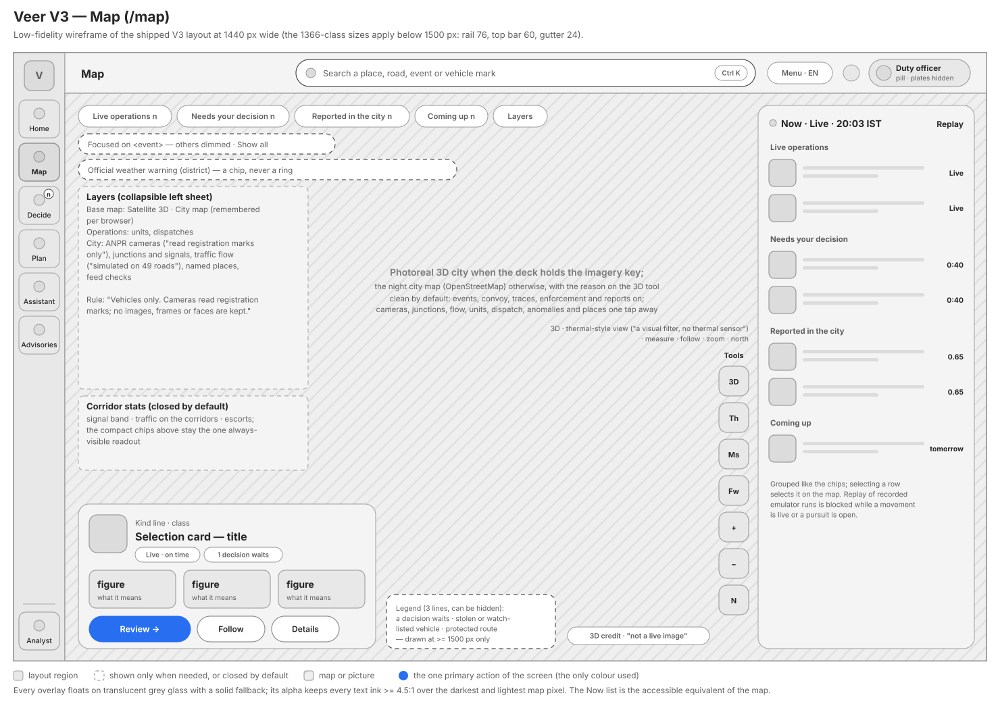

`/map` mounts the same city canvas as the Analyst city map, with the V3 chrome around it.

- **Defaults.** It opens on the natural-colour **photoreal 3D city** when the deck holds the imagery key, labelled
  *"Photoreal 3D city from Google, via Cesium ion · not a live image"*; otherwise on the night city map from
  OpenStreetMap, with the reason shown on the 3D tool. The base-map choice is remembered per browser. The night map
  shows at once while the 3D tiles load, so the screen is never blank. Clean by default: events, convoy, traces,
  enforcement and reported events on; cameras, junctions and signals, flow, units, dispatches, anomalies and named
  places one tap away.
- **Summary chips** across the top: Live operations · Needs your decision · Reported in the city · Coming up, and
  Layers. They are the one always-visible readout.
- **Layers sheet** on the left, collapsible: base map (Satellite 3D · City map), Operations (units, dispatches) and
  City (ANPR cameras — "read registration marks only", junctions and signals, traffic flow — "simulated on 49
  roads", named places, feed checks), with the rule "Vehicles only. Cameras read registration marks; no images,
  frames or faces are kept."
- **Corridor stats** in their own panel, closed by default.
- **Now panel** on the right (380 px, 320 px below 1500 px): the same objects as the map, grouped like the chips,
  with live countdowns and Replay for recorded emulator runs (blocked while a movement is live or a pursuit is open).
  It is the map's accessible equivalent.
- **Selection card** for anything picked: at most two tags and three figures, one verb (Review, which links to the
  decision's home in Decide), Follow and Details — never an approve button.
- **Focus mode**: selecting an event frames it and dims the rest; "Show all" returns.
- **Tools**: 3D, the thermal-style view (labelled "a visual filter, no thermal sensor"), measure, follow, zoom and
  north.
- **Legend**: three lines — a decision waits · stolen or watchlisted vehicle · protected route — that can be hidden;
  drawn at ≥ 1500 px.
- **Official weather warnings** appear as a chip, never as a ring on the map.
- **Glass panels.** Every overlay floats on translucent grey glass (`rgba(24, 24, 24, 0.9)` with a blur where the
  browser supports it) and falls back to the same grey, opaque, where it does not. The alpha was chosen so every
  text ink keeps ≥ 4.5:1 over the darkest and the lightest pixel a map can put under it (`tests/v3-map.unit.mjs`).
- If map tiles stop loading, the roads are still drawn from Veer's own network and the map says so.

---

## 8. Decide — the one-card anatomy

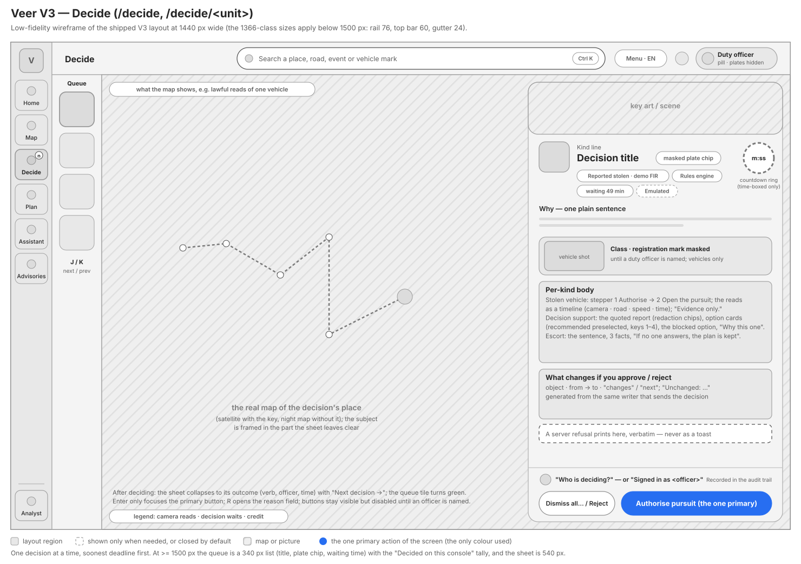

One decision at a time, soonest deadline first. Three zones: the **queue** (340 px with titles at ≥ 1500 px; art
only, 92 px, below), the **real map of the decision's place** (the subject framed in the part the sheet leaves
clear), and **one decision sheet** (540 px; 470 px below 1500 px) floating over the map.

Every kind of decision — stolen-vehicle sighting, e-challan recommendation, escort proposal, 108 corridor request,
decision-support response, pursuit opening — uses the same anatomy (`DecisionSheet.svelte`):

1. **Header** — the kind's picture and art, the kind line, the title (its plate in a masked chip), at most four
   tags, and a **countdown ring** for a time-boxed proposal.
2. **Why** — one plain sentence.
3. **The body for its kind** — a stolen vehicle shows its vehicle shot ("Car · registration mark masked … Vehicles
   only: cameras read plates, never people"), a two-step stepper (1 Authorise → 2 Open the pursuit), the reads as a
   timeline and *"Evidence only. No fine is ever issued for a stolen vehicle. One approval opens one pursuit."*; a
   decision-support response shows the quoted report with its redactions, the courses of action as option cards
   (the recommended one preselected), the blocked stronger option with "Request a unit", and "Why this one"; an
   escort proposal shows the sentence, three facts and *"If no one answers in time, the current plan is kept and
   nothing is applied."* An e-challan on a reported-stolen vehicle offers Reject only: "Its owner is the theft victim,
   so this e-challan can only be rejected."
4. **What changes if you approve / reject / defer / authorise** — generated from the same writer that sends the
   decision, with "Unchanged: …".
5. **Who is deciding?** — until an officer is named, the buttons stay visible but disabled, with the reason; then
   "Signed in as <officer> · Recorded in the audit trail". The helper text is exact: *"Naming yourself shows full
   registration marks on this console and records your name with the decision. Attribution, not sign-in."*
6. **The buttons** — secondary verbs (Reject, Defer, Dismiss all…) and **one primary**, whose label follows the
   choice ("Authorise pursuit", "Approve the hold", "Approve standard response").

After a decision the sheet collapses to its outcome (verb, officer, time), the queue tile turns green and
**Next decision** moves on. A server refusal is printed inside the card, verbatim — never as a toast. A side tally
shows what was decided on this console (approved, rejected or dismissed, deferred, expired with the plan kept). There
is no confirmation dialog on a time-boxed proposal: the countdown is the constraint. Keys: `J` / `K` next and
previous, `1`–`4` choose an option, `Enter` only focuses the primary button, `R` opens the reason field; no single key
decides, and a double click sends one request.

---

## 9. The other screens

### Home

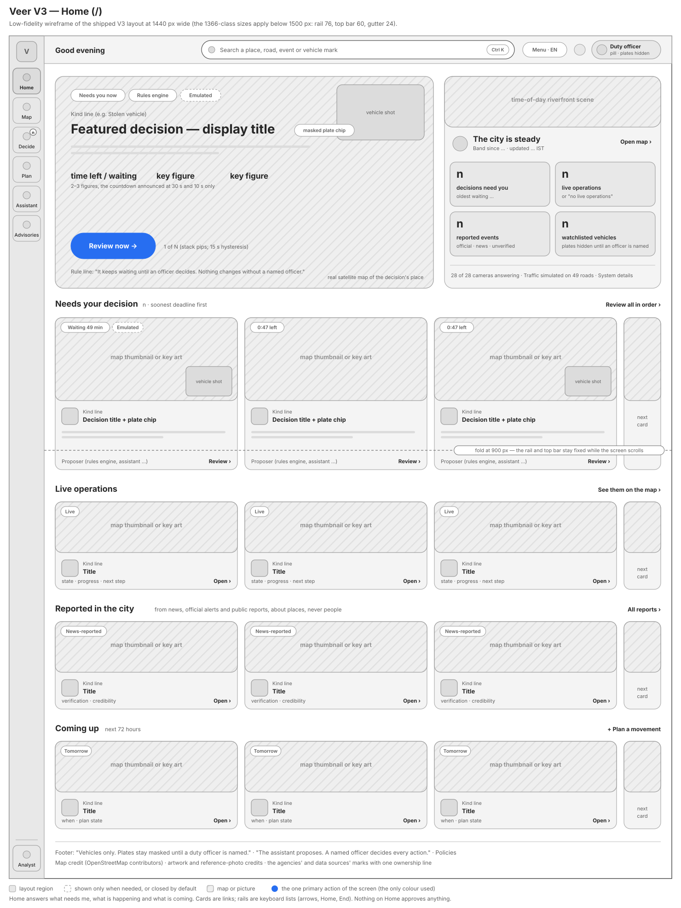

Home answers three questions — what needs me, what is happening, what is coming. The **featured decision** is the
waiting decision with the soonest deadline (kept until another is at least 15 s sooner, so it does not flicker), over
the real map of its place, with tags, a one-line reason, two or three figures, one large **Review now** and the rule
underneath ("It keeps waiting until an officer decides. Nothing changes without a named officer."). The **city
pulse** puts a time-of-day scene over one sentence for the city band ("The city is steady", "Traffic is building",
"The city is under strain", "Roads are at a standstill"), four large counts and a systems line ("28 of 28 cameras
answering · Traffic simulated on 49 roads"). Below: four rails of cards — **Needs your decision**, **Live
operations**, **Reported in the city** ("from news, official alerts and public reports, about places, never people")
and **Coming up** (next 72 hours) — and a footer with the rules in words, Policies and the credits.

### Plan a movement

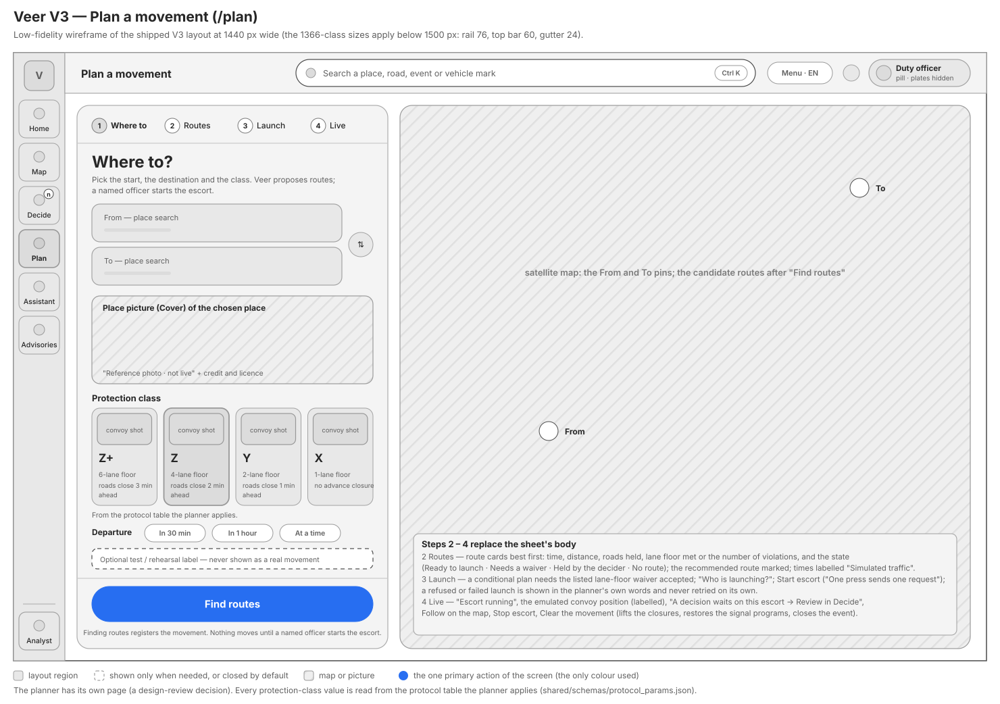

A four-step sheet beside a satellite map: **Where to → Routes → Launch → Live**. The protection classes are four
cards (Z+, Z, Y, X) whose lane floors and closure leads are read from the protocol table the planner applies. "Find
routes" registers the movement — "Nothing moves until a named officer starts the escort." A conditional plan needs
the listed lane-floor waiver accepted; a refused or failed launch is shown in the planner's own words and never
retried on its own.

### Object page

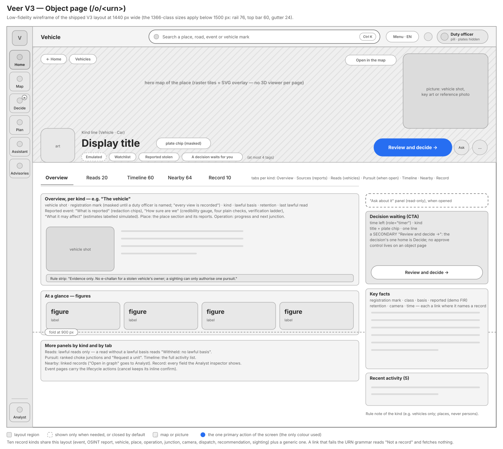

Every record has a page: a hero map of the place (a raster tile, not a 3D viewer), a picture, the title bar (art,
kind line, display title, at most four tags, one primary action, "Ask about it", More), tabs by kind (Overview,
Sources, Reads, Pursuit, Timeline, Nearby, Record) and a side column with the waiting decision's call to action
(a secondary button — the decision's home is Decide), key facts and recent activity. A reported event shows "How sure
are we": a credibility gauge, four plain checks and a verification ladder (Unverified → News-reported → Official),
with the reminder that credibility measures how far the sources agree, not whether the report is true. A vehicle page
lists only lawful reads; a read without a lawful basis reads "Withheld: no lawful basis".

### Public pages: Citizen and 108 driver

| Citizen advisory | 108 driver |
|---|---|
| 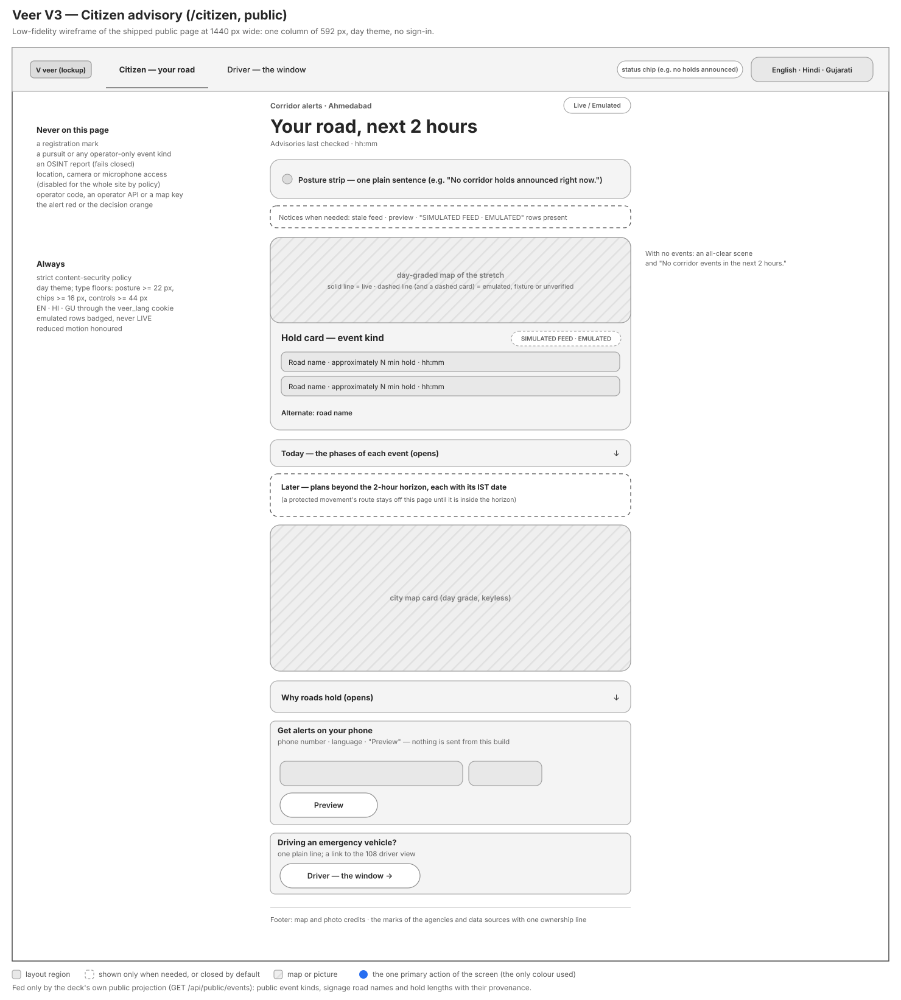 | 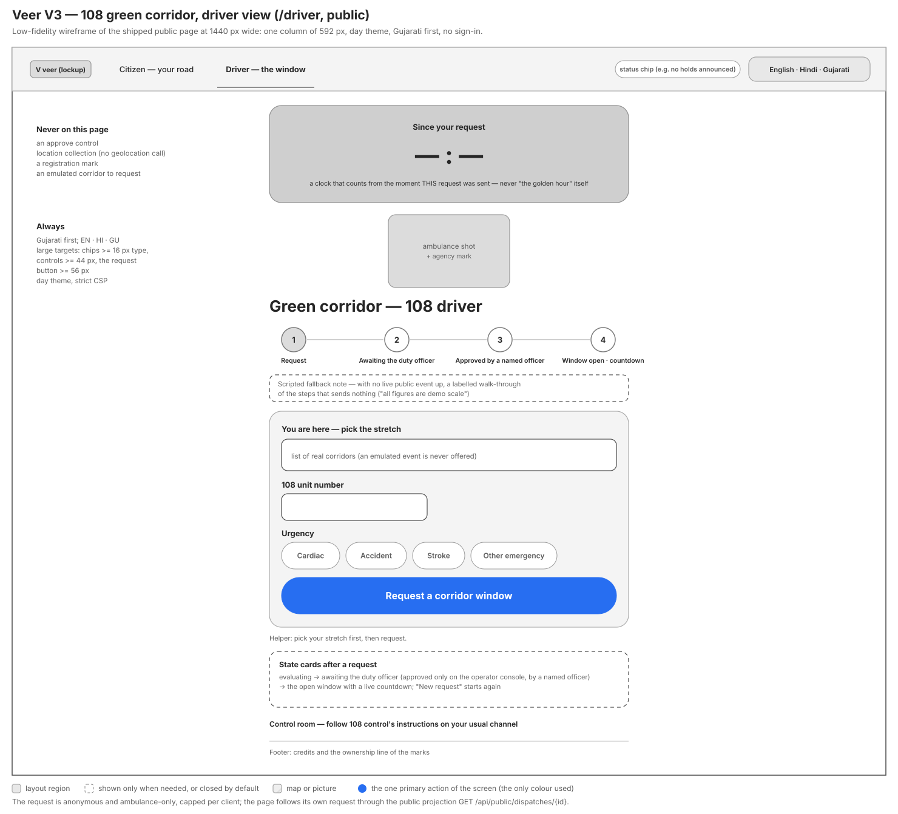 |

Both public pages use the day theme, one column of 592 px and large type, load no operator code, run under a strict
content-security policy, receive no map key and read only the deck's own public projection. The citizen page leads
with one plain posture sentence and hold cards topped by a map of the stretch — a **solid** line is live, a
**dashed** line and a dashed card are emulated, fixture or unverified, badged SIMULATED FEED · EMULATED, never LIVE.
The driver page is Gujarati first: a clock that counts from the moment *this* request was sent (it never claims to
be the golden hour itself), four large steps, three inputs (the stretch, the 108 unit number, the urgency) and one
large **Request a corridor window**. Neither page has an approve control, a registration mark or a location request.

---

## 10. Trilingual copy rules

- Every user-visible string of the operator screens ships in **English, Hindi and Gujarati**, in per-screen packs
  loaded on the route that needs them; the language follows one cookie (`veer_lang`) shared by every page. The tests
  check that the three packs carry the same keys and that Hindi and Gujarati are really translated (no English string
  left in place; for the imagery pack, also no Gujarati in Hindi and no Devanagari in Gujarati).
- Operational numbers and times stay in Latin digits on operator pages; the public pages follow the language.
- No text inside images (the artwork test refuses any `<text>` element). Layout boxes are sized for the longest
  language: the shell smoke measures the rail and the top bar in Hindi and Gujarati at 1366 px.
- English copy rules, enforced by `tests/copy-lint.mjs` and `tests/v3-tokens.unit.mjs`: a section title is at most
  32 characters; a chrome string has at most one " · "; no ALL-CAPS word outside the acronym list.
- **Say what happens, what does not, and how sure**: "Approve the hold"; "If no one answers, the current plan is
  kept"; "Credibility says how far the sources agree. It does not say the report is true."
- **Model diagnostics become one human sentence** on officer screens: "Two of my models disagreed on the next step;
  I used the cautious one. Check before acting." · "I'm not confident here; treat this as a starting point." ·
  "Answered by the backup model." No model id, tool name or alert code reaches the V3 assistant's page; the raw codes
  stay in Analyst.
- Decision support shows one figure per option (time to scene, or "no units"); vehicle-hours, closeness, rank and the
  method names stay in Analyst.
- Redactions render as chips: `age withheld`, `name withheld`.

---

## 11. Accessibility

- **Contrast.** Every text ink ≥ 4.5:1 on every surface of its theme (tested, §4). The focus ring is 2 px of the
  accent blue with a 2 px offset. Colour is never the only signal: an orange dot comes with "needs you", a red ring
  with a "stolen" tag, teal with "Live".
- **Keyboard.** Every card is a link or a button; rails are keyboard lists (arrows, `Home`, `End`). No single key
  approves, unmasks, dispatches or publishes.

  | Keys | Where | Action |
  |---|---|---|
  | `Ctrl K`, `⌘ K` or `/` | everywhere | Open search |
  | `G` then `H` / `M` / `D` / `P` / `A` / `V` | everywhere | Home / Map / Decide / Plan / Assistant / Advisories |
  | `Esc` | everywhere | Close, then clear; never navigates |
  | `?` | Analyst pages | Shortcuts sheet |
  | `J` / `K` | Decide | Next / previous waiting decision |
  | `1`–`4` | Decide | Choose a response option |
  | `Enter` | Decide | Focus the primary button (it never presses it) |
  | `R` | Decide | Open the reason field (a reject still needs a click) |
  | `L` / `F` / `3` | Map | Layers / Follow / 3D city |

- **Screen readers.** A "Skip to main content" link is the first stop. Rails are labelled sections. The Decide badge
  says its count in words ("2 decisions waiting"). Countdowns use `role="timer"` and announce politely at 30 s and
  10 s only. A masked plate reads "registration mark masked". The map's Now list is its text equivalent.
- **Reduced motion.** Under `prefers-reduced-motion` the live dots and the map's pulsing rings hold still, cards do
  not lift and transitions are instant.
- **Targets.** At least 36 px on the operator desktop; on the public pages controls are at least 44 px and the
  driver's request button at least 56 px.

---

## 12. Honest-label rules

No surface may present simulated data as field data, or a visual effect as a sensor or a photograph.

| Rule | How it shows |
|---|---|
| Every source says what it is | Tags **EMULATED**, **SIMULATED**, **UNVERIFIED-OSINT**, **NEWS-REPORTED**, **OFFICIAL-VERIFIED**; "Traffic simulated on 49 roads"; route times labelled "Simulated traffic"; wargame estimates labelled simulated. |
| Emulated or unverified is drawn dashed | Dashed lines, dashed cards and the dashed neutral role; on the public page an emulated hold is badged SIMULATED FEED · EMULATED, never LIVE. |
| Exercise data is declared | The flask on the header menu while the console runs on exercise data; the emulated stolen vehicle's FIR reads "demo FIR …". |
| A picture says what it is | "Reference photo · not live" and the credit on every photograph; "Photoreal 3D city from Google, via Cesium ion · not a live image"; "Thermal-style view (a visual filter, no thermal sensor)". |
| Who proposed it | "Proposed by the convoy assistant" in the AI colour; a proposal raised by the fixed rule because no model answered says the rule proposed it, never AI. |
| What did and did not happen | "Drafted — not delivered" on every advisory; "If no one answers, the current plan is kept"; "Evidence only" on every stolen-vehicle card; a refusal printed verbatim. |
| OSINT is about places | "about places, never people"; redaction chips; "Link not kept: it may name a person". |
| No false alarm from rehearsal | The chime never sounds for an emulated decision unless exercise data is declared. |

---

## 13. Design decisions and the review feedback that shaped them

### Decisions

| Decision | Why | Where it shows |
|---|---|---|
| Keep the v2 machine; add a simpler surface on top | Officers need "what do I do now?"; analysts must lose nothing | Home, Decide, Map; the Analyst family under one rail item |
| **Analyst is visible to every officer** (one rail item), not only to supervisors | Power tools stay one click away for anyone who needs them | The rail's bottom item |
| **The alert chime is on by default** for each new waiting decision — soft, mutable — with the exercise rule | A decision must not wait unnoticed; rehearsal traffic must not train officers to react | `alerts.svelte.ts`, `chimeAllowed` |
| **One home per decision kind** | Several places to decide had been confusing; every other surface links there | `/decide/<unit>`; cards, chips and proposal cards only link |
| **No 3D viewer per card** | A page of cards must stay light; thumbnails are raster tiles with an overlay | `MapThumb.svelte` and its quota guard |
| **The thermal-style view stays on the main map toolbar**, with its honest label | It is used in operations; the label keeps it honest | Map tools |
| **A content-security policy per document**: the operator groups get the policy the 3D city needs, the public pages a strict one | A client-side navigation keeps its document, so the policy follows the resolved route, not the URL | `hooks.server.ts` |
| **Neutral palette** (2026-10-27): black, white and grey grounds, white or black primary buttons, one accent blue `#276EF1` (the assistant moved from violet to blue) | Colour keeps its meaning only where it means something; the screens read calmer | `tokens.css` |
| **Pictures, not only maps** (2026-10-27): vehicle shots, key art, scenes, credited reference photos, agency marks | Faster recognition at a glance, without ever passing a picture off as live | `src/lib/v3/media/`, `static/artwork`, `static/photos`, `static/logos` |

### Design review feedback

A design review of the V3 direction, held on 2026-10-26 before the last phases were built, produced nine binding
inputs. Each was implemented:

| Review feedback | What was built |
|---|---|
| Uniform navigation: the same rail and top bar, in the same place, on every page — including Analyst and the situation wall | The Analyst pages and `/comms` moved under `V3Shell`; the shell smoke proves identical pixels on every page |
| The convoy and corridor planner on its own page, as a "Where to?" flow, not on the map or workspace | `/plan` and the Plan rail item |
| Focus on a specific event: framed and highlighted, the others dimmed, with "Show all" | The map's focus mode |
| Corridor statistics in a separate collapsible panel, closed by default; the compact summary at the top of the map stays the one always-visible readout | The corridor stats panel and the summary chips |
| No threat-posture block; a terse legend that can be shown or hidden | The three-line legend |
| Layer and option selection in a collapsible panel on the left of the map | The Layers sheet |
| Decision audit and analysis on a separate page, not on operational pages | The Analyst views and the object page's Timeline and Record tabs; Decide links "Full record in Analyst" |
| A header without extra information and with a prominent search; secondary items in a compact menu | The slim top bar with the centred search and the header menu (language, exercise data, data status, map style) |
| Collapsible overlays as translucent grey glass with a solid fallback, keeping contrast ≥ 4.5:1 over the map | The map's glass surface (`map/glass.ts`) |

---

## 14. The design-phase prototype

The V3 design phase produced a clickable static HTML prototype (2026-10-26). The images below are that prototype
rendered at 1440 × 900. **They are design prototypes, not the shipped product.** Their state (the live movement, the
escort proposal, the 108 request, the officer "R. Mehta") was composed for the design; each page carries a small
"Prototype · composed design state" note. The maps are graded captures of a sandbox deck's own map.

The prototype **predates the neutral palette and the review feedback**: it uses navy grounds, a violet assistant
colour and the brand blue `#4C8DFF`; its rail has no Plan item; the language switch and the exercise tag sit in the
top bar (they moved into the header menu); and it carries no vehicle shots, key art or photographs. Compare the
wireframes above and the screenshots in `VVIP/docs/screenshots/`.

| Home | Decide (escort proposal) |
|---|---|
| 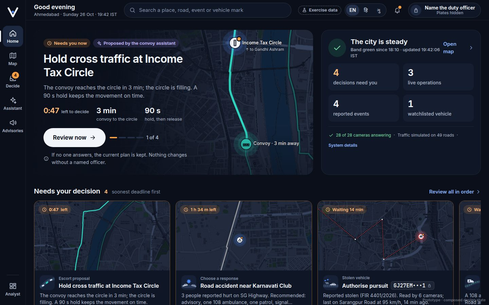 | 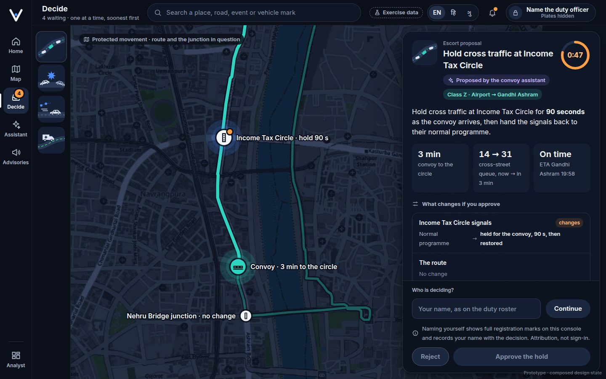 |

| Map | Reported event (object page) |
|---|---|
| 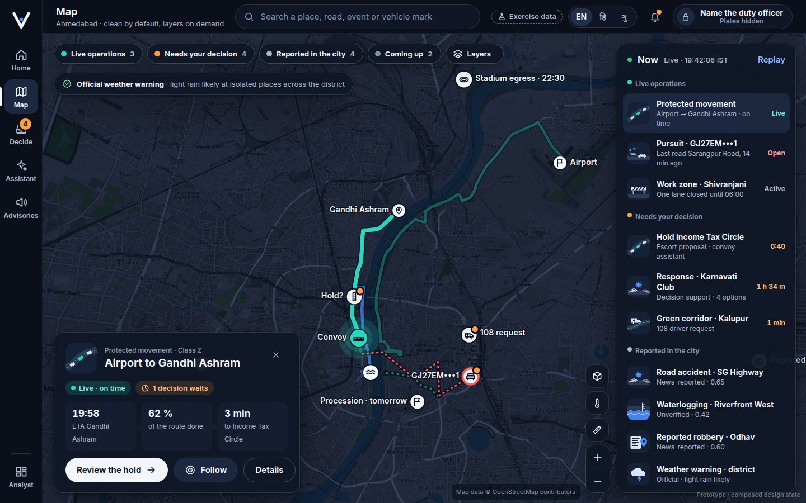 | 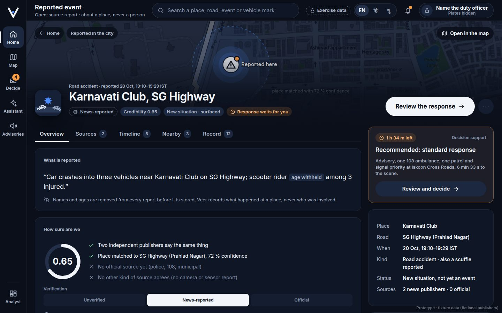 |

| Assistant |
|---|
| 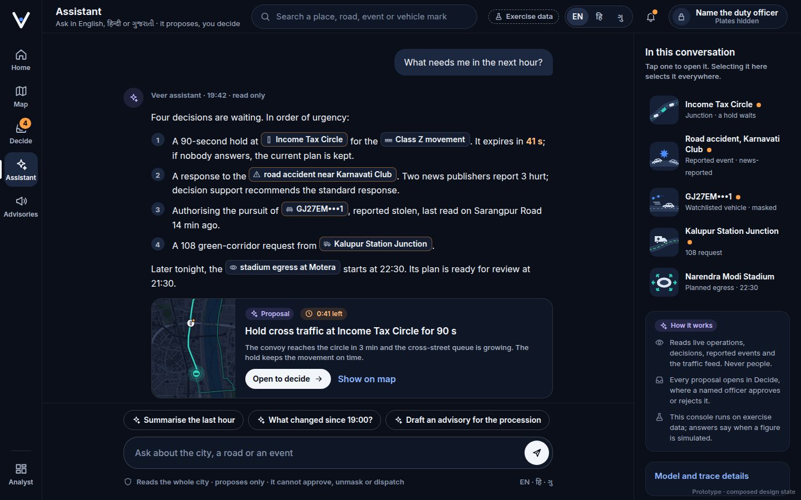 |

---

## 15. Known gaps

Recorded in `VVIP/TECHNICAL_DOCS.md` §18.7 and `PRODUCT.md` §6.3, and not hidden here:

- The tablet layout is not built: the rail stays on the left at every width, and the tablet bottom-sheet "Now" list
  does not exist.
- The alerts bell is not fed on the Analyst pages (waiting decisions still show on the Decide badge, the Inbox chip
  and the live strip).
- The `#evt=`, `#rec=` and `#dsp=` deep-link hand-overs from `/` are not done (they still work on `/ops`).
- The Analyst assistant console (`/chat`) still shows the brain's raw alert codes; the V3 Assistant turns them into
  one plain caution.
- Route JavaScript is held under ceilings that stop regressions, but the redesign's original first-load budget is
  not met.
- No usability testing with working control-room operators yet; the design rests on expert review.
