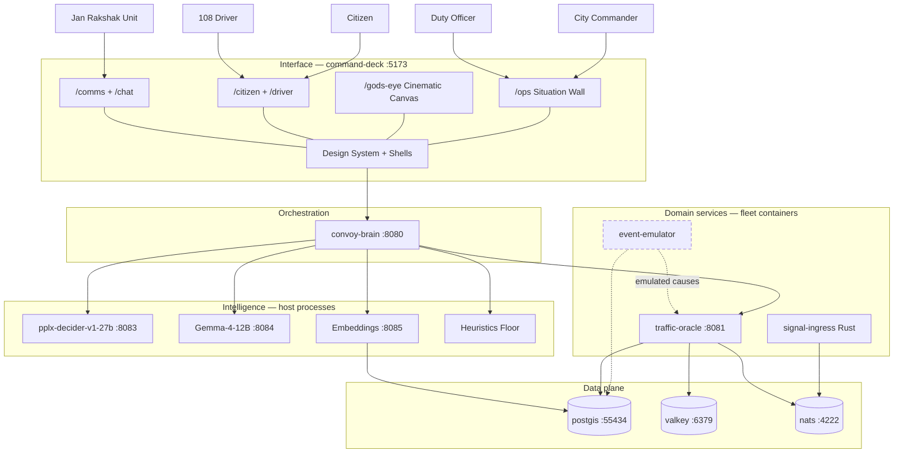
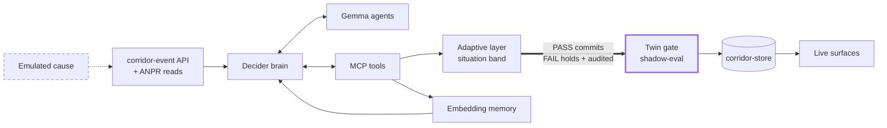
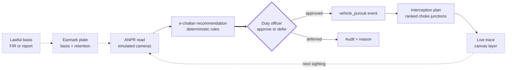
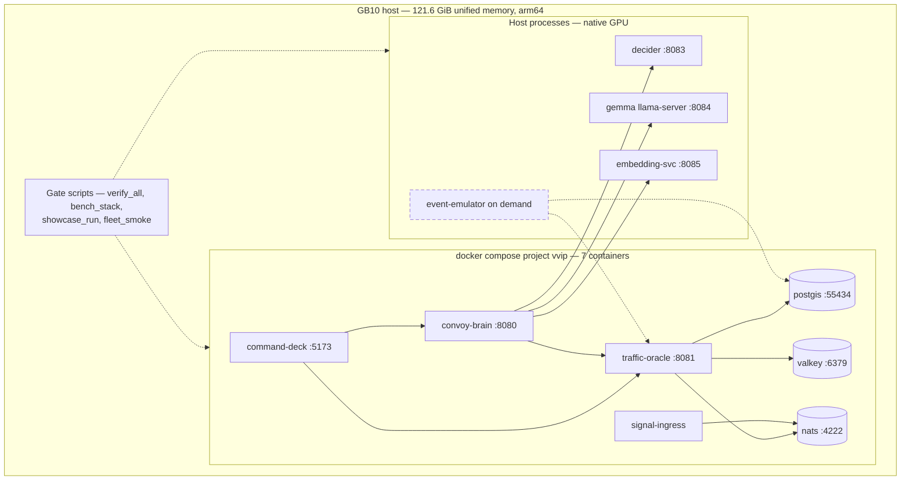

# Veer — System Architecture

> Authoritative architecture schematic of the Veer city-scale multi-agency
> corridor-operations platform as built and gated on the GB10 host (October
> 2026). Companion interactive view: rendered beside this file in the session
> interface. All ports are live-verified; all gates green at last run.
>
> **Diagram notation (theme-neutral, works in light and dark viewers):**
> dashed border = *emulated-causes plane* · thick border = *human decision or
> safety gate* · plain nodes = the real-tackling plane. No fill colors are
> used anywhere, so every node inherits your viewer's theme.

---

## 1. System context — the layered view

Veer is a two-plane system: an **emulated-causes plane** (event injection that
stands in for the real world) and a **real-tackling plane** (the actual
intelligence stack that responds). Five layers carry it. The interface layer
is command-deck `:5173` — the canonical surface for every audience (city
commander, duty officer, citizen, driver) — built on a shared design system
(design tokens + 16 primitive components, dark operator shell and light
citizen shell).

**What each interface surface carries:** the Situation Wall (`/ops`) hosts the
live event board, the pursuit/watchlist console, the e-challan recommendation
queue with real approve/defer actions, Jan Rakshak dispatch tiles, signal
plans showing proposed-vs-held states with reasons, the Active Movement
Adaptation module card, the decision audit stream and twin shadow-eval
compare. The Cinematic Canvas (`/gods-eye`) is CesiumJS keyless 3D with a
layer registry — corridor events, vehicle traces, signal network, agency
units, cameras — plus a FLIR sensor shader and shareable camera URLs. The
public surfaces (`/citizen`, `/driver`) are trilingual EN·हिंदी/ગુજરાતી, with
freeze windows, alternates, alert subscription, and the green-corridor
request flow.

**What each intelligence tier owns:** the decider is the strategic brain —
typed tool selection, confidence gating, p95-based degradation. Gemma-4-12B
(the on-host aditi-ps18-v7h fine-tune) runs the tactical agents under
GBNF-grammar-constrained tool arguments. The heuristics floor is the
deterministic third tier so the system degrades but never goes silent.
traffic-oracle carries DSTGAT forecasting, OR-Tools routing, RL signal
control, the simulation twin, the adaptive layer, city signal plans, the
vehicle watchlist and enforcement rules.

---

## 2. The intelligence chain — how one event is actually handled

The emulated/real split in one picture: the cause enters on the left (dashed
= emulated only); every hop after it is real, and every decision is audited.
The twin gate is the safety hinge — a non-baseline adaptation commits only if
the simulation twin vouches for it; when the twin is uncalibrated the writer
refuses, and that refusal is itself audited and surfaced.

A representative turn: procession + monsoon injected → decider selects tools
and scores confidence → Gemma agents draft analyses and tool arguments →
adaptive layer classifies the situation (GREEN/AMBER/RED/BLACK with
hysteresis and protocol floors) → the twin shadow-evaluates the proposed
adaptation → commit (or an audited hold) → the situation wall, 3D canvas,
citizen advisory and driver windows all read the same committed state.

---

## 3. The enforcement & pursuit chain (vehicles-only, human-in-the-loop)

Everything begins from a lawful basis and pauses at a human. The thick-bordered
node is the point where the system hands judgment to a duty officer — the
ethics rail in action. Vehicles only, never faces or persons; penalties are
recommendations; sightings carry lawful-basis flags and retention limits;
nothing anti-government — the system strengthens government capability.

Flagship proof (the "God's Eye Morning" showcase, all real API calls): plate
GJ27EM9001 earmarked under FIR 4401/2026 → four emulated camera reads at
93/101/96/113 km/h → rule R_SPD_SEGMENT recommends ("113 in a 40 zone") →
approved by the duty officer on the append-only audit tail → pursuit event →
nine choke junctions ranked via pgRouting off the latest sighting → 28 timed
trace positions feeding the canvas, looping into the next read.

---

## 4. Deployment view — one GB10, one fleet

The entire platform — 27B brain, 12B tactical model, embeddings, twin,
fleet, UI — runs on one machine with no cloud dependency anywhere in the
loop. Measured residency: ~62.7 GiB of the 121.6 GiB unified pool.

---

## 5. Data architecture — corridor-store in one map

| Schema | Key tables | Purpose |
|---|---|---|
| `corridor` | road_segments, junctions, segment_adjacency, road_graph (view), signal_programs, **corridor_events, event_profiles** (007–008), **vehicles, vehicle_earmarks, sightings, e_challan_recommendations** (010), **city_coordination** (011) | The city graph + the event-agnostic domain model + the vehicle backbone |
| `traffic` | observations (partitioned), hourly_aggregates, anomaly_log, **memory_docs** (bge-m3 `vector(1024)` + pplx-late `vector(128)[]`), incidents, memory_segment_embeddings | Live/historic traffic + the embedding memory spine |
| `convoy` | movements, planned_routes, diversions | The VVIP base case (kept first-class) |
| `simulation` | runs, calibrations | Twin runs + the calibration ledger (n≥30, MAE≤5 km/h) |

Migrations 001–011, applied by the idempotent ledgered runner
(`scripts/migrate.py` — psql `--single-transaction` per file, sha256 ledger).

---

## 6. Interface architecture — one canonical product

- **Canonical surface:** command-deck `:5173` for *every* audience
  (operator / citizen / driver). The legacy React `frontend/` is the offline
  citizen fallback, documented as such.
- **Design system:** `lib/design/tokens.*` + 16 primitives (Panel, Badge,
  BandChip, DataTile, FeedItem, AuditRow, MapLegend, LayerRail, Modal,
  Toast, EmptyState, BandMasthead, DecisionCard, EventDossier…), dark
  operator shell / light citizen shell, global motion with reduced-motion.
- **God's-eye canvas:** CesiumJS keyless (OSM raster + entities, zero ion
  calls) with a borrowed-and-attributed layer registry
  (`lib/gods-eye/layers/`: corridor-events, vehicle-traces, signal-network,
  agency-units, cameras), FLIR sensor shader, shareable camera URL.
- **Live-data rule:** every screen wires to live endpoints with a
  clearly-labelled offline fallback; trilingual EN/हिंदी/ગુજરાતી on public
  surfaces.

---

## 7. Port map & verification gates (quick reference)

| Port | Service |
|---|---|
| :5173 | command-deck (canonical UI) |
| :8080 | convoy-brain (two-tier orchestrator) |
| :8081 | traffic-oracle (domain + ML + adaptive) |
| :8083 | pplx-decider-v1-27b (brain) |
| :8084 | Gemma-4-12B llama-server (tactical) |
| :8085 | embedding service (pplx-late + bge-m3) |
| :55434 | PostGIS (migrated 001–011) |
| :6379 / :4222 | valkey / NATS |

| Gate | What it proves |
|---|---|
| `verify_all.sh` | frontend bundle + headless e2e + canvas checks + 6 pytest suites + live model smoke |
| `bench_stack.sh` | throughput/quality (19/19 scenarios score 100; decider ~548 tok/s p99 ~861 ms; 62.7 GiB) |
| `showcase_run.sh` | the flagship "God's Eye Morning" end-to-end incl. the pursuit chain |
| `fleet_smoke.sh` | 7-container fleet as one system |

---

## 8. Design principles the architecture encodes

1. **Emulated causes, real tackling** — the simulator stands in for the
   world; the intelligence stack is never simulated.
2. **Event-agnostic core** — VVIP convoys are one event family among
   processions, monsoons, pursuits, stadium egress; one engine handles all.
3. **Fail-closed adaptation** — non-baseline changes require twin
   shadow-eval PASS; refusal is audited and surfaced, never silent.
4. **Human-in-the-loop enforcement** — recommendations, approvals, audits;
   vehicles only, never persons.
5. **Auditable intelligence** — every tier transition lands in
   `decisions_log`; the UI streams the reasoning.
6. **Edge-sovereign** — the whole platform runs on one machine; no cloud
   dependency anywhere in the loop.
